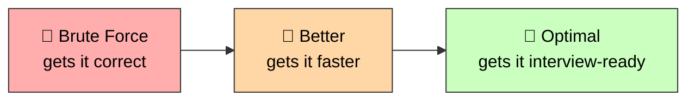

# 🚀 DSA Placement Prep — Noob to Advanced

### *Your roadmap from zero to 35–50 LPA FAANG+ offers*

A structured, pattern-based DSA repo for cracking **35–50 LPA product-based / FAANG+ interviews**. 150 hand-picked LeetCode problems across 20 core patterns, each with three Python solutions (Brute Force → Better → Optimal) and a plain-language README with a **visual, diagrammed walkthrough** explaining *why* each approach works.

## 📖 How to use this repo

1. Open the linked LeetCode problem and **actually solve it on the platform first** (don't peek at the solution).
2. Compare your solution against `brute_force.py` / `better.py` / `optimal.py` in that problem's folder, and read its `README.md` for the intuition and complexity breakdown.
3. Tick a box below every time you solve it. **Each problem has 3 checkboxes on purpose** — do it 3 times (spaced a few days apart) until the optimal approach comes to you without hesitation:
   - **Attempt 1** — first solve, even if slow/looking things up.
   - **Attempt 2** — a few days later, from scratch, no notes.
   - **Attempt 3** — a couple of weeks later, from scratch, timed (~25–35 min for Medium, ~15 min for Easy).
4. 🔥 marks problems that show up most often in FAANG/MAANG + high-paying startup interview loops.

Progress: **0 / 150 problems, 0 / 450 attempts**

## 🗂️ Topics

| # | Topic | Problems |
|---|---|---|
| 1 | [Arrays & Hashing](#1-arrays--hashing) | 8 |
| 2 | [Two Pointers](#2-two-pointers) | 5 |
| 3 | [Sliding Window](#3-sliding-window) | 6 |
| 4 | [Stack](#4-stack) | 6 |
| 5 | [Binary Search](#5-binary-search) | 6 |
| 6 | [Linked List](#6-linked-list) | 9 |
| 7 | [Trees](#7-trees) | 11 |
| 8 | [Tries](#8-tries) | 3 |
| 9 | [Heap / Priority Queue](#9-heap--priority-queue) | 7 |
| 10 | [Backtracking](#10-backtracking) | 8 |
| 11 | [Graphs](#11-graphs) | 12 |
| 12 | [Advanced Graphs](#12-advanced-graphs) | 6 |
| 13 | [1-D Dynamic Programming](#13-1-d-dynamic-programming) | 12 |
| 14 | [2-D Dynamic Programming](#14-2-d-dynamic-programming) | 11 |
| 15 | [Greedy](#15-greedy) | 8 |
| 16 | [Intervals](#16-intervals) | 6 |
| 17 | [Math & Geometry](#17-math--geometry) | 8 |
| 18 | [Bit Manipulation](#18-bit-manipulation) | 7 |
| 19 | [Strings & Pattern Matching](#19-strings--pattern-matching) | 5 |
| 20 | [Design & Advanced Data Structures](#20-design--advanced-data-structures) | 6 |
| | **Total** | **150** |

Each problem folder contains: `README.md` (statement paraphrase + link + brute/better/optimal explanation in simple language + complexity table), `brute_force.py`, `better.py`, `optimal.py`.

---

## 📊 1. Arrays & Hashing
`topics/01-arrays-hashing`

- **[1. Two Sum 🔥](topics/01-arrays-hashing/01-two-sum/)** — `Easy` — Hashing — `Array` `Hash Table`
  - [ ] Attempt 1
  - [ ] Attempt 2
  - [ ] Attempt 3
- **[217. Contains Duplicate](topics/01-arrays-hashing/02-contains-duplicate/)** — `Easy` — Hashing — `Array` `Hash Table`
  - [ ] Attempt 1
  - [ ] Attempt 2
  - [ ] Attempt 3
- **[242. Valid Anagram](topics/01-arrays-hashing/03-valid-anagram/)** — `Easy` — Hashing / Counting — `String` `Hash Table` `Sorting`
  - [ ] Attempt 1
  - [ ] Attempt 2
  - [ ] Attempt 3
- **[49. Group Anagrams 🔥](topics/01-arrays-hashing/04-group-anagrams/)** — `Medium` — Hashing — `Array` `Hash Table` `String` `Sorting`
  - [ ] Attempt 1
  - [ ] Attempt 2
  - [ ] Attempt 3
- **[347. Top K Frequent Elements 🔥](topics/01-arrays-hashing/05-top-k-frequent-elements/)** — `Medium` — Heap / Bucket Sort — `Array` `Hash Table` `Heap` `Bucket Sort`
  - [ ] Attempt 1
  - [ ] Attempt 2
  - [ ] Attempt 3
- **[238. Product of Array Except Self 🔥](topics/01-arrays-hashing/06-product-of-array-except-self/)** — `Medium` — Prefix / Suffix Products — `Array` `Prefix Sum`
  - [ ] Attempt 1
  - [ ] Attempt 2
  - [ ] Attempt 3
- **[128. Longest Consecutive Sequence 🔥](topics/01-arrays-hashing/07-longest-consecutive-sequence/)** — `Medium` — Hashing — `Array` `Hash Table` `Union Find`
  - [ ] Attempt 1
  - [ ] Attempt 2
  - [ ] Attempt 3
- **[560. Subarray Sum Equals K 🔥](topics/01-arrays-hashing/08-subarray-sum-equals-k/)** — `Medium` — Prefix Sum + HashMap — `Array` `Hash Table` `Prefix Sum`
  - [ ] Attempt 1
  - [ ] Attempt 2
  - [ ] Attempt 3

## 👉 2. Two Pointers
`topics/02-two-pointers`

- **[125. Valid Palindrome](topics/02-two-pointers/01-valid-palindrome/)** — `Easy` — Two Pointers — `String` `Two Pointers`
  - [ ] Attempt 1
  - [ ] Attempt 2
  - [ ] Attempt 3
- **[167. Two Sum II - Input Array Is Sorted](topics/02-two-pointers/02-two-sum-ii-input-array-is-sorted/)** — `Medium` — Two Pointers — `Array` `Two Pointers` `Binary Search`
  - [ ] Attempt 1
  - [ ] Attempt 2
  - [ ] Attempt 3
- **[15. 3Sum 🔥](topics/02-two-pointers/03-3sum/)** — `Medium` — Two Pointers — `Array` `Two Pointers` `Sorting`
  - [ ] Attempt 1
  - [ ] Attempt 2
  - [ ] Attempt 3
- **[11. Container With Most Water 🔥](topics/02-two-pointers/04-container-with-most-water/)** — `Medium` — Two Pointers / Greedy — `Array` `Two Pointers` `Greedy`
  - [ ] Attempt 1
  - [ ] Attempt 2
  - [ ] Attempt 3
- **[42. Trapping Rain Water 🔥](topics/02-two-pointers/05-trapping-rain-water/)** — `Hard` — Two Pointers — `Array` `Two Pointers` `DP` `Stack`
  - [ ] Attempt 1
  - [ ] Attempt 2
  - [ ] Attempt 3

## 🪟 3. Sliding Window
`topics/03-sliding-window`

- **[121. Best Time to Buy and Sell Stock 🔥](topics/03-sliding-window/01-best-time-to-buy-and-sell-stock/)** — `Easy` — Sliding Window — `Array` `DP`
  - [ ] Attempt 1
  - [ ] Attempt 2
  - [ ] Attempt 3
- **[3. Longest Substring Without Repeating Characters 🔥](topics/03-sliding-window/02-longest-substring-without-repeating-characters/)** — `Medium` — Sliding Window — `Hash Table` `String` `Sliding Window`
  - [ ] Attempt 1
  - [ ] Attempt 2
  - [ ] Attempt 3
- **[424. Longest Repeating Character Replacement](topics/03-sliding-window/03-longest-repeating-character-replacement/)** — `Medium` — Sliding Window — `String` `Sliding Window`
  - [ ] Attempt 1
  - [ ] Attempt 2
  - [ ] Attempt 3
- **[567. Permutation in String](topics/03-sliding-window/04-permutation-in-string/)** — `Medium` — Sliding Window — `String` `Sliding Window`
  - [ ] Attempt 1
  - [ ] Attempt 2
  - [ ] Attempt 3
- **[76. Minimum Window Substring 🔥](topics/03-sliding-window/05-minimum-window-substring/)** — `Hard` — Sliding Window — `Hash Table` `String` `Sliding Window`
  - [ ] Attempt 1
  - [ ] Attempt 2
  - [ ] Attempt 3
- **[239. Sliding Window Maximum 🔥](topics/03-sliding-window/06-sliding-window-maximum/)** — `Hard` — Sliding Window + Monotonic Deque — `Array` `Sliding Window` `Monotonic Queue`
  - [ ] Attempt 1
  - [ ] Attempt 2
  - [ ] Attempt 3

## 📚 4. Stack
`topics/04-stack`

- **[20. Valid Parentheses 🔥](topics/04-stack/01-valid-parentheses/)** — `Easy` — Stack — `String` `Stack`
  - [ ] Attempt 1
  - [ ] Attempt 2
  - [ ] Attempt 3
- **[155. Min Stack](topics/04-stack/02-min-stack/)** — `Medium` — Stack Design — `Stack` `Design`
  - [ ] Attempt 1
  - [ ] Attempt 2
  - [ ] Attempt 3
- **[150. Evaluate Reverse Polish Notation](topics/04-stack/03-evaluate-reverse-polish-notation/)** — `Medium` — Stack — `Array` `Stack` `Math`
  - [ ] Attempt 1
  - [ ] Attempt 2
  - [ ] Attempt 3
- **[739. Daily Temperatures 🔥](topics/04-stack/04-daily-temperatures/)** — `Medium` — Monotonic Stack — `Array` `Stack` `Monotonic Stack`
  - [ ] Attempt 1
  - [ ] Attempt 2
  - [ ] Attempt 3
- **[853. Car Fleet](topics/04-stack/05-car-fleet/)** — `Medium` — Stack + Sorting — `Array` `Stack` `Sorting`
  - [ ] Attempt 1
  - [ ] Attempt 2
  - [ ] Attempt 3
- **[84. Largest Rectangle in Histogram 🔥](topics/04-stack/06-largest-rectangle-in-histogram/)** — `Hard` — Monotonic Stack — `Array` `Stack` `Monotonic Stack`
  - [ ] Attempt 1
  - [ ] Attempt 2
  - [ ] Attempt 3

## 🔍 5. Binary Search
`topics/05-binary-search`

- **[704. Binary Search](topics/05-binary-search/01-binary-search/)** — `Easy` — Binary Search — `Array` `Binary Search`
  - [ ] Attempt 1
  - [ ] Attempt 2
  - [ ] Attempt 3
- **[74. Search a 2D Matrix](topics/05-binary-search/02-search-a-2d-matrix/)** — `Medium` — Binary Search — `Array` `Binary Search` `Matrix`
  - [ ] Attempt 1
  - [ ] Attempt 2
  - [ ] Attempt 3
- **[875. Koko Eating Bananas 🔥](topics/05-binary-search/03-koko-eating-bananas/)** — `Medium` — Binary Search on Answer — `Array` `Binary Search`
  - [ ] Attempt 1
  - [ ] Attempt 2
  - [ ] Attempt 3
- **[33. Search in Rotated Sorted Array 🔥](topics/05-binary-search/04-search-in-rotated-sorted-array/)** — `Medium` — Modified Binary Search — `Array` `Binary Search`
  - [ ] Attempt 1
  - [ ] Attempt 2
  - [ ] Attempt 3
- **[153. Find Minimum in Rotated Sorted Array](topics/05-binary-search/05-find-minimum-in-rotated-sorted-array/)** — `Medium` — Modified Binary Search — `Array` `Binary Search`
  - [ ] Attempt 1
  - [ ] Attempt 2
  - [ ] Attempt 3
- **[4. Median of Two Sorted Arrays 🔥](topics/05-binary-search/06-median-of-two-sorted-arrays/)** — `Hard` — Binary Search — `Array` `Binary Search` `Divide and Conquer`
  - [ ] Attempt 1
  - [ ] Attempt 2
  - [ ] Attempt 3

## 🔗 6. Linked List
`topics/06-linked-list`

- **[206. Reverse Linked List 🔥](topics/06-linked-list/01-reverse-linked-list/)** — `Easy` — Linked List Basics — `Linked List` `Recursion`
  - [ ] Attempt 1
  - [ ] Attempt 2
  - [ ] Attempt 3
- **[21. Merge Two Sorted Lists](topics/06-linked-list/02-merge-two-sorted-lists/)** — `Easy` — Linked List Basics — `Linked List` `Recursion`
  - [ ] Attempt 1
  - [ ] Attempt 2
  - [ ] Attempt 3
- **[141. Linked List Cycle](topics/06-linked-list/03-linked-list-cycle/)** — `Easy` — Fast & Slow Pointers — `Linked List` `Two Pointers`
  - [ ] Attempt 1
  - [ ] Attempt 2
  - [ ] Attempt 3
- **[143. Reorder List](topics/06-linked-list/04-reorder-list/)** — `Medium` — Fast/Slow + Reverse + Merge — `Linked List` `Two Pointers` `Stack`
  - [ ] Attempt 1
  - [ ] Attempt 2
  - [ ] Attempt 3
- **[19. Remove Nth Node From End of List 🔥](topics/06-linked-list/05-remove-nth-node-from-end-of-list/)** — `Medium` — Two Pointers — `Linked List` `Two Pointers`
  - [ ] Attempt 1
  - [ ] Attempt 2
  - [ ] Attempt 3
- **[138. Copy List with Random Pointer 🔥](topics/06-linked-list/06-copy-list-with-random-pointer/)** — `Medium` — Hashing — `Linked List` `Hash Table`
  - [ ] Attempt 1
  - [ ] Attempt 2
  - [ ] Attempt 3
- **[2. Add Two Numbers 🔥](topics/06-linked-list/07-add-two-numbers/)** — `Medium` — Linked List Simulation — `Linked List` `Math` `Recursion`
  - [ ] Attempt 1
  - [ ] Attempt 2
  - [ ] Attempt 3
- **[146. LRU Cache 🔥](topics/06-linked-list/08-lru-cache/)** — `Medium` — Design (HashMap + Doubly Linked List) — `Linked List` `Design` `Hash Table`
  - [ ] Attempt 1
  - [ ] Attempt 2
  - [ ] Attempt 3
- **[23. Merge k Sorted Lists 🔥](topics/06-linked-list/09-merge-k-sorted-lists/)** — `Hard` — Divide & Conquer / Heap — `Linked List` `Heap` `Divide and Conquer`
  - [ ] Attempt 1
  - [ ] Attempt 2
  - [ ] Attempt 3

## 🌳 7. Trees
`topics/07-trees`

- **[226. Invert Binary Tree](topics/07-trees/01-invert-binary-tree/)** — `Easy` — Tree Traversal — `Tree` `DFS` `BFS`
  - [ ] Attempt 1
  - [ ] Attempt 2
  - [ ] Attempt 3
- **[104. Maximum Depth of Binary Tree](topics/07-trees/02-maximum-depth-of-binary-tree/)** — `Easy` — Tree Traversal — `Tree` `DFS` `BFS`
  - [ ] Attempt 1
  - [ ] Attempt 2
  - [ ] Attempt 3
- **[100. Same Tree](topics/07-trees/03-same-tree/)** — `Easy` — Tree Traversal — `Tree` `DFS`
  - [ ] Attempt 1
  - [ ] Attempt 2
  - [ ] Attempt 3
- **[572. Subtree of Another Tree](topics/07-trees/04-subtree-of-another-tree/)** — `Easy` — Tree Traversal — `Tree` `DFS`
  - [ ] Attempt 1
  - [ ] Attempt 2
  - [ ] Attempt 3
- **[235. Lowest Common Ancestor of a BST 🔥](topics/07-trees/05-lowest-common-ancestor-of-a-bst/)** — `Medium` — BST Property — `Tree` `BST` `DFS`
  - [ ] Attempt 1
  - [ ] Attempt 2
  - [ ] Attempt 3
- **[102. Binary Tree Level Order Traversal 🔥](topics/07-trees/06-binary-tree-level-order-traversal/)** — `Medium` — BFS — `Tree` `BFS`
  - [ ] Attempt 1
  - [ ] Attempt 2
  - [ ] Attempt 3
- **[98. Validate Binary Search Tree 🔥](topics/07-trees/07-validate-binary-search-tree/)** — `Medium` — BST Property — `Tree` `BST` `DFS`
  - [ ] Attempt 1
  - [ ] Attempt 2
  - [ ] Attempt 3
- **[230. Kth Smallest Element in a BST](topics/07-trees/08-kth-smallest-element-in-a-bst/)** — `Medium` — Inorder Traversal — `Tree` `BST` `DFS`
  - [ ] Attempt 1
  - [ ] Attempt 2
  - [ ] Attempt 3
- **[105. Construct Binary Tree from Preorder and Inorder Traversal 🔥](topics/07-trees/09-construct-binary-tree-from-preorder-and-inorder-traversal/)** — `Medium` — Tree Construction — `Tree` `DFS` `Divide and Conquer`
  - [ ] Attempt 1
  - [ ] Attempt 2
  - [ ] Attempt 3
- **[124. Binary Tree Maximum Path Sum 🔥](topics/07-trees/10-binary-tree-maximum-path-sum/)** — `Hard` — DFS Post-order — `Tree` `DFS`
  - [ ] Attempt 1
  - [ ] Attempt 2
  - [ ] Attempt 3
- **[297. Serialize and Deserialize Binary Tree 🔥](topics/07-trees/11-serialize-and-deserialize-binary-tree/)** — `Hard` — Tree Design — `Tree` `DFS` `BFS` `Design`
  - [ ] Attempt 1
  - [ ] Attempt 2
  - [ ] Attempt 3

## 🔤 8. Tries
`topics/08-tries`

- **[208. Implement Trie (Prefix Tree) 🔥](topics/08-tries/01-implement-trie-prefix-tree/)** — `Medium` — Trie Design — `Trie` `Design`
  - [ ] Attempt 1
  - [ ] Attempt 2
  - [ ] Attempt 3
- **[211. Design Add and Search Words Data Structure](topics/08-tries/02-design-add-and-search-words-data-structure/)** — `Medium` — Trie + DFS — `Trie` `Design` `DFS`
  - [ ] Attempt 1
  - [ ] Attempt 2
  - [ ] Attempt 3
- **[212. Word Search II 🔥](topics/08-tries/03-word-search-ii/)** — `Hard` — Trie + Backtracking — `Trie` `Backtracking` `DFS`
  - [ ] Attempt 1
  - [ ] Attempt 2
  - [ ] Attempt 3

## 🏔️ 9. Heap / Priority Queue
`topics/09-heap-priority-queue`

- **[703. Kth Largest Element in a Stream](topics/09-heap-priority-queue/01-kth-largest-element-in-a-stream/)** — `Easy` — Heap Design — `Heap` `Design`
  - [ ] Attempt 1
  - [ ] Attempt 2
  - [ ] Attempt 3
- **[1046. Last Stone Weight](topics/09-heap-priority-queue/02-last-stone-weight/)** — `Easy` — Heap — `Heap`
  - [ ] Attempt 1
  - [ ] Attempt 2
  - [ ] Attempt 3
- **[973. K Closest Points to Origin 🔥](topics/09-heap-priority-queue/03-k-closest-points-to-origin/)** — `Medium` — Heap — `Heap` `Array` `Sorting`
  - [ ] Attempt 1
  - [ ] Attempt 2
  - [ ] Attempt 3
- **[215. Kth Largest Element in an Array 🔥](topics/09-heap-priority-queue/04-kth-largest-element-in-an-array/)** — `Medium` — Heap / Quickselect — `Heap` `Sorting` `Divide and Conquer`
  - [ ] Attempt 1
  - [ ] Attempt 2
  - [ ] Attempt 3
- **[621. Task Scheduler 🔥](topics/09-heap-priority-queue/05-task-scheduler/)** — `Medium` — Greedy + Heap — `Heap` `Greedy` `Array`
  - [ ] Attempt 1
  - [ ] Attempt 2
  - [ ] Attempt 3
- **[355. Design Twitter](topics/09-heap-priority-queue/06-design-twitter/)** — `Medium` — Heap + HashMap Design — `Heap` `Design` `Hash Table`
  - [ ] Attempt 1
  - [ ] Attempt 2
  - [ ] Attempt 3
- **[295. Find Median from Data Stream 🔥](topics/09-heap-priority-queue/07-find-median-from-data-stream/)** — `Hard` — Two Heaps — `Heap` `Design`
  - [ ] Attempt 1
  - [ ] Attempt 2
  - [ ] Attempt 3

## 🔙 10. Backtracking
`topics/10-backtracking`

- **[78. Subsets 🔥](topics/10-backtracking/01-subsets/)** — `Medium` — Backtracking — `Array` `Backtracking`
  - [ ] Attempt 1
  - [ ] Attempt 2
  - [ ] Attempt 3
- **[39. Combination Sum 🔥](topics/10-backtracking/02-combination-sum/)** — `Medium` — Backtracking — `Array` `Backtracking`
  - [ ] Attempt 1
  - [ ] Attempt 2
  - [ ] Attempt 3
- **[46. Permutations 🔥](topics/10-backtracking/03-permutations/)** — `Medium` — Backtracking — `Array` `Backtracking`
  - [ ] Attempt 1
  - [ ] Attempt 2
  - [ ] Attempt 3
- **[90. Subsets II](topics/10-backtracking/04-subsets-ii/)** — `Medium` — Backtracking + Dedup — `Array` `Backtracking`
  - [ ] Attempt 1
  - [ ] Attempt 2
  - [ ] Attempt 3
- **[40. Combination Sum II](topics/10-backtracking/05-combination-sum-ii/)** — `Medium` — Backtracking + Dedup — `Array` `Backtracking`
  - [ ] Attempt 1
  - [ ] Attempt 2
  - [ ] Attempt 3
- **[79. Word Search 🔥](topics/10-backtracking/06-word-search/)** — `Medium` — Backtracking on Grid — `Array` `Backtracking` `DFS`
  - [ ] Attempt 1
  - [ ] Attempt 2
  - [ ] Attempt 3
- **[131. Palindrome Partitioning 🔥](topics/10-backtracking/07-palindrome-partitioning/)** — `Medium` — Backtracking — `String` `Backtracking` `DP`
  - [ ] Attempt 1
  - [ ] Attempt 2
  - [ ] Attempt 3
- **[51. N-Queens 🔥](topics/10-backtracking/08-n-queens/)** — `Hard` — Backtracking — `Backtracking`
  - [ ] Attempt 1
  - [ ] Attempt 2
  - [ ] Attempt 3

## 🕸️ 11. Graphs
`topics/11-graphs`

- **[200. Number of Islands 🔥](topics/11-graphs/01-number-of-islands/)** — `Medium` — BFS/DFS on Grid — `Graph` `BFS` `DFS` `Matrix`
  - [ ] Attempt 1
  - [ ] Attempt 2
  - [ ] Attempt 3
- **[133. Clone Graph 🔥](topics/11-graphs/02-clone-graph/)** — `Medium` — DFS/BFS + Hashing — `Graph` `DFS` `BFS` `Hash Table`
  - [ ] Attempt 1
  - [ ] Attempt 2
  - [ ] Attempt 3
- **[695. Max Area of Island](topics/11-graphs/03-max-area-of-island/)** — `Medium` — DFS on Grid — `Graph` `DFS` `Matrix`
  - [ ] Attempt 1
  - [ ] Attempt 2
  - [ ] Attempt 3
- **[417. Pacific Atlantic Water Flow](topics/11-graphs/04-pacific-atlantic-water-flow/)** — `Medium` — Multi-source DFS/BFS — `Graph` `DFS` `BFS` `Matrix`
  - [ ] Attempt 1
  - [ ] Attempt 2
  - [ ] Attempt 3
- **[130. Surrounded Regions](topics/11-graphs/05-surrounded-regions/)** — `Medium` — Boundary DFS/BFS — `Graph` `DFS` `BFS` `Matrix`
  - [ ] Attempt 1
  - [ ] Attempt 2
  - [ ] Attempt 3
- **[994. Rotting Oranges 🔥](topics/11-graphs/06-rotting-oranges/)** — `Medium` — Multi-source BFS — `Graph` `BFS` `Matrix`
  - [ ] Attempt 1
  - [ ] Attempt 2
  - [ ] Attempt 3
- **[207. Course Schedule 🔥](topics/11-graphs/07-course-schedule/)** — `Medium` — Topological Sort (cycle detection) — `Graph` `Topological Sort` `DFS` `BFS`
  - [ ] Attempt 1
  - [ ] Attempt 2
  - [ ] Attempt 3
- **[210. Course Schedule II](topics/11-graphs/08-course-schedule-ii/)** — `Medium` — Topological Sort — `Graph` `Topological Sort`
  - [ ] Attempt 1
  - [ ] Attempt 2
  - [ ] Attempt 3
- **[684. Redundant Connection](topics/11-graphs/09-redundant-connection/)** — `Medium` — Union Find — `Graph` `Union Find`
  - [ ] Attempt 1
  - [ ] Attempt 2
  - [ ] Attempt 3
- **[323. Number of Connected Components in an Undirected Graph](topics/11-graphs/10-number-of-connected-components-in-an-undirected-graph/)** — `Medium` — Union Find — `Graph` `Union Find`
  - [ ] Attempt 1
  - [ ] Attempt 2
  - [ ] Attempt 3
- **[261. Graph Valid Tree](topics/11-graphs/11-graph-valid-tree/)** — `Medium` — Union Find — `Graph` `Union Find`
  - [ ] Attempt 1
  - [ ] Attempt 2
  - [ ] Attempt 3
- **[127. Word Ladder 🔥](topics/11-graphs/12-word-ladder/)** — `Hard` — BFS — `Graph` `BFS`
  - [ ] Attempt 1
  - [ ] Attempt 2
  - [ ] Attempt 3

## 🌐 12. Advanced Graphs
`topics/12-advanced-graphs`

- **[1584. Min Cost to Connect All Points 🔥](topics/12-advanced-graphs/01-min-cost-to-connect-all-points/)** — `Medium` — MST (Prim's) — `Graph` `MST` `Heap`
  - [ ] Attempt 1
  - [ ] Attempt 2
  - [ ] Attempt 3
- **[743. Network Delay Time 🔥](topics/12-advanced-graphs/02-network-delay-time/)** — `Medium` — Dijkstra — `Graph` `Dijkstra` `Heap`
  - [ ] Attempt 1
  - [ ] Attempt 2
  - [ ] Attempt 3
- **[787. Cheapest Flights Within K Stops 🔥](topics/12-advanced-graphs/03-cheapest-flights-within-k-stops/)** — `Medium` — Bellman-Ford — `Graph` `Bellman-Ford` `DP`
  - [ ] Attempt 1
  - [ ] Attempt 2
  - [ ] Attempt 3
- **[778. Swim in Rising Water](topics/12-advanced-graphs/04-swim-in-rising-water/)** — `Hard` — Dijkstra / Binary Search — `Graph` `Heap` `Binary Search`
  - [ ] Attempt 1
  - [ ] Attempt 2
  - [ ] Attempt 3
- **[269. Alien Dictionary 🔥](topics/12-advanced-graphs/05-alien-dictionary/)** — `Hard` — Topological Sort — `Graph` `Topological Sort`
  - [ ] Attempt 1
  - [ ] Attempt 2
  - [ ] Attempt 3
- **[332. Reconstruct Itinerary](topics/12-advanced-graphs/06-reconstruct-itinerary/)** — `Hard` — Eulerian Path (Hierholzer's) — `Graph` `DFS` `Eulerian Path`
  - [ ] Attempt 1
  - [ ] Attempt 2
  - [ ] Attempt 3

## 📈 13. 1-D Dynamic Programming
`topics/13-1d-dynamic-programming`

- **[70. Climbing Stairs 🔥](topics/13-1d-dynamic-programming/01-climbing-stairs/)** — `Easy` — 1D DP — `DP`
  - [ ] Attempt 1
  - [ ] Attempt 2
  - [ ] Attempt 3
- **[746. Min Cost Climbing Stairs](topics/13-1d-dynamic-programming/02-min-cost-climbing-stairs/)** — `Easy` — 1D DP — `DP`
  - [ ] Attempt 1
  - [ ] Attempt 2
  - [ ] Attempt 3
- **[198. House Robber 🔥](topics/13-1d-dynamic-programming/03-house-robber/)** — `Medium` — 1D DP — `DP`
  - [ ] Attempt 1
  - [ ] Attempt 2
  - [ ] Attempt 3
- **[213. House Robber II](topics/13-1d-dynamic-programming/04-house-robber-ii/)** — `Medium` — 1D DP (circular array) — `DP`
  - [ ] Attempt 1
  - [ ] Attempt 2
  - [ ] Attempt 3
- **[5. Longest Palindromic Substring 🔥](topics/13-1d-dynamic-programming/05-longest-palindromic-substring/)** — `Medium` — Expand Around Center / DP — `DP` `Two Pointers` `String`
  - [ ] Attempt 1
  - [ ] Attempt 2
  - [ ] Attempt 3
- **[647. Palindromic Substrings](topics/13-1d-dynamic-programming/06-palindromic-substrings/)** — `Medium` — Expand Around Center / DP — `DP` `String`
  - [ ] Attempt 1
  - [ ] Attempt 2
  - [ ] Attempt 3
- **[91. Decode Ways](topics/13-1d-dynamic-programming/07-decode-ways/)** — `Medium` — 1D DP — `DP` `String`
  - [ ] Attempt 1
  - [ ] Attempt 2
  - [ ] Attempt 3
- **[322. Coin Change 🔥](topics/13-1d-dynamic-programming/08-coin-change/)** — `Medium` — Unbounded Knapsack DP — `DP`
  - [ ] Attempt 1
  - [ ] Attempt 2
  - [ ] Attempt 3
- **[152. Maximum Product Subarray 🔥](topics/13-1d-dynamic-programming/09-maximum-product-subarray/)** — `Medium` — 1D DP — `DP` `Array`
  - [ ] Attempt 1
  - [ ] Attempt 2
  - [ ] Attempt 3
- **[139. Word Break 🔥](topics/13-1d-dynamic-programming/10-word-break/)** — `Medium` — 1D DP — `DP` `String` `Trie`
  - [ ] Attempt 1
  - [ ] Attempt 2
  - [ ] Attempt 3
- **[300. Longest Increasing Subsequence 🔥](topics/13-1d-dynamic-programming/11-longest-increasing-subsequence/)** — `Medium` — 1D DP / Binary Search — `DP` `Binary Search`
  - [ ] Attempt 1
  - [ ] Attempt 2
  - [ ] Attempt 3
- **[416. Partition Equal Subset Sum](topics/13-1d-dynamic-programming/12-partition-equal-subset-sum/)** — `Medium` — 0/1 Knapsack DP — `DP`
  - [ ] Attempt 1
  - [ ] Attempt 2
  - [ ] Attempt 3

## 🧮 14. 2-D Dynamic Programming
`topics/14-2d-dynamic-programming`

- **[62. Unique Paths](topics/14-2d-dynamic-programming/01-unique-paths/)** — `Medium` — 2D DP — `DP` `Combinatorics`
  - [ ] Attempt 1
  - [ ] Attempt 2
  - [ ] Attempt 3
- **[1143. Longest Common Subsequence 🔥](topics/14-2d-dynamic-programming/02-longest-common-subsequence/)** — `Medium` — 2D DP — `DP` `String`
  - [ ] Attempt 1
  - [ ] Attempt 2
  - [ ] Attempt 3
- **[309. Best Time to Buy and Sell Stock with Cooldown](topics/14-2d-dynamic-programming/03-best-time-to-buy-and-sell-stock-with-cooldown/)** — `Medium` — State Machine DP — `DP`
  - [ ] Attempt 1
  - [ ] Attempt 2
  - [ ] Attempt 3
- **[518. Coin Change II](topics/14-2d-dynamic-programming/04-coin-change-ii/)** — `Medium` — Unbounded Knapsack DP — `DP`
  - [ ] Attempt 1
  - [ ] Attempt 2
  - [ ] Attempt 3
- **[494. Target Sum](topics/14-2d-dynamic-programming/05-target-sum/)** — `Medium` — 0/1 Knapsack DP — `DP` `Backtracking`
  - [ ] Attempt 1
  - [ ] Attempt 2
  - [ ] Attempt 3
- **[97. Interleaving String](topics/14-2d-dynamic-programming/06-interleaving-string/)** — `Medium` — 2D DP — `DP` `String`
  - [ ] Attempt 1
  - [ ] Attempt 2
  - [ ] Attempt 3
- **[329. Longest Increasing Path in a Matrix 🔥](topics/14-2d-dynamic-programming/07-longest-increasing-path-in-a-matrix/)** — `Hard` — DFS + Memoization — `DP` `DFS` `Matrix`
  - [ ] Attempt 1
  - [ ] Attempt 2
  - [ ] Attempt 3
- **[115. Distinct Subsequences](topics/14-2d-dynamic-programming/08-distinct-subsequences/)** — `Hard` — 2D DP — `DP` `String`
  - [ ] Attempt 1
  - [ ] Attempt 2
  - [ ] Attempt 3
- **[72. Edit Distance 🔥](topics/14-2d-dynamic-programming/09-edit-distance/)** — `Hard` — 2D DP — `DP` `String`
  - [ ] Attempt 1
  - [ ] Attempt 2
  - [ ] Attempt 3
- **[312. Burst Balloons 🔥](topics/14-2d-dynamic-programming/10-burst-balloons/)** — `Hard` — Interval DP — `DP`
  - [ ] Attempt 1
  - [ ] Attempt 2
  - [ ] Attempt 3
- **[10. Regular Expression Matching 🔥](topics/14-2d-dynamic-programming/11-regular-expression-matching/)** — `Hard` — 2D DP — `DP` `String` `Recursion`
  - [ ] Attempt 1
  - [ ] Attempt 2
  - [ ] Attempt 3

## 🎯 15. Greedy
`topics/15-greedy`

- **[53. Maximum Subarray 🔥](topics/15-greedy/01-maximum-subarray/)** — `Medium` — Kadane's Algorithm — `Array` `DP` `Greedy`
  - [ ] Attempt 1
  - [ ] Attempt 2
  - [ ] Attempt 3
- **[55. Jump Game 🔥](topics/15-greedy/02-jump-game/)** — `Medium` — Greedy — `Array` `Greedy` `DP`
  - [ ] Attempt 1
  - [ ] Attempt 2
  - [ ] Attempt 3
- **[45. Jump Game II](topics/15-greedy/03-jump-game-ii/)** — `Medium` — Greedy — `Array` `Greedy`
  - [ ] Attempt 1
  - [ ] Attempt 2
  - [ ] Attempt 3
- **[134. Gas Station](topics/15-greedy/04-gas-station/)** — `Medium` — Greedy — `Array` `Greedy`
  - [ ] Attempt 1
  - [ ] Attempt 2
  - [ ] Attempt 3
- **[846. Hand of Straights](topics/15-greedy/05-hand-of-straights/)** — `Medium` — Greedy + HashMap — `Array` `Greedy` `Hash Table` `Sorting`
  - [ ] Attempt 1
  - [ ] Attempt 2
  - [ ] Attempt 3
- **[1899. Merge Triplets to Form Target Triplet](topics/15-greedy/06-merge-triplets-to-form-target-triplet/)** — `Medium` — Greedy — `Array` `Greedy`
  - [ ] Attempt 1
  - [ ] Attempt 2
  - [ ] Attempt 3
- **[763. Partition Labels 🔥](topics/15-greedy/07-partition-labels/)** — `Medium` — Greedy — `Array` `Greedy` `Two Pointers`
  - [ ] Attempt 1
  - [ ] Attempt 2
  - [ ] Attempt 3
- **[678. Valid Parenthesis String](topics/15-greedy/08-valid-parenthesis-string/)** — `Medium` — Greedy — `String` `Greedy` `Stack` `DP`
  - [ ] Attempt 1
  - [ ] Attempt 2
  - [ ] Attempt 3

## 📅 16. Intervals
`topics/16-intervals`

- **[252. Meeting Rooms](topics/16-intervals/01-meeting-rooms/)** — `Easy` — Intervals — `Array` `Sorting` `Intervals`
  - [ ] Attempt 1
  - [ ] Attempt 2
  - [ ] Attempt 3
- **[57. Insert Interval 🔥](topics/16-intervals/02-insert-interval/)** — `Medium` — Intervals — `Array` `Intervals`
  - [ ] Attempt 1
  - [ ] Attempt 2
  - [ ] Attempt 3
- **[56. Merge Intervals 🔥](topics/16-intervals/03-merge-intervals/)** — `Medium` — Intervals — `Array` `Sorting` `Intervals`
  - [ ] Attempt 1
  - [ ] Attempt 2
  - [ ] Attempt 3
- **[435. Non-overlapping Intervals 🔥](topics/16-intervals/04-non-overlapping-intervals/)** — `Medium` — Intervals + Greedy — `Array` `Sorting` `Greedy` `Intervals`
  - [ ] Attempt 1
  - [ ] Attempt 2
  - [ ] Attempt 3
- **[253. Meeting Rooms II 🔥](topics/16-intervals/05-meeting-rooms-ii/)** — `Medium` — Intervals + Heap — `Array` `Heap` `Sorting` `Intervals`
  - [ ] Attempt 1
  - [ ] Attempt 2
  - [ ] Attempt 3
- **[1851. Minimum Interval to Include Each Query](topics/16-intervals/06-minimum-interval-to-include-each-query/)** — `Hard` — Intervals + Heap — `Array` `Heap` `Sorting` `Intervals`
  - [ ] Attempt 1
  - [ ] Attempt 2
  - [ ] Attempt 3

## ➗ 17. Math & Geometry
`topics/17-math-geometry`

- **[202. Happy Number](topics/17-math-geometry/01-happy-number/)** — `Easy` — Math / Cycle Detection — `Math` `Two Pointers` `Hash Table`
  - [ ] Attempt 1
  - [ ] Attempt 2
  - [ ] Attempt 3
- **[66. Plus One](topics/17-math-geometry/02-plus-one/)** — `Easy` — Math — `Array` `Math`
  - [ ] Attempt 1
  - [ ] Attempt 2
  - [ ] Attempt 3
- **[48. Rotate Image 🔥](topics/17-math-geometry/03-rotate-image/)** — `Medium` — Matrix Manipulation — `Array` `Matrix` `Math`
  - [ ] Attempt 1
  - [ ] Attempt 2
  - [ ] Attempt 3
- **[54. Spiral Matrix 🔥](topics/17-math-geometry/04-spiral-matrix/)** — `Medium` — Matrix Traversal — `Array` `Matrix`
  - [ ] Attempt 1
  - [ ] Attempt 2
  - [ ] Attempt 3
- **[73. Set Matrix Zeroes 🔥](topics/17-math-geometry/05-set-matrix-zeroes/)** — `Medium` — Matrix Manipulation — `Array` `Matrix`
  - [ ] Attempt 1
  - [ ] Attempt 2
  - [ ] Attempt 3
- **[50. Pow(x, n)](topics/17-math-geometry/06-powx-n/)** — `Medium` — Fast Exponentiation — `Math` `Recursion` `Divide and Conquer`
  - [ ] Attempt 1
  - [ ] Attempt 2
  - [ ] Attempt 3
- **[43. Multiply Strings](topics/17-math-geometry/07-multiply-strings/)** — `Medium` — Math Simulation — `Math` `String` `Simulation`
  - [ ] Attempt 1
  - [ ] Attempt 2
  - [ ] Attempt 3
- **[2013. Detect Squares](topics/17-math-geometry/08-detect-squares/)** — `Medium` — Hashing + Geometry — `Design` `Hash Table` `Math`
  - [ ] Attempt 1
  - [ ] Attempt 2
  - [ ] Attempt 3

## 🔢 18. Bit Manipulation
`topics/18-bit-manipulation`

- **[136. Single Number 🔥](topics/18-bit-manipulation/01-single-number/)** — `Easy` — Bit Manipulation — `Bit Manipulation`
  - [ ] Attempt 1
  - [ ] Attempt 2
  - [ ] Attempt 3
- **[191. Number of 1 Bits](topics/18-bit-manipulation/02-number-of-1-bits/)** — `Easy` — Bit Manipulation — `Bit Manipulation`
  - [ ] Attempt 1
  - [ ] Attempt 2
  - [ ] Attempt 3
- **[338. Counting Bits](topics/18-bit-manipulation/03-counting-bits/)** — `Easy` — Bit Manipulation + DP — `Bit Manipulation` `DP`
  - [ ] Attempt 1
  - [ ] Attempt 2
  - [ ] Attempt 3
- **[190. Reverse Bits](topics/18-bit-manipulation/04-reverse-bits/)** — `Easy` — Bit Manipulation — `Bit Manipulation`
  - [ ] Attempt 1
  - [ ] Attempt 2
  - [ ] Attempt 3
- **[268. Missing Number](topics/18-bit-manipulation/05-missing-number/)** — `Easy` — Bit Manipulation / Math — `Bit Manipulation` `Array` `Math`
  - [ ] Attempt 1
  - [ ] Attempt 2
  - [ ] Attempt 3
- **[371. Sum of Two Integers](topics/18-bit-manipulation/06-sum-of-two-integers/)** — `Medium` — Bit Manipulation — `Bit Manipulation` `Math`
  - [ ] Attempt 1
  - [ ] Attempt 2
  - [ ] Attempt 3
- **[7. Reverse Integer](topics/18-bit-manipulation/07-reverse-integer/)** — `Medium` — Math / Overflow Handling — `Math`
  - [ ] Attempt 1
  - [ ] Attempt 2
  - [ ] Attempt 3

## 📝 19. Strings & Pattern Matching
`topics/19-strings-pattern-matching`

- **[28. Find the Index of the First Occurrence in a String 🔥](topics/19-strings-pattern-matching/01-find-the-index-of-the-first-occurrence-in-a-string/)** — `Easy` — String Matching (Brute vs KMP) — `String` `Two Pointers` `String Matching`
  - [ ] Attempt 1
  - [ ] Attempt 2
  - [ ] Attempt 3
- **[187. Repeated DNA Sequences](topics/19-strings-pattern-matching/02-repeated-dna-sequences/)** — `Medium` — Rolling Hash / Sliding Window — `String` `Hash Table` `Bit Manipulation` `Sliding Window`
  - [ ] Attempt 1
  - [ ] Attempt 2
  - [ ] Attempt 3
- **[686. Repeated String Match](topics/19-strings-pattern-matching/03-repeated-string-match/)** — `Medium` — String Matching — `String` `String Matching`
  - [ ] Attempt 1
  - [ ] Attempt 2
  - [ ] Attempt 3
- **[1392. Longest Happy Prefix](topics/19-strings-pattern-matching/04-longest-happy-prefix/)** — `Hard` — KMP Failure Function — `String` `String Matching`
  - [ ] Attempt 1
  - [ ] Attempt 2
  - [ ] Attempt 3
- **[214. Shortest Palindrome](topics/19-strings-pattern-matching/05-shortest-palindrome/)** — `Hard` — KMP — `String` `String Matching`
  - [ ] Attempt 1
  - [ ] Attempt 2
  - [ ] Attempt 3

## 🏗️ 20. Design & Advanced Data Structures
`topics/20-design-advanced-ds`

- **[380. Insert Delete GetRandom O(1) 🔥](topics/20-design-advanced-ds/01-insert-delete-getrandom-o1/)** — `Medium` — Design — `Array` `Hash Table` `Design`
  - [ ] Attempt 1
  - [ ] Attempt 2
  - [ ] Attempt 3
- **[981. Time Based Key-Value Store](topics/20-design-advanced-ds/02-time-based-key-value-store/)** — `Medium` — Design + Binary Search — `Design` `Hash Table` `Binary Search`
  - [ ] Attempt 1
  - [ ] Attempt 2
  - [ ] Attempt 3
- **[460. LFU Cache 🔥](topics/20-design-advanced-ds/03-lfu-cache/)** — `Hard` — Design — `Hash Table` `Linked List` `Design`
  - [ ] Attempt 1
  - [ ] Attempt 2
  - [ ] Attempt 3
- **[307. Range Sum Query - Mutable](topics/20-design-advanced-ds/04-range-sum-query-mutable/)** — `Medium` — Fenwick Tree / Segment Tree — `Design` `Binary Indexed Tree` `Segment Tree` `Array`
  - [ ] Attempt 1
  - [ ] Attempt 2
  - [ ] Attempt 3
- **[315. Count of Smaller Numbers After Self 🔥](topics/20-design-advanced-ds/05-count-of-smaller-numbers-after-self/)** — `Hard` — BIT / Merge Sort — `Binary Indexed Tree` `Segment Tree` `Merge Sort` `Divide and Conquer`
  - [ ] Attempt 1
  - [ ] Attempt 2
  - [ ] Attempt 3
- **[480. Sliding Window Median](topics/20-design-advanced-ds/06-sliding-window-median/)** — `Hard` — Two Heaps + Lazy Deletion — `Heap` `Design` `Sliding Window`
  - [ ] Attempt 1
  - [ ] Attempt 2
  - [ ] Attempt 3

---

## 🗺️ Suggested order (noob → advanced)

If you're starting from scratch, don't go top-to-bottom on difficulty blindly — follow this rough sequence:

1. Arrays & Hashing → Two Pointers → Sliding Window → Stack (build array/string fluency)
2. Binary Search → Linked List (pointer manipulation)
3. Trees → Tries → Heap/Priority Queue (non-linear structures)
4. Backtracking → Graphs → Advanced Graphs (recursion & traversal depth)
5. 1-D DP → 2-D DP (the biggest interview differentiator at this comp band)
6. Greedy → Intervals → Math & Geometry → Bit Manipulation (rounding out breadth)
7. Strings & Pattern Matching → Design & Advanced DS (staff/senior-leaning, less common but shows up at top-paying companies)

## 🧠 Notes on the three solutions per problem

- **`brute_force.py`** — the most obvious/naive approach. Usually what you'd write under panic in the first 2 minutes. Establishes correctness and a complexity baseline.
- **`better.py`** — a meaningfully improved approach (extra space for speed, sorting, a smarter data structure) that isn't yet the best known solution.
- **`optimal.py`** — the best known time/space complexity, the one you should be able to produce cold in an actual interview.

Each solution file is self-contained and runnable (`python optimal.py`) with example test cases in a `__main__` block, so you can sanity check locally before pasting into LeetCode.
