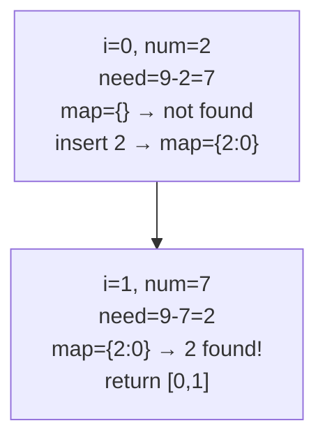

# 1. Two Sum

 
**LeetCode:** https://leetcode.com/problems/two-sum/

## Problem
You're given an array of integers and a target value. Find the indices of the two numbers in the array that add up exactly to the target, and return them as a pair. You may assume exactly one valid answer exists, and you can't use the same element twice.

**Input:** an integer array `nums`, an integer `target`
**Output:** a list/tuple of two indices `[i, j]` such that `nums[i] + nums[j] == target`

**Examples:**
1. `nums = [2, 7, 11, 15]`, `target = 9` → `[0, 1]` because `2 + 7 = 9`.
2. `nums = [3, 2, 4]`, `target = 6` → `[1, 2]` because `2 + 4 = 6` (note the answer isn't always the first two elements).
3. `nums = [3, 3]`, `target = 6` → `[0, 1]` — duplicate values are allowed as long as they're different indices.

**Constraints:** `2 <= nums.length <= 10^4`, values can be negative, exactly one valid answer exists.

> 🔑 **Pattern Recognition**
> Need to find a pair summing to a target in one array pass → keep a hash map of values you've already seen (value → index) so each lookup is O(1) instead of nested loops.

## Intuition

### 1. Brute Force
- Try every pair of indices `(i, j)` with `i < j` and check if they sum to the target. It's correct because we're literally checking all possibilities.
- Time complexity: O(n^2)  Space complexity: O(1)
- Too slow once `n` gets into the thousands — an interviewer will always ask you to do better.

### 2. Better
- Same nested-loop idea, but instead of forcing plain brute force, first sort a copy of the array and use two pointers to find the sum, then map back to original indices. This gets us off O(n^2) time.
- It's correct because a sorted array lets us discard half the search space each step (move left pointer up if sum too small, right pointer down if too big).
- Time complexity: O(n log n)  Space complexity: O(n) (for the index-tracking copy)
- Still not optimal — sorting is unnecessary work when a hash map can do it in a single pass.

### 3. Optimal
- Walk through the array once. For each number, check if `target - number` has already been seen (stored in a hash map from value → index). If yes, we found our pair immediately.
- This works because by the time we reach index `j`, every earlier index `i` is already in the map, so we discover the pair the moment we hit the second element of it.
- Time complexity: O(n)  Space complexity: O(n)
- Edge cases: duplicate values (must not reuse the same index twice — check *before* inserting the current number), no solution existing (not applicable here per constraints), negative numbers (hashing works the same).

#### 🎯 Visual Walkthrough
Tracing `nums = [2, 7, 11, 15]`, `target = 9`:

## Complexity Summary
| Approach | Time | Space |
|---|---|---|
| Brute Force | O(n^2) | O(1) |
| Better | O(n log n) | O(n) |
| Optimal | O(n) | O(n) |
