# 49. Group Anagrams

 
**LeetCode:** https://leetcode.com/problems/group-anagrams/

## Problem
Given a list of strings, group the ones that are anagrams of each other into the same bucket. Order of the groups, and order within a group, doesn't matter.

**Input:** a string array `strs`
**Output:** a list of lists, where each inner list holds strings that are anagrams of one another

**Examples:**
1. `strs = ["eat", "tea", "tan", "ate", "nat", "bat"]` → `[["eat","tea","ate"], ["tan","nat"], ["bat"]]` — three groups by shared letter multiset.
2. `strs = [""]` → `[[""]]` — a single empty string forms its own group.
3. `strs = ["a"]` → `[["a"]]` — a single-character word is its own group.

**Constraints:** `1 <= strs.length <= 10^4`, `0 <= strs[i].length <= 100`, lowercase English letters.

> 🔑 **Pattern Recognition**
> Need to bucket items that share a hidden property (same letter multiset) → compute a canonical key per item (sorted string or count signature) and group by that key in a hash map.

## Intuition

### 1. Brute Force
- For each string, compare it against a representative of every existing group (using the same "sorted equality" or count-matching check as Valid Anagram) to decide which group it belongs to; if none match, start a new group. Correct because it directly checks the anagram relationship against every group formed so far.
- Time complexity: O(n^2 * k) where n = number of strings, k = max string length (each comparison itself costs O(k))
- Quadratic in the number of strings — too slow once `n` approaches 10^4.

### 2. Better
- Sort each string's characters to get a canonical form, then use that sorted string as a key in a hash map from canonical-form → list of original strings. Two strings land in the same bucket exactly when their sorted forms match.
- Correct for the same reason sorting works in Valid Anagram: sorting is a canonical representation of a letter multiset.
- Time complexity: O(n * k log k) (sorting each of n strings of length up to k)  Space complexity: O(n * k)
- Good and commonly accepted as optimal in interviews, but the `k log k` per string can be avoided entirely with counting.

### 3. Optimal
- Instead of sorting each string, build a fixed-size count signature (a tuple of 26 counts for lowercase letters) for each string, and use that tuple as the hash map key. Strings with the same letter counts land in the same bucket — no sorting needed.
- Works because the count tuple is also a canonical form of a letter multiset, and computing it is linear in the string's length rather than `k log k`.
- Time complexity: O(n * k)  Space complexity: O(n * k)
- Edge cases: empty strings (count tuple of all zeros, correctly grouped together), single-character strings, very long strings (counting still linear), strings with repeated identical entries.

#### 🎯 Visual Walkthrough
Tracing `strs = ["eat", "tea", "tan", "ate", "nat", "bat"]` (using count signatures as keys):

```mermaid
flowchart TD
    A["'eat' → sig(a:1,e:1,t:1)<br/>map={sig1:&#91;eat&#93;}"] --> B["'tea' → sig(a:1,e:1,t:1)<br/>same key → map={sig1:&#91;eat,tea&#93;}"]
    B --> C["'tan' → sig(a:1,n:1,t:1)<br/>new key → map={sig1:..., sig2:&#91;tan&#93;}"]
    C --> D["'ate' → sig1 → &#91;eat,tea,ate&#93;<br/>'nat' → sig2 → &#91;tan,nat&#93;<br/>'bat' → new sig3 → &#91;bat&#93;"]
    D --> E["result: &#91;&#91;eat,tea,ate&#93;,&#91;tan,nat&#93;,&#91;bat&#93;&#93;"]
```

## Complexity Summary
| Approach | Time | Space |
|---|---|---|
| Brute Force | O(n^2 * k) | O(n * k) |
| Better | O(n * k log k) | O(n * k) |
| Optimal | O(n * k) | O(n * k) |
