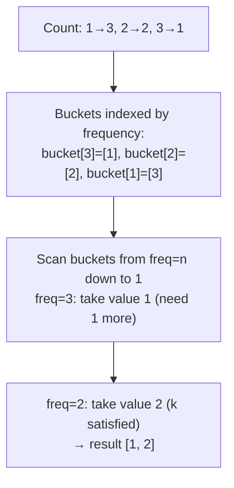

# 347. Top K Frequent Elements

 
**LeetCode:** https://leetcode.com/problems/top-k-frequent-elements/

## Problem
Given an integer array and an integer `k`, return the `k` values that occur most often, in any order.

**Input:** an integer array `nums`, an integer `k`
**Output:** an array of the `k` most frequent elements

**Examples:**
1. `nums = [1,1,1,2,2,3]`, `k = 2` → `[1, 2]` — 1 appears 3 times, 2 appears twice, 3 once, so the top 2 are 1 and 2.
2. `nums = [1]`, `k = 1` → `[1]` — only one distinct value.
3. `nums = [4,4,4,6,6,7]`, `k = 2` → `[4, 6]` — 4 appears most, 6 is the runner-up over 7.

**Constraints:** `1 <= nums.length <= 10^5`, `k` is always valid (`1 <= k <= number of distinct elements`), answer is guaranteed unique for the given inputs in the typical judge (ties can be broken arbitrarily in general).

> 🔑 **Pattern Recognition**
> "Top k by frequency" where frequency is bounded by `n` → bucket sort by count (or a size-k heap) avoids a full O(d log d) sort of every distinct value.

## Intuition

### 1. Brute Force
- Count each element's frequency with a hash map, then repeatedly scan the whole frequency map to pull out the current maximum, `k` times in a row. Correct because we're always selecting the true maximum remaining frequency.
- Time complexity: O(n + k * d) where d = number of distinct elements (worst case O(n * d) ~ O(n^2))  Space complexity: O(n)
- Repeatedly re-scanning for the max is wasteful — a beginner's first pass, not interview-ready once k or d grows.

### 2. Better
- Count frequencies with a hash map, then sort the distinct (value, frequency) pairs by frequency descending and take the first `k`. Correct because sorting gives us a fully ordered view of frequencies in one shot instead of repeated scans.
- Time complexity: O(n + d log d)  Space complexity: O(n)
- Sorting all distinct elements is overkill when we only need the top `k`, not a full ranking — a heap or bucket approach avoids the full sort.

### 3. Optimal
- Count frequencies with a hash map, then use **bucket sort**: create `n+1` buckets indexed by frequency (0..n), and place each distinct value into the bucket matching its count. Then walk the buckets from highest frequency down to 1, collecting values until we have `k` of them.
- This works because frequency can never exceed `n` (the array length), so bucketing by frequency turns the "top k by count" problem into a simple linear scan over a bounded range — no comparison-based sorting needed at all. (A heap of size k, O(n log k), is the other standard optimal-ish approach and is shown as an alternative comment.)
- Time complexity: O(n)  Space complexity: O(n)
- Edge cases: `k` equals the number of distinct elements (return all of them), all elements identical (single bucket at max frequency), ties in frequency (any valid set of k is accepted).

#### 🎯 Visual Walkthrough
Tracing `nums = [1,1,1,2,2,3]`, `k = 2`:

## Complexity Summary
| Approach | Time | Space |
|---|---|---|
| Brute Force | O(n * d) | O(n) |
| Better | O(n + d log d) | O(n) |
| Optimal | O(n) | O(n) |
