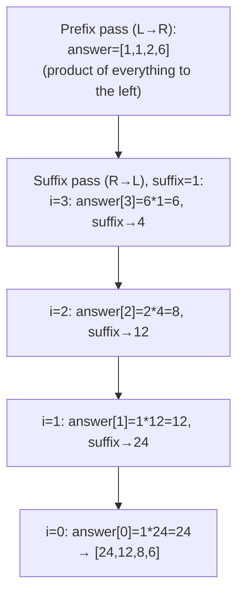

# 238. Product of Array Except Self

 
**LeetCode:** https://leetcode.com/problems/product-of-array-except-self/

## Problem
Given an integer array, return a new array where each position holds the product of every element except the one at that position — and you must do it **without using the division operator**.

**Input:** an integer array `nums`
**Output:** an array `answer` where `answer[i]` = product of all `nums[j]` for `j != i`

**Examples:**
1. `nums = [1,2,3,4]` → `[24,12,8,6]` (e.g. `answer[0] = 2*3*4 = 24`).
2. `nums = [-1,1,0,-3,3]` → `[0,0,9,0,0]` — a single zero in the array makes every position except the zero's own position equal to 0.
3. `nums = [2,3]` → `[3,2]` — smallest valid case with two elements.

**Constraints:** `2 <= nums.length <= 10^5`, product of any prefix/suffix fits in a 32-bit integer, no division allowed.

> 🔑 **Pattern Recognition**
> "Product/sum of everything except index i" with no division allowed → split it into a prefix pass and a suffix pass, and combine them at each index.

## Intuition

### 1. Brute Force
- For each index `i`, loop through the entire array again multiplying everything except `nums[i]`. Correct because it directly computes the definition.
- Time complexity: O(n^2)  Space complexity: O(1) extra (excluding output array)
- Nested loop over up to 10^5 elements is far too slow (10^10 operations worst case).

### 2. Better
- Precompute two auxiliary arrays: `prefix[i]` = product of everything to the left of `i`, and `suffix[i]` = product of everything to the right of `i`. Then `answer[i] = prefix[i] * suffix[i]`. This avoids any division while still doing the multiplication smartly.
- Correct because splitting "everything except i" into "everything before i" times "everything after i" covers exactly the required elements once each.
- Time complexity: O(n)  Space complexity: O(n) (two extra arrays)
- Already linear time — but we're using 2 extra full-size arrays when the output array itself can double as one of them.

### 3. Optimal
- Build the answer array by first filling it with prefix products in one left-to-right pass (`answer[i]` = product of everything before `i`). Then do a second right-to-left pass with a single running `suffix` variable, multiplying it into `answer[i]` as we go — no separate suffix array needed.
- Works because we only ever need the running suffix product at each step, not the whole suffix array stored simultaneously — a single accumulator variable suffices.
- Time complexity: O(n)  Space complexity: O(1) extra (output array doesn't count toward extra space per the problem's convention)
- Edge cases: array containing one zero (result is zero everywhere except that index), array containing two or more zeros (result is all zeros), negative numbers (sign handled naturally by multiplication).

#### 🎯 Visual Walkthrough
Tracing `nums = [1, 2, 3, 4]` → `[24, 12, 8, 6]`:

## Complexity Summary
| Approach | Time | Space |
|---|---|---|
| Brute Force | O(n^2) | O(1) |
| Better | O(n) | O(n) |
| Optimal | O(n) | O(1) |
