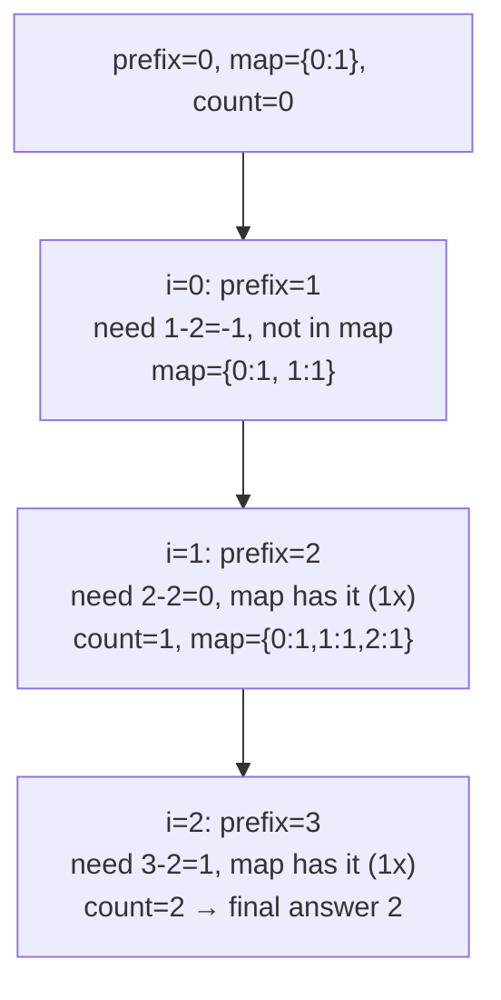

# 560. Subarray Sum Equals K

 
**LeetCode:** https://leetcode.com/problems/subarray-sum-equals-k/

## Problem
Given an integer array and a target integer `k`, count how many contiguous subarrays sum exactly to `k`. Numbers can be negative, so a "sliding window" that only grows/shrinks monotonically doesn't directly apply.

**Input:** an integer array `nums`, an integer `k`
**Output:** an integer — the count of contiguous subarrays whose elements sum to `k`

**Examples:**
1. `nums = [1,1,1]`, `k = 2` → `2` — subarrays `[1,1]` (indices 0-1) and `[1,1]` (indices 1-2) both sum to 2.
2. `nums = [1,2,3]`, `k = 3` → `2` — subarrays `[1,2]` and `[3]` both sum to 3.
3. `nums = [1,-1,0]`, `k = 0` → `3` — the qualifying subarrays are `[1,-1]` (indices 0-1), `[0]` (index 2 alone), and `[1,-1,0]` (the whole array) — three subarrays sum to 0.

**Constraints:** `1 <= nums.length <= 2*10^4`, values (including k) can be negative, so two pointers alone won't work directly — this is a prefix-sum problem.

> 🔑 **Pattern Recognition**
> Counting subarrays with an exact target sum, and values can be negative → prefix sums plus a hash map counting how often each prefix sum has occurred (not a sliding window, since negatives break monotonicity).

## Intuition

### 1. Brute Force
- For every pair of start and end indices, compute the sum of that subarray directly (a third nested loop or an inline running sum) and check if it equals `k`. Correct because it enumerates literally every contiguous subarray.
- Time complexity: O(n^2) using a running sum per start index (O(n^3) if you naively re-sum from scratch each time)  Space complexity: O(1)
- Quadratic blows past acceptable time for `n = 2*10^4` in an interview setting when a linear solution exists.

### 2. Better
- Precompute a prefix-sum array where `prefix[i]` = sum of `nums[0..i-1]`. Then the sum of any subarray `nums[i..j]` is `prefix[j+1] - prefix[i]`, computable in O(1) after preprocessing, so checking all O(n^2) pairs is now O(n^2) total instead of O(n^3), or with a nested loop over pairs you still get O(n^2) — the real win comes from combining this idea with a hash map (see optimal). As a "better" middle step, we still use two loops over start/end but with O(1) sum lookups instead of recomputing sums.
- Correct because prefix sums exactly capture cumulative totals, and subtracting two of them isolates any range's sum.
- Time complexity: O(n^2)  Space complexity: O(n) (the prefix array)
- We've replaced O(n) per-subarray-sum computation with O(1), but we're still checking every pair — a hash map lets us skip enumerating pairs entirely.

### 3. Optimal
- Walk through the array once maintaining a running prefix sum. At each step, we want to know: how many earlier prefix sums equal `current_prefix - k`? Because if `prefix[j] - prefix[i] = k`, then `prefix[i] = prefix[j] - k`. Keep a hash map counting how many times each prefix sum value has occurred so far (initialized with `{0: 1}` to correctly count subarrays starting at index 0), and add the count found to our running answer at each step, then record the current prefix sum in the map.
- This works because the hash map lets us answer "how many valid start points exist for the current end point" in O(1) average time instead of scanning backward, turning an O(n^2) pair-check into a single O(n) pass.
- Time complexity: O(n)  Space complexity: O(n)
- Edge cases: negative numbers (prefix sums can decrease, handled naturally — no monotonicity assumed), `k = 0` (relies on the `{0: 1}` seed to catch subarrays whose sum is exactly the running total so far), all zeros (many overlapping valid subarrays, counted correctly since we count subarrays not distinct sums).

#### 🎯 Visual Walkthrough
Tracing `nums = [1, 1, 1]`, `k = 2`:

## Complexity Summary
| Approach | Time | Space |
|---|---|---|
| Brute Force | O(n^2) | O(1) |
| Better | O(n^2) | O(n) |
| Optimal | O(n) | O(n) |
