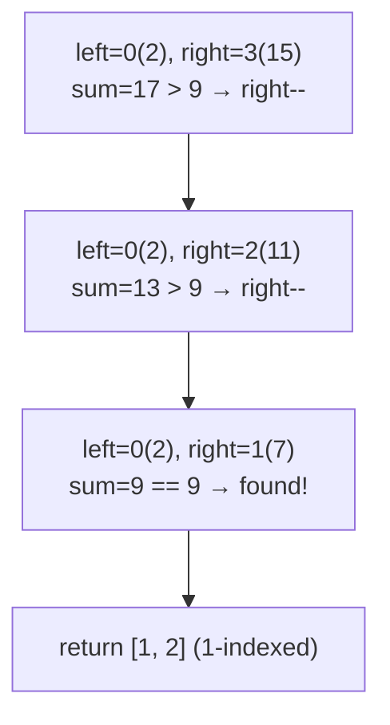

# 167. Two Sum II - Input Array Is Sorted

 
**LeetCode:** https://leetcode.com/problems/two-sum-ii-input-array-is-sorted/

## Problem
Given a **1-indexed** array that is already sorted in non-decreasing order, find two numbers that add up to a target and return their 1-indexed positions. Exactly one valid answer exists, and you can't reuse the same element twice.

**Input:** a sorted integer array `numbers` (1-indexed for the answer), an integer `target`
**Output:** a list of two 1-indexed positions `[i, j]` with `i < j` such that `numbers[i-1] + numbers[j-1] == target`

**Examples:**
1. `numbers = [2,7,11,15]`, `target = 9` → `[1,2]` because `2 + 7 = 9` (positions 1 and 2, 1-indexed).
2. `numbers = [2,3,4]`, `target = 6` → `[1,3]` because `2 + 4 = 6`.
3. `numbers = [-1,0]`, `target = -1` → `[1,2]` because `-1 + 0 = -1` — negatives are allowed too.

**Constraints:** `2 <= numbers.length <= 3*10^4`, `numbers` sorted non-decreasing, exactly one solution exists, must use O(1) extra space for full credit (which points straight at two pointers over a hash map).

> 🔑 **Pattern Recognition**
> Pair-sum target on an **already-sorted** array → two pointers from both ends, moving the low pointer up when the sum is too small and the high pointer down when it's too big, beats re-hashing in O(1) extra space.

## Intuition

### 1. Brute Force
- Check every pair `(i, j)` with `i < j` and see if they sum to target — same idea as unsorted Two Sum, just ignoring the fact that the array is sorted. Correct because it's an exhaustive check.
- Time complexity: O(n^2)  Space complexity: O(1)
- Ignores the sorted structure entirely, so it's needlessly slow — the interviewer explicitly gave you a sorted array as a hint.

### 2. Better
- Use a hash map from value → index while scanning once, just like classic Two Sum: for each number, check if `target - number` was already seen. Correct for the same reason as the hash-map Two Sum solution.
- Time complexity: O(n)  Space complexity: O(n)
- This is linear time, which is great, but it uses O(n) extra space and completely ignores the sortedness — the intended optimal solution uses the sorted order to get O(1) space instead.

### 3. Optimal
- Use two pointers: one at the start (`left`), one at the end (`right`). Compute the sum of `numbers[left] + numbers[right]`. If it matches target, we're done. If it's too small, we need a bigger sum, so move `left` right (since the array is sorted, moving left forward only increases values). If it's too big, move `right` left.
- This works because sortedness guarantees monotonic behavior: increasing `left` can only increase the sum, decreasing `right` can only decrease it, so at every step we can safely discard one end without missing the answer.
- Time complexity: O(n)  Space complexity: O(1)
- Edge cases: two-element array (pointers start adjacent, one comparison solves it), negative numbers (two pointers handle them naturally since comparisons are just `<`, `>`, `==`), target achievable only at the very ends (handled correctly since pointers start there).

#### 🎯 Visual Walkthrough
Tracing `numbers = [2, 7, 11, 15]`, `target = 9`:

## Complexity Summary
| Approach | Time | Space |
|---|---|---|
| Brute Force | O(n^2) | O(1) |
| Better | O(n) | O(n) |
| Optimal | O(n) | O(1) |
