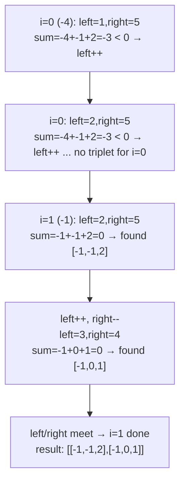

# 15. 3Sum

 
**LeetCode:** https://leetcode.com/problems/3sum/

## Problem
Given an integer array, find all unique triplets of values (by value, not by index) that sum to zero. The same value can't be reused from the same index twice within a triplet, and the result must not contain duplicate triplets.

**Input:** an integer array `nums`
**Output:** a list of triplets `[a, b, c]` (as value-lists, order within a triplet and across triplets doesn't matter) where `a + b + c == 0`, with no duplicate triplets

**Examples:**
1. `nums = [-1,0,1,2,-1,-4]` → `[[-1,-1,2], [-1,0,1]]` — two distinct triplets sum to zero.
2. `nums = [0,1,1]` → `[]` — no triplet sums to zero.
3. `nums = [0,0,0]` → `[[0,0,0]]` — one triplet, using all three zeros, and it only appears once in the output despite multiple ways to pick indices.

**Constraints:** `3 <= nums.length <= 3000`, values can be very large in magnitude (positive or negative), duplicate values are common and must not produce duplicate triplets in the output.

> 🔑 **Pattern Recognition**
> Triplet-sum target → sort first, fix one element with a loop, then two-pointer the remaining two — 3Sum reduces directly to a Two Sum II on the rest of the array.

## Intuition

### 1. Brute Force
- Three nested loops over all index triples `(i, j, k)` with `i < j < k`, checking if the three values sum to zero, and using a hash set of sorted-tuples to dedupe triplets before adding them to the result. Correct because it enumerates every possible triplet of indices.
- Time complexity: O(n^3)  Space complexity: O(n) for the dedupe set (output aside)
- Cubic time is unacceptable once `n` approaches even a few hundred, let alone 3000.

### 2. Better
- Fix the first number with a single loop, then for the remaining two numbers use a hash-set-based Two Sum (like classic Two Sum, target = `-nums[i]`) over the rest of the array. Sort the array first (or sort each found triplet) and use a set of tuples to avoid duplicate triplets.
- Correct because fixing one element and hash-searching for the other two covers every valid triplet, and Two Sum's hash approach is already proven correct.
- Time complexity: O(n^2) average (n iterations of the outer loop, each doing an O(n) hash-based two-sum)  Space complexity: O(n) for the hash set per iteration
- Quadratic time is much better, but managing duplicate triplets with hash sets of tuples is fiddly and uses more memory than necessary — sorting first enables a cleaner two-pointer approach.

### 3. Optimal
- Sort the array first. Then for each index `i` (skipping duplicate values to avoid duplicate triplets), use two pointers (`left = i+1`, `right = n-1`) to find pairs that sum to `-nums[i]`, moving inward based on whether the current sum is too small or too big — exactly like Two Sum II. Skip over duplicate values for `left` and `right` too once a valid triplet is found, to avoid emitting the same triplet twice.
- This works because after sorting, fixing the smallest element of a candidate triplet and two-pointering the rest is both correct (same monotonic argument as Two Sum II) and naturally lets us skip duplicates by comparing adjacent sorted values.
- Time complexity: O(n^2) (n outer iterations, each doing an O(n) two-pointer scan) — same asymptotic complexity as Better, but O(1) extra space per iteration and much simpler duplicate handling  Space complexity: O(1) extra (excluding sort and output; O(log n) to O(n) for the sort itself depending on implementation)
- Edge cases: array with fewer than 3 elements (not reachable per constraints, but guard anyway), all zeros (one triplet `[0,0,0]`), no valid triplet exists (return empty list), many duplicate values (skipping duplicates at every pointer position is essential for correctness).

#### 🎯 Visual Walkthrough
Tracing `nums = [-1, 0, 1, 2, -1, -4]` → sorted `[-4, -1, -1, 0, 1, 2]`:

## Complexity Summary
| Approach | Time | Space |
|---|---|---|
| Brute Force | O(n^3) | O(n) |
| Better | O(n^2) | O(n) |
| Optimal | O(n^2) | O(1) extra |
