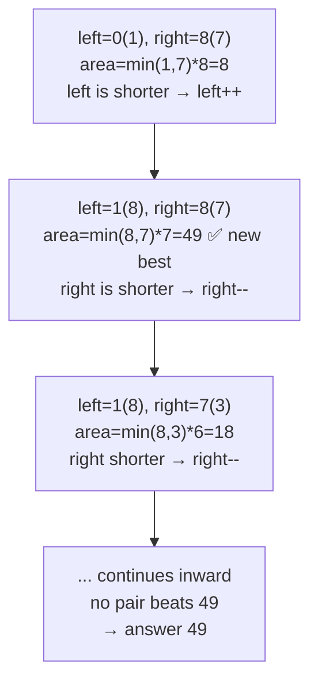

# 11. Container With Most Water

 
**LeetCode:** https://leetcode.com/problems/container-with-most-water/

## Problem
You're given an array where each value represents the height of a vertical line drawn at that index. Pick two lines that, together with the x-axis, form a container, and find the pair that holds the most water. The container's capacity is `min(height of the two lines) * (distance between them)` — water can't rise above the shorter line.

**Input:** an integer array `height`
**Output:** an integer — the maximum water area achievable by any pair of lines

**Examples:**
1. `height = [1,8,6,2,5,4,8,3,7]` → `49` — lines at index 1 (height 8) and index 8 (height 7) give `min(8,7) * (8-1) = 7 * 7 = 49`.
2. `height = [1,1]` → `1` — only one pair possible, `min(1,1) * 1 = 1`.
3. `height = [4,3,2,1,4]` → `16` — the two end lines (both height 4) give `min(4,4) * (4-0) = 16`, beating any narrower pair.

**Constraints:** `2 <= height.length <= 10^5`, `0 <= height[i] <= 10^4`.

> 🔑 **Pattern Recognition**
> Maximize an area/volume bounded by two "walls" picked from an array → two pointers starting at the outer ends, always move the pointer at the **shorter** wall inward (it can never be part of a better answer once left in place).

## Intuition

### 1. Brute Force
- Try every pair of lines `(i, j)` and compute the area for each, keeping the maximum. Correct because it's an exhaustive check of every possible container.
- Time complexity: O(n^2)  Space complexity: O(1)
- Way too slow for `n` up to 10^5 — needs to come down to linear.

### 2. Better
- Same idea as brute force but pruned slightly: for each left line, only continue scanning right lines while there's a chance of beating the current best (e.g., stop early if `height[i] * (n-1-i)` — the theoretical max possible width times the left height — can't beat the current best). This is still fundamentally quadratic in the worst case (e.g., all equal heights) but demonstrates a stepping-stone "smarter loop" before reaching two pointers.
- Correct because we still consider every pair whose area could plausibly exceed the running best; we just skip pairs guaranteed not to improve on it.
- Time complexity: O(n^2) worst case (no asymptotic improvement, though often faster in practice)  Space complexity: O(1)
- Still not good enough for an interview bar — the real fix is realizing which pointer to move, not just pruning.

### 3. Optimal
- Use two pointers starting at the two ends of the array. Compute the area, update the best seen so far, and then move whichever pointer points to the **shorter** line inward (never move the taller one).
- This works because the container's height is capped by the shorter line — if we keep the shorter line and move the taller one inward, the width shrinks while the height cap can only stay the same or get worse, so that move can never produce a better answer. Moving the shorter line's pointer is the only move that has any chance of finding a taller limiting line to compensate for the reduced width. This greedy elimination is safe because we never discard a pair that could have been optimal.
- Time complexity: O(n)  Space complexity: O(1)
- Edge cases: two elements only (single comparison, immediately correct), all same height (any pair works, two pointers still finds the max width one which wins), a zero-height line (area involving it is always 0, naturally handled since `min(...)` becomes 0).

#### 🎯 Visual Walkthrough
Tracing `height = [1, 8, 6, 2, 5, 4, 8, 3, 7]`:

## Complexity Summary
| Approach | Time | Space |
|---|---|---|
| Brute Force | O(n^2) | O(1) |
| Better | O(n^2) worst case | O(1) |
| Optimal | O(n) | O(1) |
