# 42. Trapping Rain Water

 
**LeetCode:** https://leetcode.com/problems/trapping-rain-water/

## Problem
Given an array representing an elevation map (bar heights of width 1), compute how much water it can trap after rain. Water sits in the "valleys" between taller bars and is bounded on each side by the tallest bar to its left and right.

**Input:** an integer array `height`
**Output:** an integer — total units of water trapped

**Examples:**
1. `height = [0,1,0,2,1,0,1,3,2,1,2,1]` → `6` — water pools in several dips, e.g. index 2 traps `min(1,2)-0 = 1` unit, and so on across the array, totaling 6.
2. `height = [4,2,0,3,2,5]` → `9` — a wide valley between the two tall bars (4 and 5) traps a lot of water.
3. `height = [1,2,3]` → `0` — strictly increasing heights trap nothing, there's no wall on the right to hold water in.

**Constraints:** `1 <= height.length <= 2*10^4`, `0 <= height[i] <= 10^5`.

> 🔑 **Pattern Recognition**
> Water trapped at each position is bounded by the max-so-far on both sides → two pointers with running left-max/right-max, always advance the side whose running max is currently smaller (it's the binding wall).

## Intuition

### 1. Brute Force
- For each bar `i`, the water it can hold is `min(max height to its left, max height to its right) - height[i]` (if positive). Compute the left-max and right-max for every index by scanning outward from it each time. Correct because this is exactly the physical definition of how much water a bar's position can trap.
- Time complexity: O(n^2) (for each of n positions, scan left and right, each O(n))  Space complexity: O(1)
- Recomputing the left-max and right-max from scratch for every index is extremely wasteful — these can be precomputed once.

### 2. Better
- Precompute two arrays in one pass each: `left_max[i]` = the tallest bar from index 0 to i, and `right_max[i]` = the tallest bar from i to the end. Then for each index, the trapped water is `min(left_max[i], right_max[i]) - height[i]`, summed over all indices.
- Correct because we've simply cached the left-max/right-max lookups instead of recomputing them, but the formula and correctness argument are identical to brute force.
- Time complexity: O(n)  Space complexity: O(n) (two extra arrays)
- Already linear time, which is often accepted as "optimal enough," but it uses O(n) extra space when the same answer can be found with O(1) extra space using two pointers.

### 3. Optimal
- Use two pointers, `left` at the start and `right` at the end, along with running `left_max` and `right_max` values. At each step, compare `height[left]` and `height[right]`: whichever side is smaller determines that side's water contribution, because the smaller side's own max-so-far is guaranteed to be the binding (limiting) wall — the other side has an even taller bar somewhere blocking it, so its max doesn't matter yet. Move the pointer on the smaller side inward, updating its running max and adding trapped water as `running_max - height[pointer]` (if positive).
- This works because whichever side currently has the smaller boundary determines the water level at that position — the water can never rise above the shorter of the two "walls" we know about so far, and we always know the true minimum boundary on the side we're processing since the other side is provably at least as tall.
- Time complexity: O(n)  Space complexity: O(1)
- Edge cases: strictly increasing or decreasing heights (traps 0 water, pointers naturally never accumulate anything), all same height (no water, flat surface), single bar or empty array (0 water, loop simply doesn't run), a bar taller than everything else in the middle (correctly acts as a divider between two independent trapping regions).

#### 🎯 Visual Walkthrough
Tracing `height = [0,1,0,2,1,0,1,3,2,1,2,1]` → total `6`:

```mermaid
flowchart TD
    A["left=0(0), right=11(1)<br/>leftMax=0, rightMax=1<br/>height&#91;left&#93;<=height&#91;right&#93; → process left"] --> B["left=1(1): leftMax→1<br/>water += 1-1=0, left++"]
    B --> C["left=2(0): leftMax stays 1<br/>water += 1-0=1 (total=1), left++"]
    C --> D["... both pointers sweep inward,<br/>always processing the smaller-max side"]
    D --> E["pointers meet<br/>→ total water = 6"]
```

## Complexity Summary
| Approach | Time | Space |
|---|---|---|
| Brute Force | O(n^2) | O(1) |
| Better | O(n) | O(n) |
| Optimal | O(n) | O(1) |
