# 3. Longest Substring Without Repeating Characters

 
**LeetCode:** https://leetcode.com/problems/longest-substring-without-repeating-characters/

## Problem
Given a string, find the length of the longest contiguous stretch of it that contains no repeated characters.

- **Input:** a string `s` (may contain letters, digits, symbols, spaces).
- **Output:** an integer — the length of the longest substring with all-unique characters.

**Examples**
1. `s = "abcabcbb"` → `3`. The substring `"abc"` is the longest run with no repeats.
2. `s = "bbbbb"` → `1`. Every character repeats immediately, so the best we can do is a single character.
3. `s = "pwwkew"` → `3`. `"wke"` has length 3; note `"pwke"` is not contiguous so it doesn't count.

**Constraints:** `0 <= s.length <= 5 * 10^4`, `s` consists of printable ASCII characters.

> 🔑 **Pattern Recognition**
> Longest substring under a "no repeats" constraint → sliding window with a hash map tracking each character's last-seen index, jumping the left edge past the duplicate instead of shrinking one step at a time.

## Intuition (explained simply)

### 1. Brute Force
- Check every possible substring, and for each one scan it to verify all characters are distinct, keeping the longest valid length.
- Correct because it's exhaustive — every substring gets checked.
- Time complexity: O(n³) (O(n²) substrings, O(n) to check each with a set) — often stated O(n²) if you build the set incrementally, but naive checking is cubic.
- Far too slow for `n` up to 50,000; nested triple work blows the time limit immediately.

### 2. Better
- Use a sliding window with a hash **set**: expand the right edge one character at a time; if the new character is already in the set, shrink from the left one step at a time (removing characters) until the duplicate is gone.
- This is correct because the window always represents a valid substring with unique characters, and every character is added/removed from the set a bounded number of times.
- Time complexity: O(n) amortized (each pointer moves forward at most n times), but the inner "shrink one at a time" loop can still feel like O(n) per step in the worst case, so this version is a stepping stone before the jump-based optimal.  Space complexity: O(min(n, alphabet size)).
- Works fine, but repeatedly shrinking one character at a time is not as slick as directly jumping the window.

### 3. Optimal
- Use a sliding window with a hash **map** from character → its most recent index. When you see a character already in the window, jump the left pointer directly to `(last_seen_index + 1)` instead of shrinking one step at a time — but only if that last occurrence is inside the current window (otherwise it's stale and you should ignore it).
- This works because the map lets us compute exactly where the duplicate is and skip past it in O(1), rather than walking left step by step.
- Time complexity: O(n) — a true single pass, each character visited once.  Space complexity: O(min(n, alphabet size)).
- Edge cases: empty string → 0; all identical characters → 1; ensure the left pointer never moves backward (guard with `max(left, last_seen[c] + 1)`).

#### 🎯 Visual Walkthrough
Tracing `s = "abcabcbb"`:

```mermaid
flowchart TD
    A["right=0 'a': map={a:0}<br/>window='a', best=1"] --> B["right=1 'b', right=2 'c'<br/>window='abc', best=3"]
    B --> C["right=3 'a': seen at 0, inside window<br/>left jumps to 1<br/>map&#91;a&#93;=3, window='bca'"]
    C --> D["... repeats jumping on each dup<br/>best length stays 3"]
```

## Complexity Summary
| Approach | Time | Space |
|---|---|---|
| Brute Force | O(n^3) | O(min(n, k)) |
| Better | O(n) amortized | O(min(n, k)) |
| Optimal | O(n) | O(min(n, k)) |
