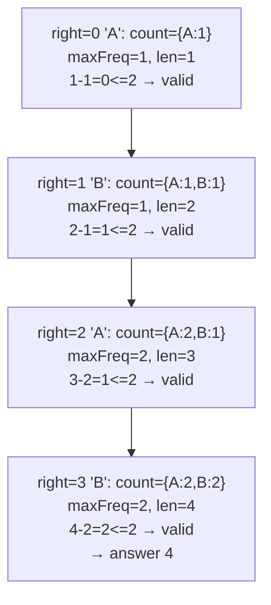

# 424. Longest Repeating Character Replacement

 
**LeetCode:** https://leetcode.com/problems/longest-repeating-character-replacement/

## Problem
You have a string of uppercase letters and are allowed to change up to `k` characters in it to any other letter. Find the length of the longest substring you can turn into a run of a single repeated letter.

- **Input:** a string `s` and an integer `k` (max number of replacements allowed).
- **Output:** an integer — the length of the longest substring achievable where all characters are the same after at most `k` replacements.

**Examples**
1. `s = "ABAB", k = 2` → `4`. Replace both `B`s with `A` (or vice versa): the whole string becomes uniform.
2. `s = "AABABBA", k = 1` → `4`. Change one character in `"ABBA"` → `"ABBA"` with 1 flip becomes 4 of the same letter, e.g. flip index 3 to get `"AABBBBA"`... concretely, the substring `"BABB"` needs only 1 change to become `"BBBB"`.
3. `s = "AAAA", k = 0` → `4`. No replacements needed or allowed; the string is already uniform.

**Constraints:** `1 <= s.length <= 10^5`, `s` consists of uppercase English letters, `0 <= k <= s.length`.

> 🔑 **Pattern Recognition**
> Longest substring achievable within a "budget" of `k` allowed changes → sliding window that only ever grows or slides (never shrinks), tracking the count of the window's most frequent character.

## Intuition (explained simply)

### 1. Brute Force
- For every substring, count the frequency of its most common letter. If `(substring length - count of most common letter) <= k`, that substring can be made uniform with at most `k` replacements. Track the max length that satisfies this.
- Correct because it directly checks the replacement condition for every candidate substring.
- Time complexity: O(n² · 26) or O(n³) if you recompute frequencies naively — either way too slow.  Space complexity: O(26) per substring check.
- With `n` up to 100,000, any O(n²) or worse solution times out.

### 2. Better
- Use a sliding window that only ever **grows or shifts**, never shrinks in length: keep a frequency count of letters inside the window and track `maxFreq`, the count of the most frequent letter seen in the window's history. If `window length - maxFreq > k`, slide the window forward by one (remove the leftmost character, advance both pointers by one net position). This guarantees the window length is monotonic non-decreasing, so we don't need to shrink and re-check — we just slide.
- Correct because we only care about the *maximum* window size found; even if `maxFreq` becomes stale (overcounts a letter no longer fully in a shrunk window), the window length itself never decreases below the best found so far, so the answer stays correct even though intermediate windows may technically not all be perfectly valid.
- Time complexity: O(n · 26) ≈ O(n)  Space complexity: O(26) = O(1).
- This is close to optimal already — the "better" and "optimal" versions here are conceptually the same sliding-window trick; the difference is mostly implementation cleanliness (recomputing max each time vs. tracking incrementally).

### 3. Optimal
- Same sliding window idea, but track `maxFreq` incrementally (update it only when adding a new character extends it) instead of scanning the frequency table every iteration. The key insight: the window size only grows when we find a longer valid window, so we never need to shrink — just slide when invalid.
- This works because we're not trying to find *every* valid window, only the length of the largest one — and once we've achieved a window of size `L`, we never need a smaller one again.
- Time complexity: O(n) — one pass, O(1) work per character with a fixed 26-letter alphabet.  Space complexity: O(26) = O(1).
- Edge cases: `k = 0` (no replacements allowed, answer is just the longest run of one repeated letter); `k >= s.length` (answer is the whole string length).

#### 🎯 Visual Walkthrough
Tracing `s = "ABAB"`, `k = 2`:

## Complexity Summary
| Approach | Time | Space |
|---|---|---|
| Brute Force | O(n^2 · 26) | O(26) |
| Better | O(n · 26) | O(26) |
| Optimal | O(n) | O(26) |
