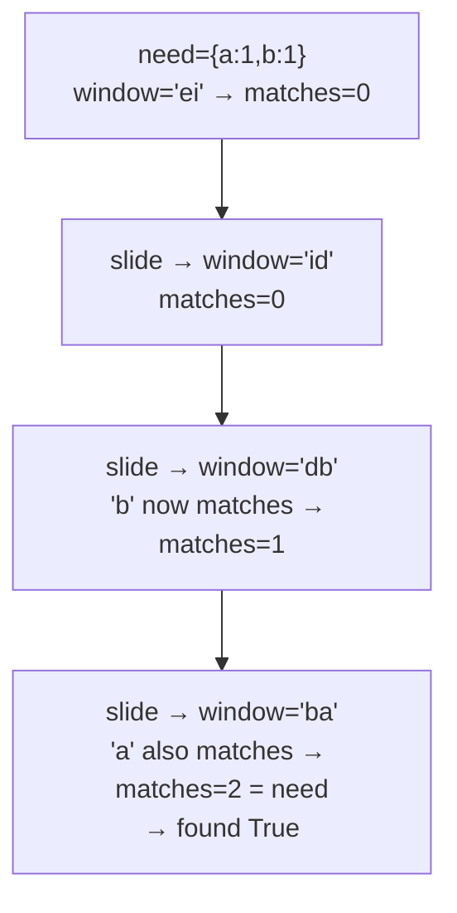

# 567. Permutation in String

 
**LeetCode:** https://leetcode.com/problems/permutation-in-string/

## Problem
Given two strings `s1` and `s2`, determine whether `s2` contains any contiguous substring that is a rearrangement (permutation) of `s1`.

- **Input:** two strings `s1` (the pattern) and `s2` (the text to search).
- **Output:** a boolean — `True` if some contiguous window of `s2` is an anagram of `s1`, else `False`.

**Examples**
1. `s1 = "ab", s2 = "eidbaooo"` → `True`. The substring `"ba"` (positions 2-3) is an anagram of `"ab"`.
2. `s1 = "ab", s2 = "eidboaoo"` → `False`. No contiguous window of length 2 in `s2` is an anagram of `"ab"`.
3. `s1 = "adc", s2 = "dcda"` → `True`. The substring `"cda"` (positions 1-3) uses the same letters as `"adc"`.

**Constraints:** `1 <= s1.length, s2.length <= 10^4`, both strings are lowercase English letters.

> 🔑 **Pattern Recognition**
> "Does any fixed-length window match a target frequency profile?" → fixed-size sliding window with an incrementally updated frequency/match count, sliding one character at a time.

## Intuition (explained simply)

### 1. Brute Force
- Generate every contiguous substring of `s2` with length equal to `len(s1)`, sort its characters (and sort `s1` once), and compare. If they match, we found a permutation.
- Correct because two strings are anagrams exactly when their sorted forms are identical.
- Time complexity: O(n · m log m) where `n = len(s2)`, `m = len(s1)` (sorting each window).  Space complexity: O(m).
- Sorting every window from scratch is wasteful — repeated work we can avoid with counting.

### 2. Better
- Instead of sorting, use frequency counts: precompute the letter-count `Counter` of `s1`. Slide a window of size `len(s1)` across `s2`, and for each window build a fresh `Counter` of the window and compare it to `s1`'s counter.
- Correct because two strings of equal length are anagrams exactly when their letter-frequency counts match.
- Time complexity: O(n · 26) (rebuilding a 26-letter counter comparison each window) which is O(n) in practice, but we're still redoing work per window instead of updating incrementally.  Space complexity: O(26).
- We recompute the whole window's counts from scratch every slide — we can instead update counts incrementally in O(1) per slide.

### 3. Optimal
- Maintain a single running frequency count for the current window and a count of how many of the 26 letters currently have a **matching** count with `s1`'s frequency table. When sliding the window (add one character on the right, remove one on the left), only update the match-count for the two letters that changed. If all 26 letters match, we've found a permutation.
- This works because an anagram check reduces to "do all 26 frequency counts match," and we can track that incrementally instead of recomputing every window.
- Time complexity: O(n) — one pass over `s2`, O(1) work per step (fixed alphabet size).  Space complexity: O(26) = O(1).
- Edge cases: `len(s1) > len(s2)` → immediately `False`; identical strings → `True`; make sure the window size stays fixed at `len(s1)` throughout.

#### 🎯 Visual Walkthrough
Tracing `s1 = "ab"`, `s2 = "eidbaooo"`:

## Complexity Summary
| Approach | Time | Space |
|---|---|---|
| Brute Force | O(n · m log m) | O(m) |
| Better | O(n · 26) | O(26) |
| Optimal | O(n) | O(26) |
