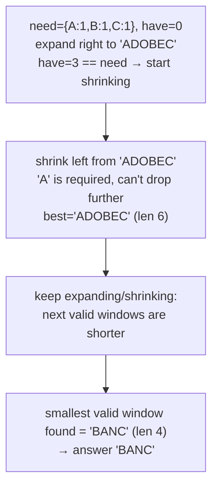

# 76. Minimum Window Substring

 
**LeetCode:** https://leetcode.com/problems/minimum-window-substring/

## Problem
Given two strings `s` and `t`, find the smallest contiguous substring of `s` that contains every character of `t` (including duplicates — if `t` has two `a`s, the window needs at least two `a`s). If no such window exists, return an empty string.

- **Input:** strings `s` (the text) and `t` (the required characters, with multiplicity).
- **Output:** the shortest substring of `s` covering all of `t`'s characters, or `""` if impossible.

**Examples**
1. `s = "ADOBECODEBANC", t = "ABC"` → `"BANC"`. It's the shortest window containing at least one `A`, one `B`, and one `C`.
2. `s = "a", t = "a"` → `"a"`. The whole string is already the minimal window.
3. `s = "a", t = "aa"` → `""`. `t` needs two `a`s but `s` only has one, so no valid window exists.

**Constraints:** `1 <= s.length, t.length <= 10^5`, both strings consist of English letters (upper/lower case).

> 🔑 **Pattern Recognition**
> Smallest window in `s` that covers all of `t`'s characters → classic variable-size sliding window: expand the right edge until the window is valid, then greedily shrink the left edge to minimize it.

## Intuition (explained simply)

### 1. Brute Force
- Try every possible substring of `s` (every start, every end), and for each one check whether it contains all characters of `t` with the right multiplicities. Keep the shortest one that qualifies.
- Correct because it's exhaustive — every candidate window gets validated directly.
- Time complexity: O(n² · m) (n² substrings, each validated in O(m) or O(26) using counts).  Space complexity: O(m).
- With `n` up to 100,000, this is nowhere close to fast enough.

### 2. Better
- Use a sliding window with a "required character count" table from `t`. Expand the right pointer, and whenever the window satisfies all requirements, try shrinking from the left one step at a time to see if it's still valid, recording the best (shortest) valid window found. Validity check ("does window satisfy all requirements?") is done by comparing the window's frequency table to `t`'s each time.
- Correct because we only shrink while the window still contains everything needed, so we always test genuinely valid windows and never miss the minimal one for a given right endpoint.
- Time complexity: O(n · 26) — for each of the n window positions we may do a fixed-alphabet-size comparison to check validity.  Space complexity: O(52) for counts (upper + lower case).
- Recomputing "is the window fully valid" via a frequency comparison on every shrink step is wasteful — we can track validity incrementally with a single counter instead.

### 3. Optimal
- Track how many of `t`'s **distinct required characters** are currently satisfied (`have`) versus how many are needed (`need = len(set(t))`). Expand the right pointer, updating a window frequency count and incrementing `have` when a character's count first reaches its required amount. Once `have == need`, greedily shrink the left pointer while the window is still fully valid, updating the best answer and decrementing `have` when shrinking breaks a requirement.
- This works because `have`/`need` gives an O(1) check for "is the window currently valid," replacing the O(26)–O(52) frequency comparison with a single integer comparison, so the whole algorithm becomes a true linear two-pointer sweep.
- Time complexity: O(n + m) — each pointer moves forward at most n times, and building the requirement table from `t` takes O(m).  Space complexity: O(52) ≈ O(1) (fixed alphabet).
- Edge cases: `t` longer than `s` → impossible, return `""`; duplicate characters in `t` (need per-character *counts*, not just presence); no valid window ever found → return `""`.

#### 🎯 Visual Walkthrough
Tracing `s = "ADOBECODEBANC"`, `t = "ABC"`:

## Complexity Summary
| Approach | Time | Space |
|---|---|---|
| Brute Force | O(n^2 · m) | O(m) |
| Better | O(n · 26) | O(52) |
| Optimal | O(n + m) | O(52) |
