# 239. Sliding Window Maximum

 
**LeetCode:** https://leetcode.com/problems/sliding-window-maximum/

## Problem
You have an array and a window of fixed size `k` that slides from the left end to the right end, one step at a time. For every position of the window, report the maximum value inside it.

- **Input:** an integer array `nums` and a window size `k`.
- **Output:** an array where element `i` is the max of `nums[i .. i+k-1]`, for every valid window position.

**Examples**
1. `nums = [1,3,-1,-3,5,3,6,7], k = 3` → `[3,3,5,5,6,7]`. E.g. window `[1,3,-1]` → max 3; window `[5,3,6]` → max 6.
2. `nums = [1], k = 1` → `[1]`. Only one window, containing just the single element.
3. `nums = [9,11], k = 2` → `[11]`. One window `[9,11]`, max is 11.

**Constraints:** `1 <= nums.length <= 10^5`, `1 <= k <= nums.length`, `-10^4 <= nums[i] <= 10^4`.

> 🔑 **Pattern Recognition**
> Max of every fixed-size window as it slides → a monotonic decreasing deque of indices, discarding anything that can never be the max again the moment a bigger element arrives.

## Intuition (explained simply)

### 1. Brute Force
- For each window position, scan all `k` elements inside it to find the maximum, then move to the next window.
- Correct because it directly computes the definition of "max of this window" for every window.
- Time complexity: O(n · k) — up to O(n²) when `k` is large.  Space complexity: O(1) extra (excluding output).
- With `n` up to 100,000, a large `k` makes this too slow (up to 10^10 operations).

### 2. Better
- Use a max-heap (priority queue) of `(value, index)` pairs. Push every element as it enters the window. To get the current max, peek the top of the heap, but first "lazily" pop any entries whose index has fallen outside the current window (they're stale, not actually in range).
- Correct because the heap always eventually surfaces the true max within range once stale entries are discarded; we just don't delete immediately, we defer deletion until it matters.
- Time complexity: O(n log n) — each element is pushed once and popped at most once, each heap operation is O(log n).  Space complexity: O(n) for the heap.
- Better than brute force, but the log factor and heap bookkeeping isn't necessary — a monotonic deque achieves the same in linear time.

### 3. Optimal
- Maintain a **deque of indices** whose corresponding values are in strictly decreasing order (monotonic decreasing deque). For each new element: (1) pop from the back while the back's value is ≤ the new value (those elements can never be the max again since a larger, later element exists), (2) push the new index to the back, (3) pop from the front if it has slid out of the window, (4) once the window is full, the front of the deque is always the current window's max.
- This works because the deque only ever keeps indices that could plausibly be the max of some future window — anything smaller than a later element is permanently useless and gets discarded.
- Time complexity: O(n) — each index is pushed and popped from the deque at most once.  Space complexity: O(k) for the deque.
- Edge cases: `k = 1` (answer is the array itself); `k = n` (a single window, answer has one element); make sure to pop expired front indices *before* reading the max, not after.

#### 🎯 Visual Walkthrough
Tracing `nums = [1,3,-1,-3,5,3,6,7]`, `k = 3`:

```mermaid
flowchart TD
    A["i=0(1): deque=&#91;0&#93;"] --> B["i=1(3): pop idx0(1<=3)<br/>deque=&#91;1&#93;"]
    B --> C["i=2(-1): deque=&#91;1,2&#93;<br/>window full → max=nums&#91;1&#93;=3"]
    C --> D["i=3(-3): deque=&#91;1,2,3&#93;<br/>front idx1 still in range → max=3"]
    D --> E["i=4(5): pop idx3,2,1 (all <=5)<br/>deque=&#91;4&#93; → max=5"]
    E --> F["... continues sliding<br/>→ result &#91;3,3,5,5,6,7&#93;"]
```

## Complexity Summary
| Approach | Time | Space |
|---|---|---|
| Brute Force | O(n · k) | O(1) |
| Better | O(n log n) | O(n) |
| Optimal | O(n) | O(k) |
