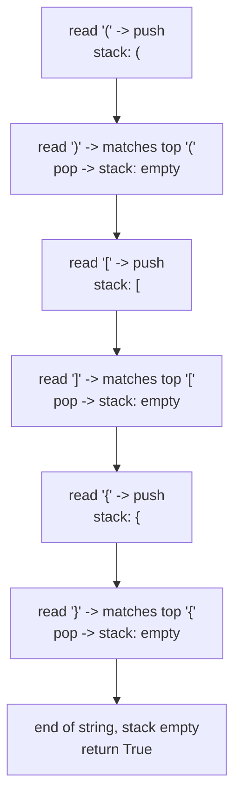

# 20. Valid Parentheses

**LeetCode:** https://leetcode.com/problems/valid-parentheses/

## Problem
Given a string made only of the bracket characters `(`, `)`, `{`, `}`, `[`, `]`, decide whether the brackets are balanced — every opening bracket has a matching closing bracket of the same type, closed in the correct order.

- **Input:** a string `s` consisting only of the six bracket characters.
- **Output:** a boolean — `True` if the brackets are validly matched and nested, else `False`.

**Examples**
1. `s = "()[]{}"` → `True`. Each pair opens and closes independently and in order.
2. `s = "(]"` → `False`. `(` is closed by `]`, which is the wrong bracket type.
3. `s = "([)]"` → `False`. The brackets overlap incorrectly — `(` opens, `[` opens, but then `)` tries to close before `[` is closed.

**Constraints:** `1 <= s.length <= 10^4`, `s` consists only of `()[]{}`.

> 🔑 **Pattern Recognition**
> Nested/matching structure where the *most recently opened* item must be the *first closed* → reach for a stack. Any "balanced brackets/tags" phrasing is the interview cue.

## Intuition (explained simply)

### 1. Brute Force
- Repeatedly scan the string looking for any adjacent matching pair like `()`, `[]`, or `{}`, and remove it, shrinking the string. Keep repeating until no more pairs can be removed. If the string becomes empty, it was valid.
- Correct because a valid bracket string can always be fully reduced to empty by repeatedly canceling innermost matched pairs.
- Time complexity: O(n²) — each removal pass scans up to n characters, and up to n/2 removals may be needed.  Space complexity: O(n) for building the shrunk string each pass.
- Simulating removal by literally shrinking the string over and over is wasteful — a stack gives us the same "cancel innermost pair" behavior in one linear pass.

### 2. Better
- Use a stack, but check matches with a chain of if/elif conditions written out by hand for each bracket type (`if char == ')' and stack and stack[-1] == '(': ...` etc.) instead of a lookup table. Push opening brackets; on a closing bracket, verify the top of the stack is its correct partner and pop it.
- Correct because a stack naturally captures "most recently opened, not yet closed" — exactly what needs to match a closing bracket.
- Time complexity: O(n) — one pass, O(1) stack operations per character.  Space complexity: O(n) for the stack in the worst case (all openers).
- Functionally equivalent to optimal, but the hardcoded if/elif chain is repetitive and harder to extend — a hash map is the idiomatic cleanup.

### 3. Optimal
- Same stack idea, but use a hash map from each closing bracket to its matching opening bracket. Push openers onto the stack. On a closer, check the stack isn't empty and its top equals `map[closer]`; if so pop, else the string is invalid. At the end, the string is valid only if the stack is empty (no unmatched openers left).
- This works because the stack's top is always the most recently opened, unclosed bracket — exactly the one that must match next — and the hash map makes the matching check a clean O(1) lookup.
- Time complexity: O(n) — single pass, O(1) work per character.  Space complexity: O(n) worst case (e.g., all opening brackets).
- Edge cases: odd-length strings (can never be valid, though the algorithm handles this naturally); a closing bracket with an empty stack (invalid — nothing to match); leftover openers at the end (invalid — never closed).

#### 🎯 Visual Walkthrough
Tracing `s = "()[]{}"` through the optimal algorithm:

## Complexity Summary
| Approach | Time | Space |
|---|---|---|
| Brute Force | O(n^2) | O(n) |
| Better | O(n) | O(n) |
| Optimal | O(n) | O(n) |
