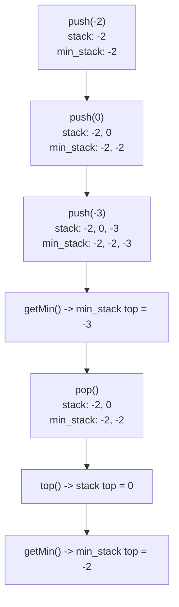

# 155. Min Stack

**LeetCode:** https://leetcode.com/problems/min-stack/

## Problem
Design a stack that supports the usual `push`, `pop`, and `top` operations, plus a `getMin` operation that returns the current minimum element in the stack — and all four operations must run in O(1) time.

- **Input:** a sequence of operations: `push(val)`, `pop()`, `top()`, `getMin()`.
- **Output:** for `top()` and `getMin()`, the corresponding value at that point in time.

**Examples**
1. `push(-2); push(0); push(-3); getMin() → -3; pop(); top() → 0; getMin() → -2`. After popping `-3`, the minimum reverts to `-2`.
2. `push(5); push(5); push(5); getMin() → 5; pop(); getMin() → 5`. Duplicate minimums must survive a single pop.
3. `push(1); push(2); getMin() → 1; push(0); getMin() → 0; pop(); getMin() → 1`. The min tracks the smallest value currently present, updating as elements are pushed and popped.

**Constraints:** up to `3 * 10^4` calls total to `push`, `pop`, `top`, `getMin`; `pop`, `top`, `getMin` are only called on a non-empty stack; values fit in a 32-bit signed integer.

> 🔑 **Pattern Recognition**
> "Design a stack that also answers X in O(1)" → keep a second, parallel stack that caches the running answer to X (here, the minimum) at every depth, so popping both together always restores the correct prior state.

## Intuition (explained simply)

### 1. Brute Force
- Use a plain list as the stack for `push`/`pop`/`top`. For `getMin()`, just scan the entire stack each time to find the smallest element.
- Correct because scanning always finds the true minimum of whatever is currently on the stack.
- Time complexity: `push`/`pop`/`top` O(1), but `getMin()` O(n).  Space complexity: O(n).
- The problem explicitly requires O(1) for *every* operation including `getMin`, so a linear scan fails the requirement even though it's "correct."

### 2. Better
- Keep a second stack (or sorted structure) that mirrors pushes/pops, but only insert into it when a new value would change the minimum, and use a small counter/flag to know when to also pop from it. Concretely: maintain a secondary stack of "running minimums," but only push to it if `val <= current_min` and only pop from it if the popped main-stack value equals the current min. This avoids growing the auxiliary stack unnecessarily, but requires an equality check with possible duplicate-handling caveats.
- Correct because we conditionally track only the values that could ever become the new minimum after some pops, though care is needed with `<=` vs `<` to correctly handle duplicate minimum values.
- Time complexity: O(1) per operation (amortized).  Space complexity: O(n) worst case, but typically less than the "push every min" approach.
- Works, but the conditional push/pop logic is fiddly and easy to get wrong with duplicates — the fully parallel min-stack (optimal) is simpler and equally efficient.

### 3. Optimal
- Maintain two stacks in lockstep: a normal `stack` for values, and a `min_stack` where `min_stack[i]` is always the minimum of `stack[0..i]`. On every `push(val)`, push `val` onto `stack` and push `min(val, min_stack[-1] if min_stack else val)` onto `min_stack`. On `pop()`, pop from both. `getMin()` is just `min_stack[-1]`.
- This works because `min_stack` at every depth stores "the minimum considering everything pushed up to and including this point," so popping the top of both stacks together automatically restores the correct previous minimum — no special-casing needed.
- Time complexity: O(1) for every operation — `push`, `pop`, `top`, `getMin`.  Space complexity: O(n) for the two parallel stacks (still linear, just simple and robust).
- Edge cases: pushing duplicate values (must not lose track of the min when one duplicate is popped); popping down to an empty stack; single-element stack (`getMin` and `top` return that element).

#### 🎯 Visual Walkthrough
Tracing example 1: `push(-2); push(0); push(-3); getMin(); pop(); top(); getMin()`

## Complexity Summary
| Approach | Time | Space |
|---|---|---|
| Brute Force | O(n) for getMin, O(1) others | O(n) |
| Better | O(1) amortized | O(n) |
| Optimal | O(1) all ops | O(n) |
