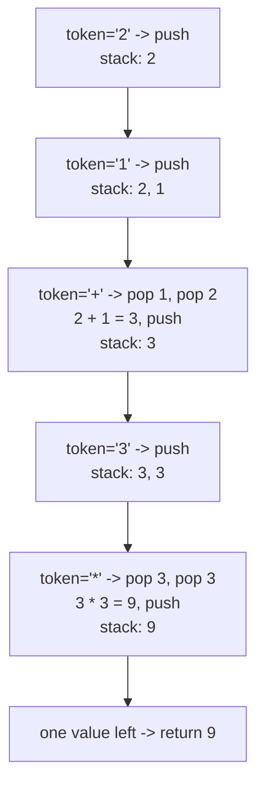

# 150. Evaluate Reverse Polish Notation

**LeetCode:** https://leetcode.com/problems/evaluate-reverse-polish-notation/

## Problem
You're given an arithmetic expression written in Reverse Polish Notation (postfix notation), as a list of tokens where each token is either an integer or an operator (`+`, `-`, `*`, `/`). Evaluate it and return the result.

- **Input:** a list of string tokens, e.g. `["2","1","+","3","*"]`.
- **Output:** an integer — the value of the evaluated expression.

**Examples**
1. `tokens = ["2","1","+","3","*"]` → `9`. This is `(2 + 1) * 3 = 9` — postfix notation puts the operator after its operands.
2. `tokens = ["4","13","5","/","+"]` → `6`. This is `4 + (13 / 5) = 4 + 2 = 6` (integer division truncates toward zero).
3. `tokens = ["10","6","9","3","+","-11","*","/","*","17","+","5","+"]` → `22`. A longer expression demonstrating nested postfix evaluation.

**Constraints:** `1 <= tokens.length <= 10^4`, each token is an integer in `[-200, 200]` or one of `+ - * /`; the expression is always valid and division truncates toward zero.

> 🔑 **Pattern Recognition**
> Postfix/RPN expressions are built specifically so that "the two most recent operands" are always exactly what the next operator needs → push numbers, and on an operator pop-pop-apply-push.

## Intuition (explained simply)

### 1. Brute Force
- Repeatedly scan the token list left to right looking for the *first* operator; apply it to the two numbers immediately preceding it, replace those three tokens with the result, and repeat the scan from the start until only one token remains.
- Correct because RPN guarantees that the first operator encountered always has exactly two ready operands immediately before it, so this simulates evaluation correctly, just inefficiently.
- Time complexity: O(n²) — each reduction is O(n) (rebuilding the list) and there are O(n) reductions.  Space complexity: O(n) for the list copies.
- Rebuilding the token list from scratch on every single operator application is wasteful — we don't need to search for the next operator each time if we process tokens in one linear pass with a stack.

### 2. Better
- Use a stack, but store operands as strings and convert with `int()` at the moment of applying an operator, and implement division without deliberately truncating toward zero first (e.g. plain `/` giving a float, then casting) — this is functionally close to optimal but does extra type juggling and float conversion instead of doing integer truncation directly.
- Correct because a stack naturally provides "the two most recent operands," which is exactly what a postfix operator consumes.
- Time complexity: O(n) — one pass, O(1) work per token.  Space complexity: O(n) for the stack.
- Nearly optimal already; the main cleanup left is handling truncating (Python's `//` rounds toward negative infinity, not zero) correctly and directly with integers instead of going through floats.

### 3. Optimal
- Use a single stack. Walk through tokens once: if a token is a number, push it (as an int). If it's an operator, pop the top two values (`b` then `a`, since `b` was pushed most recently), apply the operator as `a OP b`, and push the result back. At the end, the stack holds exactly one value — the answer.
- This works because postfix notation is defined precisely so that a stack-based left-to-right scan always has the correct two operands on top exactly when an operator is seen — no lookahead or parsing needed.
- Time complexity: O(n) — single pass, O(1) per token.  Space complexity: O(n) for the stack (numbers only, since operators consume and don't grow it).
- Edge cases: division must truncate toward zero, not floor (e.g. `-7 / 2` should be `-3`, not `-4`, so use `int(a / b)` rather than `a // b`); negative numbers as standalone tokens (e.g. `"-11"`) must be parsed as integers correctly, not mistaken for operators.

#### 🎯 Visual Walkthrough
Tracing `tokens = ["2","1","+","3","*"]` (which is `(2 + 1) * 3 = 9`):

## Complexity Summary
| Approach | Time | Space |
|---|---|---|
| Brute Force | O(n^2) | O(n) |
| Better | O(n) | O(n) |
| Optimal | O(n) | O(n) |
