# 739. Daily Temperatures

**LeetCode:** https://leetcode.com/problems/daily-temperatures/

## Problem
Given a list of daily temperatures, for each day find how many days you'd have to wait until a strictly warmer day comes along. If no warmer day ever comes, the answer for that day is 0.

- **Input:** an integer array `temperatures`.
- **Output:** an integer array `answer` of the same length, where `answer[i]` is the number of days after day `i` until a warmer temperature, or `0` if none exists.

**Examples**
1. `temperatures = [73,74,75,71,69,72,76,73]` → `[1,1,4,2,1,1,0,0]`. Day 0 (73) waits 1 day for 74; day 2 (75) waits 4 days for 76.
2. `temperatures = [30,40,50,60]` → `[1,1,1,0]`. Strictly increasing, so each day (except the last) waits exactly 1 day.
3. `temperatures = [30,60,90]` → `[1,1,0]`. Every day has an immediate warmer next day except the last, which has none.

**Constraints:** `1 <= temperatures.length <= 10^5`, `30 <= temperatures[i] <= 100`.

> 🔑 **Pattern Recognition**
> "Next greater/warmer element" for every position → monotonic stack. Keep indices whose answer is still unknown on the stack, and resolve them the moment a bigger value shows up.

## Intuition (explained simply)

### 1. Brute Force
- For each day, scan forward day by day until you find a strictly warmer temperature, and record the distance. If none found, record 0.
- Correct because it directly implements the definition — "days until the next warmer day" found by linear search.
- Time complexity: O(n²) — for each of n days, a scan of up to n more days.  Space complexity: O(1) extra (excluding output).
- With `n` up to 100,000, the quadratic scan is far too slow (up to 10^10 comparisons).

### 2. Better
- Since temperatures are bounded to a small range (30-100), for each day look up, among the *next warmer possible temperatures* (71 to 100 above the current day's value), the closest day where that value occurs at or after the current index — precomputed with, e.g., a sorted list of indices per temperature value. This trades the O(n) inner scan for an O(range) lookup using binary search over precomputed per-value index lists.
- Correct because scanning only the finite set of possible warmer temperature values (at most ~70 of them) and finding the nearest occurrence still finds the true nearest warmer day.
- Time complexity: O(n · R log n) where R ≈ 70 is the temperature range — much better than O(n²) for large n, but still not linear.  Space complexity: O(n) for the per-value index lists.
- This exploits a special constraint (small value range) rather than the general structural insight — a monotonic stack solves it in true linear time regardless of value range.

### 3. Optimal
- Use a monotonic stack of *indices* whose temperatures are in decreasing order. Walk through the days once: while the stack is non-empty and the current day's temperature is strictly greater than the temperature at the index on top of the stack, pop that index and set its answer to `current_index - popped_index`. Then push the current index.
- This works because the stack holds "days still waiting for a warmer day," and the moment a strictly warmer day appears, we can resolve every waiting day whose temperature it beats, all in one pass — each index is pushed once and popped once.
- Time complexity: O(n) — each index enters and leaves the stack exactly once.  Space complexity: O(n) for the stack in the worst case (strictly decreasing temperatures).
- Edge cases: all temperatures identical (no strictly warmer day, all answers 0); strictly decreasing sequence (all answers 0); the last day always gets 0 by definition.

#### 🎯 Visual Walkthrough
Tracing the first few days of `temperatures = [73,74,75,71,69,72,76,73]`:

```mermaid
flowchart TD
    A["day0=73 -> push<br/>stack(idx): &#91;0&#93;"] --> B["day1=74 > 73<br/>pop 0, answer&#91;0&#93;=1-0=1<br/>push 1 -> stack: &#91;1&#93;"]
    B --> C["day2=75 > 74<br/>pop 1, answer&#91;1&#93;=2-1=1<br/>push 2 -> stack: &#91;2&#93;"]
    C --> D["day3=71 < 75 -> push<br/>stack: &#91;2,3&#93;"]
    D --> E["day4=69 < 71 -> push<br/>stack: &#91;2,3,4&#93;"]
    E --> F["day5=72 > 69,71<br/>pop 4, answer&#91;4&#93;=5-4=1<br/>pop 3, answer&#91;3&#93;=5-3=2<br/>push 5 -> stack: &#91;2,5&#93;"]
    F --> G["day6=76 > 72,75<br/>pop 5, answer&#91;5&#93;=6-5=1<br/>pop 2, answer&#91;2&#93;=6-2=4<br/>push 6 -> stack: &#91;6&#93;"]
```

## Complexity Summary
| Approach | Time | Space |
|---|---|---|
| Brute Force | O(n^2) | O(1) |
| Better | O(n · R log n) | O(n) |
| Optimal | O(n) | O(n) |
