# 853. Car Fleet

**LeetCode:** https://leetcode.com/problems/car-fleet/

## Problem
Several cars drive along a one-lane road toward the same destination (position `target`). Each car has a starting position and a speed. A faster car that catches up to a slower car ahead of it must slow down to match its speed, and the two travel together as one "fleet" from then on (a car can never pass another). Count how many distinct fleets arrive at the destination.

- **Input:** an integer `target` (the destination position), and arrays `position` and `speed` where `position[i]`/`speed[i]` describe car `i` (positions are all distinct, and less than `target`).
- **Output:** an integer — the number of car fleets that arrive at `target`.

**Examples**
1. `target = 12, position = [10,8,0,5,3], speed = [2,4,1,1,3]` → `3`. The car at 10 and the car at 8 merge into one fleet (8 catches up to 10); the cars at 0, 5, 3 also interact, giving 3 fleets total.
2. `target = 10, position = [3], speed = [3]` → `1`. A single car is trivially its own fleet.
3. `target = 100, position = [0,2,4], speed = [4,2,1]` → `1`. The car at 0 (speed 4) catches both cars ahead of it before reaching the target, and they all merge into a single fleet.

**Constraints:** `n == position.length == speed.length`, `1 <= n <= 10^5`, `0 < target <= 10^6`, `0 <= position[i] < target`, all `position[i]` are unique, `0 < speed[i] <= 10^6`.

> 🔑 **Pattern Recognition**
> Sort by position, then process front-to-back keeping a stack of "confirmed fleet arrival times" — a car that can't beat the time on top of the stack must merge into it. Sort + stack is the signature combo whenever later elements can only be "blocked" by earlier ones.

## Intuition (explained simply)

### 1. Brute Force
- For every pair of cars, compute the time each car alone would take to reach `target` (`(target - position) / speed`). A car catches up to (and merges with) the car ahead of it if its arrival time would otherwise be *less* than the arrival time of every car ahead of it that it would pass. Simulate by repeatedly checking all pairs and merging until no more merges happen.
- Correct in principle because it directly checks the "would this car pass a car ahead" condition, which is exactly what causes a merge.
- Time complexity: O(n²) or worse if merges are repeated until a fixed point — pairwise comparisons across possibly multiple rounds.  Space complexity: O(n).
- With `n` up to 100,000, any pairwise approach is too slow, and the repeated-merging simulation is also messy to implement correctly.

### 2. Better
- Sort cars by starting position (descending, since a car can only be blocked by cars *ahead* of it, i.e. closer to `target`). Compute each car's solo arrival time `(target - position) / speed`. Then scan from the car closest to `target` backward: keep a running "current fleet's arrival time" — if the next car (further back) has a solo arrival time **less than or equal to** the current fleet's arrival time, it catches up and joins that fleet (doesn't increase the fleet count); otherwise it forms a new fleet and becomes the new "current" arrival time to compare against.
- Correct because once cars are ordered by position, a car only ever needs to compare itself to the nearest fleet ahead of it — if it wouldn't catch that one, it can't catch any fleet further ahead either (since that fleet is already moving even slower effectively, i.e. taking at least as long).
- Time complexity: O(n log n) — dominated by the sort.  Space complexity: O(n) for storing (position, speed) pairs and arrival times.
- This is essentially the optimal approach already; the version below just frames it explicitly as a monotonic stack of arrival times for clarity and to formalize the fleet-counting logic.

### 3. Optimal
- Sort cars by position descending. Walk through them in that order (nearest to `target` first) using a stack that holds the arrival times of confirmed fleets. For each car, compute its solo arrival time; if it's **greater** than the time on top of the stack, it can never catch up to the fleet ahead, so push its own time as a new fleet. Otherwise, it merges into the fleet ahead (its time is discarded, the stack top is unchanged). The final stack size is the number of fleets.
- This works because sorting by position guarantees we always process cars in the order they'd encounter each other, and the stack keeps exactly one "arrival time to catch" per fleet formed so far — a smaller-or-equal arrival time can never break away from the fleet ahead of it (it can't overtake), so it merges by definition.
- Time complexity: O(n log n) — the sort dominates; the single pass afterward is O(n).  Space complexity: O(n) for the sorted pairs and the stack.
- Edge cases: a single car (always 1 fleet); all cars with equal arrival time (all merge into one fleet, since equal-or-slower means "catches up exactly at the target"); cars already sorted or in reverse order.

#### 🎯 Visual Walkthrough
Tracing example 1: `target=12, position=[10,8,0,5,3], speed=[2,4,1,1,3]`, sorted by position descending: `(10,2), (8,4), (5,1), (3,3), (0,1)` with solo arrival times `1.0, 1.0, 7.0, 3.0, 12.0`:

```mermaid
flowchart TD
    A["car(pos=10) time=1.0<br/>stack empty -> push<br/>stack: &#91;1.0&#93;"] --> B["car(pos=8) time=1.0<br/>1.0 <= top 1.0 -> merges<br/>stack: &#91;1.0&#93;"]
    B --> C["car(pos=5) time=7.0<br/>7.0 > top 1.0 -> push<br/>stack: &#91;1.0, 7.0&#93;"]
    C --> D["car(pos=3) time=3.0<br/>3.0 <= top 7.0 -> merges<br/>stack: &#91;1.0, 7.0&#93;"]
    D --> E["car(pos=0) time=12.0<br/>12.0 > top 7.0 -> push<br/>stack: &#91;1.0, 7.0, 12.0&#93;"]
    E --> F["final stack size = 3 -> 3 fleets"]
```

## Complexity Summary
| Approach | Time | Space |
|---|---|---|
| Brute Force | O(n^2) | O(n) |
| Better | O(n log n) | O(n) |
| Optimal | O(n log n) | O(n) |
