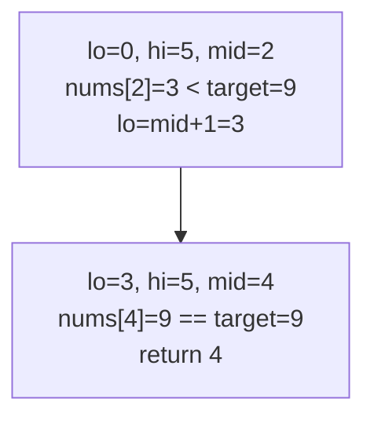

# 704. Binary Search

**LeetCode:** https://leetcode.com/problems/binary-search/

## Problem
Given a sorted (ascending) array of distinct integers and a target value, find the index of the target in the array, or -1 if it isn't present.

- **Input:** a sorted integer array `nums` and an integer `target`.
- **Output:** the index of `target` in `nums`, or `-1` if not found.

**Examples**
1. `nums = [-1,0,3,5,9,12], target = 9` → `4`. `nums[4] == 9`.
2. `nums = [-1,0,3,5,9,12], target = 2` → `-1`. `2` doesn't appear anywhere in the array.
3. `nums = [5], target = 5` → `0`. Single-element array containing exactly the target.

**Constraints:** `1 <= nums.length <= 10^4`, `-10^4 < nums[i], target < 10^4`, all `nums[i]` are unique and sorted ascending.

> 🔑 **Pattern Recognition**
> Sorted array + "find a target" → binary search. Comparing the midpoint to the target always tells you which half to discard, so you never need to touch every element.

## Intuition (explained simply)

### 1. Brute Force
- Scan the array left to right, comparing each element to the target, and return the index the moment it matches.
- Correct because it directly checks every element until it finds a match (or exhausts the array).
- Time complexity: O(n)  Space complexity: O(1)
- It doesn't use the fact that the array is *sorted* at all — a huge missed opportunity, and the problem explicitly expects a faster-than-linear solution.

### 2. Better
- Still binary search, but implemented recursively without carefully avoiding overflow-style midpoint bugs (not a real issue in Python, but conceptually worth calling out) and using `(low + high) // 2`. Recursion re-derives the same halving idea as the optimal iterative version, just with function-call overhead and O(log n) extra stack space instead of true O(1) space.
- Correct because each recursive call eliminates exactly half of the remaining search space by comparing the target to the middle element.
- Time complexity: O(log n)  Space complexity: O(log n) due to the recursion call stack.
- Functionally equivalent to the optimal solution, but the recursion stack costs extra space that an iterative loop avoids entirely.

### 3. Optimal
- Use an iterative two-pointer binary search: maintain `low` and `high` bounds, repeatedly compute `mid`, and compare `nums[mid]` to `target`. If equal, return `mid`. If `nums[mid] < target`, the target must be in the right half, so move `low = mid + 1`. If `nums[mid] > target`, move `high = mid - 1`. Stop when `low > high` (search space exhausted) and return -1.
- This works because the array is sorted, so comparing against the midpoint always tells us unambiguously which half the target could be in, letting us discard half the remaining elements every step.
- Time complexity: O(log n)  Space complexity: O(1)
- Edge cases: single-element array; target smaller than everything (`low` immediately exceeds `high`); target larger than everything; target equal to the first or last element (boundary correctness of `low`/`high` updates).

#### 🎯 Visual Walkthrough
Tracing `nums = [-1,0,3,5,9,12], target = 9`:

## Complexity Summary
| Approach | Time | Space |
|---|---|---|
| Brute Force | O(n) | O(1) |
| Better | O(log n) | O(log n) |
| Optimal | O(log n) | O(1) |
