# 74. Search a 2D Matrix

**LeetCode:** https://leetcode.com/problems/search-a-2d-matrix/

## Problem
You have an `m x n` matrix where each row is sorted ascending, and the first element of each row is greater than the last element of the previous row (so the whole matrix, read row by row, is one continuous sorted sequence). Determine whether a target value exists in the matrix.

- **Input:** a 2D integer array `matrix` with the properties above, and an integer `target`.
- **Output:** a boolean — `True` if `target` is found anywhere in the matrix, else `False`.

**Examples**
1. `matrix = [[1,3,5,7],[10,11,16,20],[23,30,34,60]], target = 3` → `True`. `3` is at row 0, column 1.
2. `matrix = [[1,3,5,7],[10,11,16,20],[23,30,34,60]], target = 13` → `False`. `13` falls between `11` and `16` but doesn't actually appear.
3. `matrix = [[1]], target = 1` → `True`. Single-cell matrix containing exactly the target.

**Constraints:** `m == matrix.length`, `n == matrix[i].length`, `1 <= m, n <= 100`, `-10^4 <= matrix[i][j], target <= 10^4`.

> 🔑 **Pattern Recognition**
> A 2D grid that's sorted row-by-row *and* row-to-row → it's really one sorted 1D array in disguise. Map a virtual index `k` to `matrix[k // n][k % n]` and binary search normally.

## Intuition (explained simply)

### 1. Brute Force
- Scan every cell of the matrix, row by row, column by column, checking for a match.
- Correct because it directly checks every element in the matrix.
- Time complexity: O(m · n)  Space complexity: O(1)
- Ignores the strong sorted structure entirely (both row-sorted *and* row-to-row sorted) — the problem is set up specifically to reward a search faster than linear.

### 2. Better
- First binary search across the rows to find the one row whose value range could contain the target (compare target against each row's first/last element), then do a linear scan across that row.
- Correct because the "first element of a row > last element of the previous row" property means at most one row's range can contain the target, and binary search finds that row quickly.
- Time complexity: O(log m + n) — O(log m) to find the candidate row, O(n) to scan it.  Space complexity: O(1)
- Scanning the found row linearly still wastes the fact that the row itself is sorted — a second binary search closes the gap to full logarithmic time.

### 3. Optimal
- Treat the entire `m x n` matrix as one virtual sorted 1D array of length `m * n` (since reading row-by-row produces a fully sorted sequence), and binary search directly over that virtual array using index math: for a virtual index `k`, the real cell is `matrix[k // n][k % n]`.
- This works because the matrix's row-major layout is provably a single sorted sequence, so a normal binary search's halving logic applies without ever materializing the 1D array — we just translate indices on the fly.
- Time complexity: O(log(m · n))  Space complexity: O(1)
- Edge cases: single row or single column matrix; target smaller than the minimum or larger than the maximum element; empty matrix (guard against `m == 0` or `n == 0`).

#### 🎯 Visual Walkthrough
Tracing `matrix = [[1,3,5,7],[10,11,16,20],[23,30,34,60]], target = 3` (virtual array of length `m*n=12`):

```mermaid
flowchart TD
    A["lo=0, hi=11, mid=5<br/>matrix&#91;5//4&#93;&#91;5%4&#93;=matrix&#91;1&#93;&#91;1&#93;=11 > 3<br/>hi=mid-1=4"] --> B["lo=0, hi=4, mid=2<br/>matrix&#91;2//4&#93;&#91;2%4&#93;=matrix&#91;0&#93;&#91;2&#93;=5 > 3<br/>hi=mid-1=1"]
    B --> C["lo=0, hi=1, mid=0<br/>matrix&#91;0&#93;&#91;0&#93;=1 < 3<br/>lo=mid+1=1"]
    C --> D["lo=1, hi=1, mid=1<br/>matrix&#91;0&#93;&#91;1&#93;=3 == target<br/>return True"]
```

## Complexity Summary
| Approach | Time | Space |
|---|---|---|
| Brute Force | O(m · n) | O(1) |
| Better | O(log m + n) | O(1) |
| Optimal | O(log(m · n)) | O(1) |
