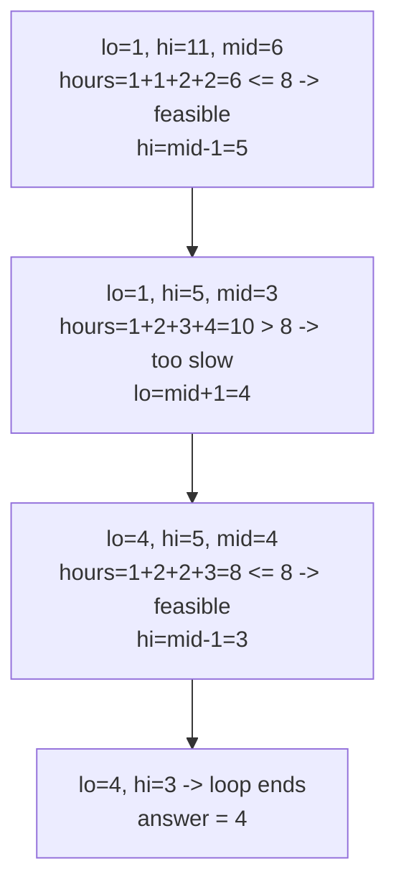

# 875. Koko Eating Bananas

**LeetCode:** https://leetcode.com/problems/koko-eating-bananas/

## Problem
Koko has `n` piles of bananas and `h` hours before the guards return. Each hour she picks one pile and eats up to `k` bananas from it (if the pile has fewer than `k`, she finishes that pile and the hour is still used up — she doesn't move to another pile in the same hour). Find the minimum integer eating speed `k` such that she can finish all piles within `h` hours.

- **Input:** an integer array `piles` (bananas in each pile) and an integer `h` (hours available).
- **Output:** the minimum integer `k` (bananas per hour) that lets Koko finish everything in `h` hours or less.

**Examples**
1. `piles = [3,6,7,11], h = 8` → `4`. At speed 4: hours needed = ceil(3/4)+ceil(6/4)+ceil(7/4)+ceil(11/4) = 1+2+2+3 = 8, exactly fits.
2. `piles = [30,11,23,4,20], h = 5` → `30`. With only 5 hours for 5 piles, she must finish each pile in exactly one hour, so speed must be at least the largest pile.
3. `piles = [30,11,23,4,20], h = 6` → `23`. One extra hour lets her split the largest pile (30) across two hours at speed 23 (ceil(30/23)=2), while all others still take 1 hour each.

**Constraints:** `1 <= piles.length <= 10^4`, `piles.length <= h <= 10^9`, `1 <= piles[i] <= 10^9`.

> 🔑 **Pattern Recognition**
> "Find the minimum/maximum value that satisfies a feasibility check, where feasibility is monotonic" → binary search *on the answer*, not on the input array. Whenever "can we do it at speed/capacity k?" flips from false to true exactly once as k grows, this pattern applies.

## Intuition (explained simply)

### 1. Brute Force
- Try every possible eating speed starting from `k = 1` upward. For each speed, compute the total hours needed (summing `ceil(pile / k)` for every pile) and stop at the first `k` where the total hours fits within `h`.
- Correct because we're checking every candidate speed in increasing order and taking the first one that works, which is by definition the minimum.
- Time complexity: O(max(piles) · n) — up to `10^9` candidate speeds, each requiring an O(n) hour-count.  Space complexity: O(1)
- With pile sizes up to `10^9`, trying every speed one at a time is astronomically slow.

### 2. Better
- Narrow the search range first: the answer must be between `1` and `max(piles)` (eating faster than the largest pile is never necessary — one pile can only take 1 hour at that speed). Then use linear scan within that bounded range instead of starting from 1 — practically the same as brute force but framed with a bound; the real improvement worth noting for interviews is realizing this range is exactly what makes **binary search** applicable, since "hours needed" decreases monotonically as speed increases (a key property to name explicitly before writing the binary search).
- Correct because the monotonic relationship (higher speed → fewer or equal hours needed) guarantees that once we identify the range `[1, max(piles)]`, a threshold speed splits it into "too slow" (needs > h hours) and "fast enough" (needs <= h hours) — a classic setup for binary search.
- Time complexity: still O(max(piles) · n) if implemented as a bounded linear scan.  Space complexity: O(1)
- This step is really about recognizing *why* binary search applies (monotonicity) before implementing it — the actual speed-up comes next.

### 3. Optimal
- Binary search over the *answer* (the eating speed `k`) rather than over the input array. Search `low = 1` to `high = max(piles)`. For each candidate `mid` speed, compute total hours needed; if it's `<= h`, this speed works, so try to go slower (`high = mid - 1`, but remember `mid` as a possibly-valid answer); if it's `> h`, this speed is too slow, so `low = mid + 1`. The smallest feasible speed found is the answer.
- This works because "can Koko finish in `h` hours at speed `k`" is a monotonic yes/no function of `k` — once true, it stays true for all faster speeds — which is exactly the condition binary search needs to find the boundary between "no" and "yes."
- Time complexity: O(n · log(max(piles))) — O(log(max(piles))) binary search steps, each doing an O(n) hour-count.  Space complexity: O(1)
- Edge cases: `h == len(piles)` (forces `k = max(piles)`, one pile per hour exactly); a single pile (`k` must at least clear it within `h` hours, i.e. `k = ceil(pile / h)`); make sure `ceil` division is computed correctly (`(pile + k - 1) // k`, not integer floor division).

#### 🎯 Visual Walkthrough
Tracing `piles = [3,6,7,11], h = 8` over the speed range `[1, 11]`:

## Complexity Summary
| Approach | Time | Space |
|---|---|---|
| Brute Force | O(max(piles) · n) | O(1) |
| Better | O(max(piles) · n) (bounded) | O(1) |
| Optimal | O(n · log(max(piles))) | O(1) |
