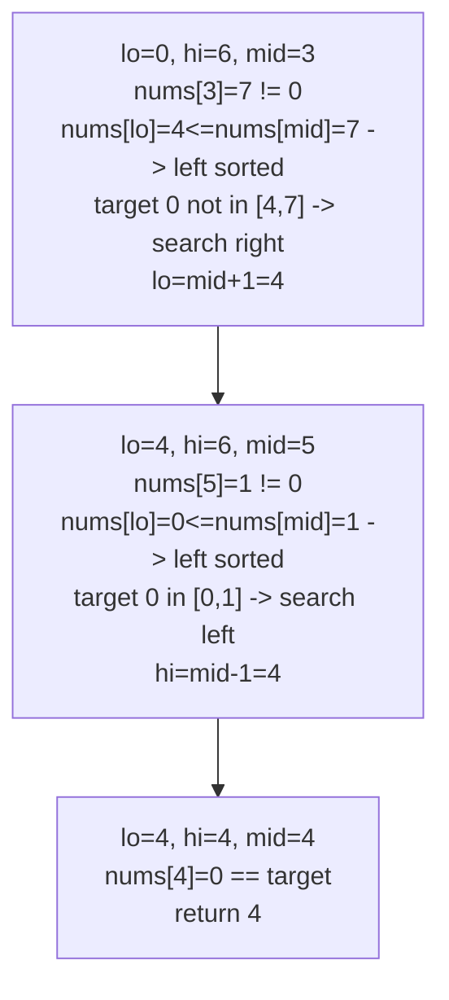

# 33. Search in Rotated Sorted Array

**LeetCode:** https://leetcode.com/problems/search-in-rotated-sorted-array/

## Problem
An array that was originally sorted ascending with all-distinct values has been "rotated" at some unknown pivot (e.g. `[0,1,2,4,5,6,7]` becomes `[4,5,6,7,0,1,2]`). Given the rotated array and a target, find the target's index, or -1 if it's not present — in O(log n) time.

- **Input:** a rotated sorted array `nums` (distinct integers) and an integer `target`.
- **Output:** the index of `target` in `nums`, or `-1` if not found.

**Examples**
1. `nums = [4,5,6,7,0,1,2], target = 0` → `4`. The rotation point is between index 3 (value 7) and index 4 (value 0).
2. `nums = [4,5,6,7,0,1,2], target = 3` → `-1`. `3` was never in the original array.
3. `nums = [1], target = 0` → `-1`. Single-element array not containing the target.

**Constraints:** `1 <= nums.length <= 5000`, `-10^4 <= nums[i] <= 10^4`, all values unique, `nums` is a rotated version of an ascending sorted array.

> 🔑 **Pattern Recognition**
> Sorted array + rotated at an unknown pivot + O(log n) target search → at every midpoint, at least one half is still genuinely sorted, so decide which half is sorted first, then check if the target lies in it.

## Intuition (explained simply)

### 1. Brute Force
- Scan the array left to right and compare each element to the target.
- Correct because it checks every element directly, regardless of rotation.
- Time complexity: O(n)  Space complexity: O(1)
- Doesn't use the sorted-then-rotated structure at all, so it can't reach the O(log n) requirement the problem is testing for.

### 2. Better
- First find the rotation pivot (the index of the minimum element) using a dedicated binary search, which tells you which sub-range `[0, pivot-1]` and `[pivot, n-1]` is fully sorted. Then decide which of the two ranges could contain the target (compare target to the boundary values) and run a *second*, ordinary binary search restricted to that sorted sub-range.
- Correct because after locating the pivot, each half is a genuinely sorted array, so a plain binary search on the correct half works.
- Time complexity: O(log n) — one O(log n) search for the pivot, one O(log n) search within a half.  Space complexity: O(1)
- Works and is O(log n) overall, but requires two separate binary search passes and extra bookkeeping to decide which half to search — it can be done in a single pass.

### 3. Optimal
- Do a single binary search, but at each step first determine which half (`low..mid` or `mid..high`) is currently sorted by comparing `nums[low]` and `nums[mid]`. If the left half is sorted and the target falls within `nums[low]..nums[mid]`, search left; otherwise search right. If the right half is sorted instead, apply the mirrored logic. This handles the rotation implicitly without ever needing to explicitly locate the pivot.
- This works because in any rotated sorted array, at least one of the two halves around any midpoint is always a normal, fully sorted, contiguous range — so we can always tell which half to safely discard.
- Time complexity: O(log n) — a single binary search pass.  Space complexity: O(1)
- Edge cases: array with no rotation at all (still works, since one "half" is trivially the whole sorted array); single-element array; target equal to `nums[mid]` at the very first comparison; target equal to the pivot value itself.

#### 🎯 Visual Walkthrough
Tracing `nums = [4,5,6,7,0,1,2], target = 0`:

## Complexity Summary
| Approach | Time | Space |
|---|---|---|
| Brute Force | O(n) | O(1) |
| Better | O(log n) (two passes) | O(1) |
| Optimal | O(log n) (one pass) | O(1) |
