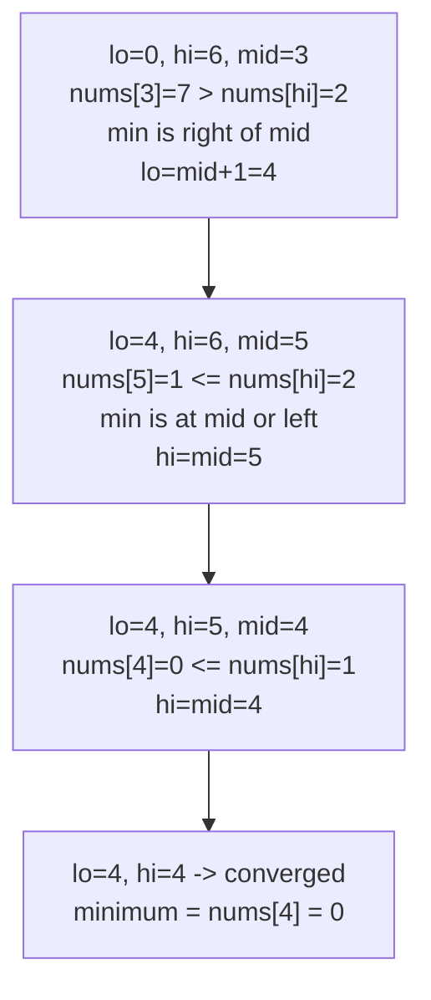

# 153. Find Minimum in Rotated Sorted Array

**LeetCode:** https://leetcode.com/problems/find-minimum-in-rotated-sorted-array/

## Problem
An array of distinct integers, originally sorted ascending, has been rotated at some unknown pivot. Find the minimum element, in O(log n) time.

- **Input:** a rotated sorted array `nums` with all distinct values.
- **Output:** an integer — the smallest value in `nums`.

**Examples**
1. `nums = [3,4,5,1,2]` → `1`. The array was rotated so the smallest value, originally at index 0, is now at index 3.
2. `nums = [4,5,6,7,0,1,2]` → `0`. The rotation point sits between `7` and `0`.
3. `nums = [11,13,15,17]` → `11`. No effective rotation (or rotated by a full cycle) — the array is already in ascending order, so the first element is the minimum.

**Constraints:** `1 <= nums.length <= 5000`, `-5000 <= nums[i] <= 5000`, all values unique, `nums` is a rotated version of an ascending sorted array.

> 🔑 **Pattern Recognition**
> Rotated sorted array + "find the rotation point" → compare `nums[mid]` to `nums[high]` to tell which side the discontinuity is on, then shrink toward it. No special-casing "no rotation" needed.

## Intuition (explained simply)

### 1. Brute Force
- Scan the entire array and track the smallest value seen.
- Correct because it's the direct definition of "find the minimum."
- Time complexity: O(n)  Space complexity: O(1)
- Completely ignores the sorted-and-rotated structure, so it can't meet the O(log n) requirement being tested.

### 2. Better
- Since the minimum is exactly the "rotation point," and everything before it is `>= nums[0]` while everything from the rotation point onward is `< nums[0]`, binary search for the first index where `nums[i] < nums[0]` using a manual boundary search (comparing each candidate against `nums[0]` explicitly) rather than the tighter comparison-with-neighbors trick used in the optimal version.
- Correct because the array splits into two monotonic zones relative to `nums[0]`, and binary search can find the boundary between them.
- Time complexity: O(log n)  Space complexity: O(1)
- Works, but comparing against the fixed `nums[0]` requires special-casing when there's no rotation at all (the "less than nums[0]" zone might be empty) — the optimal version's `nums[mid]` vs. `nums[high]` comparison avoids this special case entirely.

### 3. Optimal
- Binary search comparing `nums[mid]` to `nums[high]`: if `nums[mid] > nums[high]`, the minimum must be strictly to the right of `mid` (the array is "still descending" through the rotation point on this side), so `low = mid + 1`. Otherwise (`nums[mid] <= nums[high]`), the right half from `mid` to `high` is already sorted, so the minimum is at `mid` or to its left, so `high = mid` (not `mid - 1`, since `mid` itself could be the answer). Stop when `low == high` — that index holds the minimum.
- This works because comparing the midpoint to the *right* boundary (rather than the left) cleanly tells us which side the rotation discontinuity is on, without needing any special case for "no rotation" — a sorted array just always takes the `high = mid` branch and converges to index 0.
- Time complexity: O(log n)  Space complexity: O(1)
- Edge cases: no rotation at all (fully sorted array — minimum is `nums[0]`); rotation by exactly `n` (equivalent to no rotation); single-element array (trivially the minimum, loop doesn't execute).

#### 🎯 Visual Walkthrough
Tracing `nums = [4,5,6,7,0,1,2]`:

## Complexity Summary
| Approach | Time | Space |
|---|---|---|
| Brute Force | O(n) | O(1) |
| Better | O(log n) | O(1) |
| Optimal | O(log n) | O(1) |
