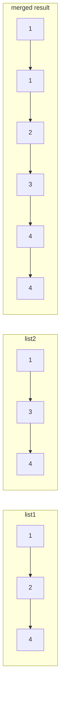

# 21. Merge Two Sorted Lists

**LeetCode:** https://leetcode.com/problems/merge-two-sorted-lists/

## Problem
You're given the heads of two singly linked lists, `list1` and `list2`, where each
list's values are already sorted in non-decreasing order. Merge them into a single
sorted linked list by splicing the existing nodes together, and return its head.

**Input:** two sorted linked list heads
**Output:** one merged sorted linked list head

**Examples**
1. `list1 = 1 -> 2 -> 4`, `list2 = 1 -> 3 -> 4` → `1 -> 1 -> 2 -> 3 -> 4 -> 4`. At each
   step we pick the smaller of the two current front nodes.
2. `list1 = []`, `list2 = []` → `[]`. Merging two empty lists gives an empty list.
3. `list1 = []`, `list2 = [0]` → `[0]`. When one list is empty, the answer is just the
   other list.

**Constraints:** total nodes across both lists in `[0, 50]`, `-100 <= Node.val <= 100`,
both lists sorted in non-decreasing order.

> 🔑 **Pattern Recognition**
> Two already-sorted sequences that need to become one sorted sequence → the classic merge-sort merge step: a dummy head + tail pointer, always splicing on whichever front node is smaller.

## Intuition (explained simply)
Both lists are already sorted, like two sorted piles of cards. To merge them into one
sorted pile, repeatedly look at the top card of each pile and take whichever is
smaller. This is exactly the "merge" step of merge sort, just applied to linked lists
instead of arrays.

### 1. Brute Force
- Walk both lists, collect every value into one array, sort that array, then rebuild
  a brand-new linked list from the sorted array.
- Correct because sorting any collection of numbers puts them in order regardless of
  where they came from, but it throws away the fact that the inputs were *already*
  sorted.
- Time complexity: O((m+n) log(m+n))  Space complexity: O(m+n)
- Why it's not good enough: it ignores the pre-sorted structure entirely and does more
  work (and more memory) than necessary — an interviewer wants you to exploit that
  both lists are sorted.

### 2. Better
- Still collect all values into one array, but since both source lists are already
  sorted, use a linear merge (two-pointer walk over the two arrays) instead of a full
  sort. Then rebuild new nodes from the merged array.
- Time complexity: O(m+n)  Space complexity: O(m+n) (extra array + new nodes)
- Still suboptimal: we're allocating brand new nodes and an intermediate array when we
  could just re-wire the existing nodes in place.

### 3. Optimal
- Use a dummy head node and a `tail` pointer. Compare the current front nodes of
  `list1` and `list2`; splice whichever is smaller onto `tail.next`, then advance both
  `tail` and the pointer of the list we took from. When one list runs out, attach the
  remainder of the other list directly (it's already sorted) — no need to walk it
  node by node.
- Why it works: at every step the smallest remaining value is always at the front of
  one of the two lists (since both are sorted), so greedily picking it builds the
  overall sorted order.
- A clean recursive version does the same thing: `merge(l1, l2)` picks the smaller
  head and recurses on the rest — equally optimal in time, but uses O(m+n) call-stack
  space instead of O(1).
- Time complexity: O(m+n)  Space complexity: O(1) iterative (O(m+n) recursion stack
  if done recursively)
- Edge cases: one or both lists empty, lists of very different lengths, duplicate
  values across lists (either order is acceptable since it's stable either way).

#### 🎯 Visual Walkthrough
Tracing `list1 = 1 -> 2 -> 4`, `list2 = 1 -> 3 -> 4`:

At each step the smaller of the two current fronts is spliced onto the result's tail: `list1` head `1` ties with `list2` head `1` (either can go first), then `2` (from list1) beats `3` (from list2), then `3` beats `4`, and finally both remaining `4`s are appended.

## Complexity Summary
| Approach | Time | Space |
|---|---|---|
| Brute Force | O((m+n) log(m+n)) | O(m+n) |
| Better | O(m+n) | O(m+n) |
| Optimal | O(m+n) | O(1) |
