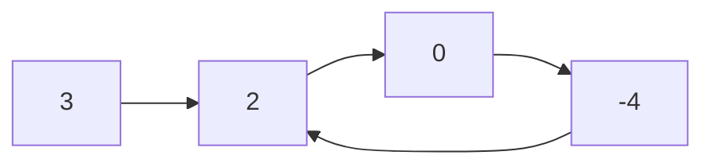

# 141. Linked List Cycle

**LeetCode:** https://leetcode.com/problems/linked-list-cycle/

## Problem
Given the head of a singly linked list, determine whether the list contains a cycle —
that is, whether some node's `next` pointer eventually loops back to a node earlier in
the list instead of ending at `None`.

**Input:** head of a linked list (a cycle, if present, is formed by a node pointing
back into the list rather than to `None`)
**Output:** `True` if a cycle exists, `False` otherwise

**Examples**
1. `3 -> 2 -> 0 -> -4`, and `-4` points back to `2` → `True`. Following the pointers
   forever revisits `2, 0, -4, 2, 0, -4, ...` and never reaches `None`.
2. `1 -> 2`, and `2` points back to `1` → `True`.
3. `1 -> None` (single node, no cycle) → `False`.

**Constraints:** number of nodes in `[0, 10^4]`, `-10^5 <= Node.val <= 10^5`.

> 🔑 **Pattern Recognition**
> Detecting a loop in a linked list without extra memory → fast & slow pointers (Floyd's Tortoise and Hare). If a cycle exists, the faster pointer is guaranteed to lap the slower one; if not, it simply falls off the end.

## Intuition (explained simply)
Imagine walking along the list one node at a time, remembering which nodes you've
already visited. If a cycle exists, you'll eventually revisit a node you've already
seen — walking a finite, cycle-free list, on the other hand, always terminates at
`None`.

### 1. Brute Force
- Traverse the list, and for every node visited, check whether it appears earlier in
  the traversal by re-scanning what's been seen so far (a plain list of visited
  nodes, checked with `in`).
- Correct because a cycle means some node gets visited twice; checking membership each
  time will eventually catch it.
- Time complexity: O(n^2) worst case (linear scan for membership at every step)
  Space complexity: O(n)
- Why it's not good enough: the repeated linear membership check is wasteful, and
  using extra memory at all is avoidable for a problem that has a famous O(1)-space
  trick.

### 2. Better
- Use a hash set of visited node identities. For each node, check if it's already in
  the set (O(1) average) — if yes, there's a cycle; otherwise add it and move on.
  If we fall off the end (`next` is `None`), there's no cycle.
- Time complexity: O(n)  Space complexity: O(n) (hash set of node references)
- Still suboptimal: uses O(n) extra memory purely to detect something that can be
  detected with two pointers and no extra memory at all.

### 3. Optimal — Floyd's Cycle Detection (Tortoise and Hare)
- Use two pointers starting at `head`: `slow` moves one step at a time, `fast` moves
  two steps at a time. If there's no cycle, `fast` reaches `None` first and we return
  `False`. If there IS a cycle, `fast` (moving faster) will eventually "lap" `slow`
  and they will land on the exact same node — return `True`.
- Why it works: think of it like two runners on a circular track — the faster runner
  gains one step on the slower one every iteration, relative to the loop, so the gap
  between them shrinks to zero and they must meet inside the cycle. If there's no
  loop, the fast runner simply runs off the end.
- Time complexity: O(n)  Space complexity: O(1)
- Edge cases: empty list (`head is None`), single node with no cycle vs. single node
  pointing to itself, checking `fast` and `fast.next` for `None` before advancing to
  avoid a crash.

#### 🎯 Visual Walkthrough
Tracing example 1: `3 -> 2 -> 0 -> -4`, where `-4` loops back to `2`:

`slow` and `fast` both start at `3`. `slow` steps one node at a time while `fast` steps two; because the list loops back into itself instead of ending at `None`, `fast` re-enters the loop and eventually lands on the same node as `slow` — proving a cycle exists.

## Complexity Summary
| Approach | Time | Space |
|---|---|---|
| Brute Force | O(n^2) | O(n) |
| Better | O(n) | O(n) |
| Optimal | O(n) | O(1) |
