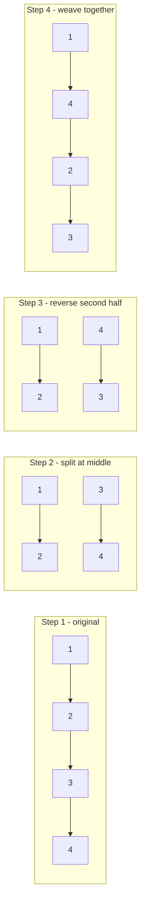

# 143. Reorder List

**LeetCode:** https://leetcode.com/problems/reorder-list/

## Problem
You're given the head of a singly linked list `L0 -> L1 -> ... -> Ln-1 -> Ln`.
Rearrange it in place into the order `L0 -> Ln -> L1 -> Ln-1 -> L2 -> Ln-2 -> ...`
(first node, last node, second node, second-to-last node, and so on). You must do
this by relinking the existing nodes, not by only changing their values.

**Input:** head of a singly linked list
**Output:** nothing returned; the list is reordered in place

**Examples**
1. `1 -> 2 -> 3 -> 4` → `1 -> 4 -> 2 -> 3`. Interleave the front half with the reversed
   back half.
2. `1 -> 2 -> 3 -> 4 -> 5` → `1 -> 5 -> 2 -> 4 -> 3`. With an odd count, the middle
   element (`3`) ends up last since it has no partner left to interleave with.
3. `1` (single node) → `1`. Nothing to reorder.

**Constraints:** number of nodes in `[1, 5*10^4]`, `1 <= Node.val <= 1000`.

> 🔑 **Pattern Recognition**
> Zig-zag reordering (front, back, front, back, ...) of a singly linked list → find the middle with fast/slow pointers, reverse the second half, then weave the two halves together one node at a time.

## Intuition (explained simply)
The target order zig-zags: first from the front, then from the back, then front,
then back. Zig-zagging front/back is much easier if you first physically split the
list into "front half" and "reversed back half" — then merging them alternately is a
simple weave.

### 1. Brute Force
- Walk the whole list, store every node (or value) in an array. Then use two pointers,
  `left = 0` and `right = len - 1`, and rebuild the `next` pointers by alternating:
  array[left], array[right], array[left+1], array[right-1], ... until they meet.
- Correct because an array gives O(1) random access to "the node from the end",
  which is exactly what the zig-zag order needs.
- Time complexity: O(n)  Space complexity: O(n) (array of all node references)
- Why it's not good enough: interviewers want you to notice this can be done with
  O(1) extra space using pointer tricks (find middle, reverse half, merge) instead of
  buffering the whole list.

### 2. Better
- Same idea as brute force but using a stack (or deque) conceptually: push all nodes
  onto a stack while also keeping a separate pointer walking from the front. Pop from
  the stack (gives nodes from the end) and interleave with the front pointer, stopping
  once the two "meet" in the middle. This is really the same asymptotic cost as brute
  force, just framed with an explicit stack — a natural intermediate before the fully
  in-place trick.
- Time complexity: O(n)  Space complexity: O(n) (stack holding all nodes)
- Still suboptimal: still O(n) extra memory; the optimal approach gets this down to
  O(1) by physically restructuring the list itself.

### 3. Optimal
- Three steps, all in O(1) extra space:
  1. **Find the middle** using slow/fast pointers (slow ends at the middle node).
  2. **Reverse the second half** of the list starting right after the middle (standard
     iterative reversal, splitting the list into two independent halves).
  3. **Merge the two halves** by alternating nodes: take one from the front half, one
     from the reversed back half, repeat, until one half is exhausted.
- Why it works: after step 1 and 2, "front half in order" and "back half reversed"
  are exactly the two sequences that need to be woven together — reversing the back
  half turns "furthest from front" into "comes first," which matches the zig-zag
  target order.
- Time complexity: O(n)  Space complexity: O(1)
- Edge cases: single node or two nodes (no-op or trivial swap), odd vs. even total
  length (careful splitting so the front half doesn't accidentally include the
  reversed-half's starting point), must cut `next` pointers properly at the split to
  avoid an accidental leftover cycle.

#### 🎯 Visual Walkthrough
Tracing `1 -> 2 -> 3 -> 4` (target output: `1 -> 4 -> 2 -> 3`):

## Complexity Summary
| Approach | Time | Space |
|---|---|---|
| Brute Force | O(n) | O(n) |
| Better | O(n) | O(n) |
| Optimal | O(n) | O(1) |
