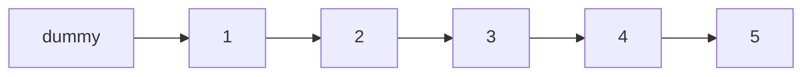

# 19. Remove Nth Node From End of List

**LeetCode:** https://leetcode.com/problems/remove-nth-node-from-end-of-list/

## Problem
Given the head of a linked list and an integer `n`, remove the `n`-th node counting
from the end of the list, and return the (possibly new) head.

**Input:** head of a linked list, integer `n` (1-indexed from the end)
**Output:** head of the list with that node removed

**Examples**
1. `1 -> 2 -> 3 -> 4 -> 5`, `n = 2` → `1 -> 2 -> 3 -> 5`. The 2nd node from the end is
   `4`, so it's removed.
2. `1`, `n = 1` → `[]`. The only node is also the 1st from the end, so the list
   becomes empty.
3. `1 -> 2`, `n = 1` → `1`. The last node (`2`) is removed.

**Constraints:** number of nodes in `[1, 30]`, `0 <= Node.val <= 100`,
`1 <= n <= number of nodes` (n is always valid).

> 🔑 **Pattern Recognition**
> "n-th node from the end, in one pass" on a singly linked list (which only walks forward) → two pointers held a fixed `n` gap apart, so when the lead pointer hits the end, the trailing pointer sits exactly where it needs to be.

## Intuition (explained simply)
The tricky part of a singly linked list is that you can only walk forward, so you
don't immediately know how far a node is from the *end*. The straightforward fix is
to first find the total length, then compute the position from the front. A slicker
trick uses two pointers a fixed `n` apart, so when the lead pointer hits the end, the
trailing pointer is exactly at the node to remove.

### 1. Brute Force
- First pass: walk the whole list to count its length `L`. Second pass: walk again to
  node `L - n - 1` (the node just before the one to delete, using a dummy head to
  handle deleting the actual head safely), and relink `prev.next = prev.next.next`.
- Correct because once you know the total length, "n-th from the end" converts
  directly into "position from the front" via simple arithmetic.
- Time complexity: O(L) (two full/partial passes, still linear) Space complexity: O(1)
- Why it's not ideal for an interview: it works and is O(L) time, but it requires two
  separate passes over the list; interviewers usually want to see if you can do it in
  a single pass.

### 2. Better
- Store every node's reference in an array as you traverse once. The node to delete
  is simply `array[length - n]`, and its predecessor is `array[length - n - 1]` (or
  treat removing the head as a special case). Relink directly using array indices —
  no second traversal needed, but O(n) extra memory is used for the array.
- Time complexity: O(L)  Space complexity: O(L) (array of all node references)
- Still suboptimal: uses O(L) extra space just to get random access, when a two
  pointer approach gets the same one-pass behavory with O(1) space.

### 3. Optimal — Two Pointers ("n-gap" technique)
- Use a dummy node before `head` (so removing the real head doesn't need special
  casing). Advance a `fast` pointer `n+1` steps ahead of a `slow` pointer (both
  starting at `dummy`). Then move both `slow` and `fast` forward together, one step
  at a time, until `fast` reaches the end (`None`). At that point `slow` is sitting
  right before the node to remove, because the gap between them stayed fixed at
  `n+1`. Relink `slow.next = slow.next.next`.
- Why it works: keeping a constant gap of `n` nodes between the two pointers means
  that when the front one runs out of list, the back one is exactly `n` nodes from
  the end.
- Time complexity: O(L), single pass  Space complexity: O(1)
- Edge cases: removing the head node itself (handled cleanly by the dummy node),
  `n` equal to the list length (removes the head), single-node list.

#### 🎯 Visual Walkthrough
Tracing example 1: `1 -> 2 -> 3 -> 4 -> 5`, `n = 2` (remove the 2nd node from the end, `4`):

`fast` starts at `dummy` and advances `n+1 = 3` steps ahead of `slow` (also at `dummy`). Then both move forward together until `fast` reaches `None`: `slow` ends up parked at `3`, one node before the target `4`, so `slow.next = slow.next.next` unlinks `4`, producing `1 -> 2 -> 3 -> 5`.

## Complexity Summary
| Approach | Time | Space |
|---|---|---|
| Brute Force | O(L) | O(1) |
| Better | O(L) | O(L) |
| Optimal | O(L) | O(1) |
