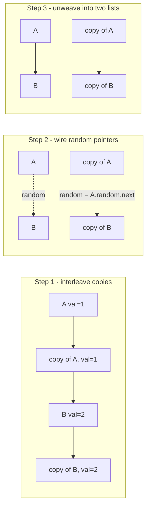

# 138. Copy List with Random Pointer

**LeetCode:** https://leetcode.com/problems/copy-list-with-random-pointer/

## Problem
You're given a linked list where each node has a `next` pointer AND a `random`
pointer, which can point to any node in the list (including itself) or to `None`.
Build a completely independent deep copy of the list — new nodes, with `next` and
`random` wired to correspond to the original structure — and return the head of the
copy.

**Input:** head of a linked list where each node is `(val, next, random)`
**Output:** head of a fully independent deep-copied list with the same structure

**Examples**
1. Nodes `A(val=1) -> B(val=2)`, `A.random = B`, `B.random = B` → a copy
   `A'(val=1) -> B'(val=2)` where `A'.random = B'` and `B'.random = B'` (never
   pointing back into the original list).
2. A single node `A(val=1)` with `A.random = None` → copy `A'(val=1)` with
   `A'.random = None`.
3. A single node `A(val=1)` with `A.random = A` (points to itself) → copy
   `A'(val=1)` with `A'.random = A'` (also points to itself, not to the original `A`).

**Constraints:** number of nodes in `[0, 1000]`, `-10^4 <= Node.val <= 10^4`,
`Node.random` is `None` or points to a node in the list.

> 🔑 **Pattern Recognition**
> Deep-copying a structure with pointers that can jump *forward* to not-yet-created nodes → either a hash map from original to copy, or (for O(1) extra space) interleave copies directly after their originals so "the copy of X" is just `X.next`.

## Intuition (explained simply)
The hard part isn't copying `next` pointers — that's a normal list copy. The hard
part is `random`, which can point *forward* to a node we haven't created a copy of
yet. We need a reliable way to look up "given this original node, what's its copy?"

### 1. Brute Force
- First pass: create a copy of every node (with the correct `val`, but `next` and
  `random` both `None` for now), and record a mapping from `original node -> copy
  node` (using a hash map keyed by node identity). Second pass: walk the originals
  again, and for each one set `copy.next = map[orig.next]` and
  `copy.random = map[orig.random]` (handling `None` safely).
- Correct because by the time we do the second pass, every original node already has
  a copy in the map, so both forward and backward `random` references resolve
  correctly regardless of order.
- Time complexity: O(n)  Space complexity: O(n) (hash map + n new nodes)
- Why it's "brute force" here: it's actually already a very reasonable solution —
  the "not good enough" angle in this problem is really about interview follow-ups
  asking for O(1) *extra* space (not counting the required output list), which this
  doesn't achieve because of the hash map.

### 2. Better
- Same two-pass hash-map idea, but do it in a single combined pass using
  `collections.defaultdict`-style lazy creation: whenever we need "the copy of node
  X" (whether X is the current node, or `curr.next`, or `curr.random`), create it on
  demand if it doesn't exist yet, and cache it. This collapses the two explicit
  passes into one pass with recursion-free lazy lookups.
- Time complexity: O(n)  Space complexity: O(n) (hash map + n new nodes)
- Still suboptimal: still uses O(n) auxiliary hash map space; the optimal trick
  avoids the hash map entirely.

### 3. Optimal — Interweaving Trick (O(1) extra space)
- Step 1: for each original node `A`, create its copy `A'` and splice it in right
  after `A`: `A -> A' -> B -> B' -> ...`. Now "the copy of any node X" is simply
  `X.next` — no hash map needed.
- Step 2: walk the interleaved list and set each copy's random pointer:
  `A'.random = A.random.next` (since `A.random`'s copy is right after it), handling
  `None` safely.
- Step 3: unweave the two lists back apart — restore the original list's `next`
  pointers and extract the copy list's `next` pointers, splitting the interleaved
  chain into two separate, valid lists.
- Why it works: interleaving turns "find the copy of node X" from a hash lookup into
  a simple `.next` dereference, since every copy is guaranteed to sit immediately
  after its original.
- Time complexity: O(n) (three linear passes)  Space complexity: O(1) extra
  (excluding the output list itself)
- Edge cases: empty list (`head is None`), `random` pointing to `None`, `random`
  pointing to the node itself, all nodes having the same `val`.

#### 🎯 Visual Walkthrough
Tracing example 1: `A(val=1) -> B(val=2)`, `A.random = B`, `B.random = B`:

## Complexity Summary
| Approach | Time | Space |
|---|---|---|
| Brute Force | O(n) | O(n) |
| Better | O(n) | O(n) |
| Optimal | O(n) | O(1) extra |
