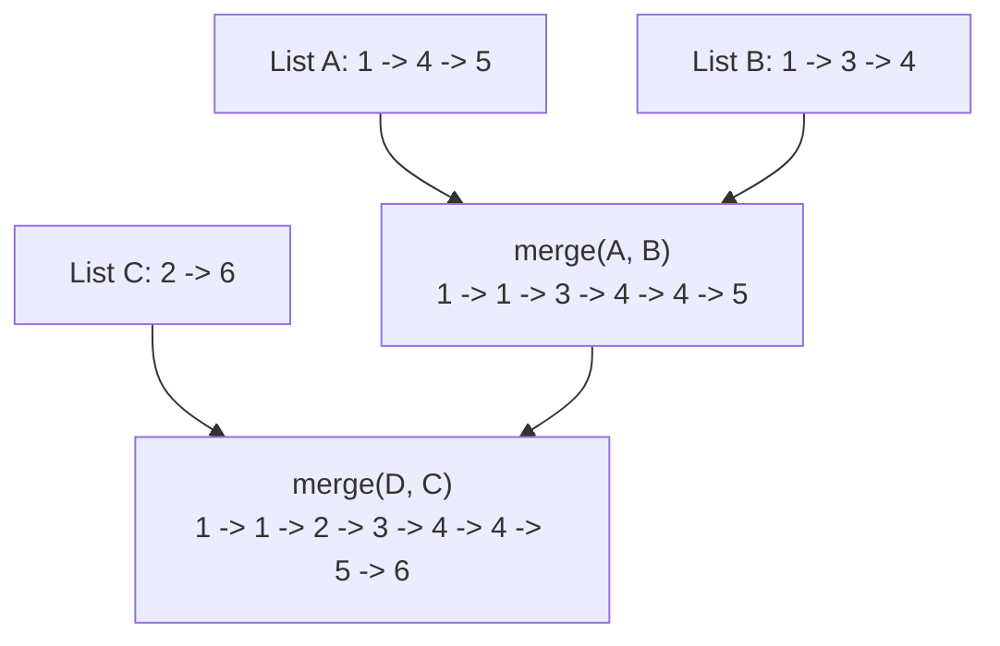

# 23. Merge k Sorted Lists

**LeetCode:** https://leetcode.com/problems/merge-k-sorted-lists/

## Problem
You're given an array of `k` linked list heads, where each individual list is
already sorted in ascending order. Merge all `k` lists into a single sorted linked
list and return its head.

**Input:** `lists`, an array of `k` sorted linked list heads (some may be `None`)
**Output:** one merged sorted linked list head

**Examples**
1. `lists = [1->4->5, 1->3->4, 2->6]` → `1->1->2->3->4->4->5->6`. Every value across
   all three lists, merged into one ascending sequence.
2. `lists = []` → `[]`. No lists to merge.
3. `lists = [None]` → `[]`. A single empty list merges to an empty result.

**Constraints:** `0 <= k <= 10^4`, `0 <= length of each list <= 500`,
`-10^4 <= Node.val <= 10^4`, total nodes across all lists `<= 10^4`.

> 🔑 **Pattern Recognition**
> "Merge two sorted lists," generalized to `k` lists → either pair-and-merge in `log k` rounds (divide & conquer), or keep the current front of every list in a min-heap so the global minimum is always O(log k) away.

## Intuition (explained simply)
This is "Merge Two Sorted Lists" generalized to `k` lists instead of 2. The question
is how to pick "the smallest current value across all k lists" efficiently at every
step, instead of just comparing 2 candidates.

### 1. Brute Force
- Walk all `k` lists, collect every value into one big array, sort that array with a
  general-purpose sort, then rebuild a linked list from the sorted array.
- Correct because sorting any collection of numbers puts them in the right order
  regardless of source, but it completely ignores that each individual list is
  already sorted.
- Time complexity: O(N log N), where N is the total number of nodes across all lists
  Space complexity: O(N)
- Why it's not good enough: it throws away the "already sorted per list" structure
  the problem hands you, and while it's not asymptotically terrible, interviewers
  expect you to exploit that structure (this problem sits at the boundary of what's
  considered acceptable vs. optimal).

### 2. Better — Merge Lists Two at a Time, Sequentially
- Repeatedly apply the classic "merge two sorted lists" routine: merge list 0 with
  list 1 into a combined list, then merge that combined list with list 2, then with
  list 3, and so on through all `k` lists.
- Time complexity: O(N * k) in the worst case — each of the k merge steps can touch
  up to all of the nodes merged so far (the combined list grows as we go),
  so total work is roughly N + 2N/k*... more simply: merging sequentially costs
  O(N*k) because each node can be re-compared up to k times across the k rounds.
  Space complexity: O(1) extra (in-place relinking) or O(N) if rebuilding
- Still suboptimal: doesn't take advantage of pairing lists smartly — merging can be
  done in a divide-and-conquer fashion to cut the number of "rounds" from k down to
  log k.

### 3. Optimal — Two Equally Good Strategies
- **(a) Divide & Conquer**: pair up the lists and merge each pair (using the
  standard 2-list merge), halving the number of lists each round, until only one
  list remains — just like the merge step of merge sort, but merging linked lists
  instead of arrays. Each of the `log k` rounds does O(N) total work across all
  pairs, giving O(N log k) overall.
- **(b) Min-Heap**: push the head node of each of the k lists into a min-heap (keyed
  by value), then repeatedly pop the smallest, append it to the result, and if that
  node has a `next`, push `next` into the heap. This always picks the global minimum
  across all remaining list fronts in O(log k) per pop/push, doing this N times.
- Why both work: (a) exploits that merging is associative and pairing lists halves
  the problem size each round (classic divide and conquer); (b) exploits that a heap
  gives O(log k) access to "the smallest of the k current candidates" at every step,
  which is exactly what merging k sorted sequences needs.
- Time complexity: O(N log k)  Space complexity: O(k) for the heap (or O(log k)
  recursion stack for divide & conquer), output list is O(N) but that's unavoidable.
- Edge cases: empty `lists` array, `lists` containing `None` entries, only one
  non-empty list, all lists empty.

#### 🎯 Visual Walkthrough
Tracing example 1 with the divide & conquer strategy: `lists = [1->4->5, 1->3->4, 2->6]`:

Pairing lists and merging each pair halves the number of lists every round (`log k` rounds total), each doing O(N) work, giving `O(N log k)` overall — the min-heap approach reaches the same complexity by always popping the smallest of the k current list-fronts.

## Complexity Summary
| Approach | Time | Space |
|---|---|---|
| Brute Force | O(N log N) | O(N) |
| Better | O(N * k) | O(1) extra |
| Optimal | O(N log k) | O(k) |
