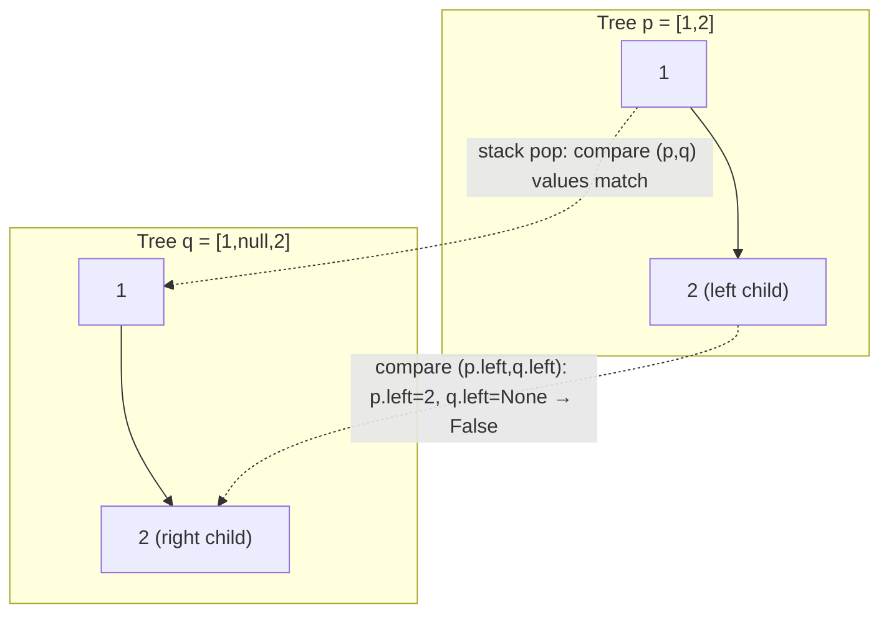

# 100. Same Tree

**LeetCode:** https://leetcode.com/problems/same-tree/

## Problem
Given the roots of two binary trees, determine whether they are structurally
identical and have the same node values at every corresponding position.

**Input:** roots of two binary trees `p` and `q`
**Output:** `True` if identical, else `False`

**Examples**
1. Input: `p = [1,2,3]`, `q = [1,2,3]` → Output: `True`. Same shape, same values.
2. Input: `p = [1,2]`, `q = [1,null,2]` → Output: `False`. Same values but `2` is on
   different sides (left vs right), so the shape differs.
3. Input: `p = [1,2,1]`, `q = [1,1,2]` → Output: `False`. Same shape but values at the
   left/right positions are swapped.

**Constraints:** `0 <= number of nodes in each tree <= 100`, `-10^4 <= Node.val <=
10^4`.

> 🔑 **Pattern Recognition**
> Comparing two trees for structural + value equality → walk both trees in lockstep
> with simultaneous DFS, short-circuiting on the first mismatch. Whenever a problem
> asks "are these two structures equal," compare live instead of serializing first.

## Intuition (explained simply)
Two trees are "the same" only if, at every matching position, both are `None`, or
both exist with equal values and their left/right subtrees are also the same. This is
naturally a recursive definition — a tree is the same as another tree if its two
halves are each the same.

### 1. Brute Force
- Serialize both trees into strings using preorder traversal with explicit markers for
  `null` children (e.g. `"1,2,#,#,3,#,#"`), then simply compare the two strings for
  equality.
- Time complexity: O(n)  Space complexity: O(n) (two full string serializations)
- Why it's not good enough: it does unnecessary work building full string
  representations of both trees just to compare them, and string comparison for large
  trees is wasteful when you could bail out on the very first mismatch found while
  walking the trees directly.

### 2. Better
- Recursive DFS comparing both trees simultaneously: if both nodes are `None`, return
  `True`; if exactly one is `None` or their values differ, return `False`; otherwise
  return `same(p.left, q.left) and same(p.right, q.right)`. This short-circuits as
  soon as any mismatch is found.
- Time complexity: O(min(n, m)) — stops early on first mismatch, O(n) if trees are
  identical  Space complexity: O(h) recursion stack
- What's still suboptimal: for very deep/skewed trees, recursion risks hitting the
  call-stack limit; an iterative version sidesteps that.

### 3. Optimal
- Iterative DFS using an explicit stack of `(node_p, node_q)` pairs: push `(p, q)`,
  and while the stack isn't empty, pop a pair, check the same `None`/value conditions,
  and push the left and right child pairs if both nodes exist. Return `False` the
  moment any check fails.
- This works identically to the recursive version logically, but replaces the
  implicit call stack with an explicit one, giving control over memory and avoiding
  recursion-depth limits.
- Time complexity: O(min(n, m))  Space complexity: O(h) explicit stack, but no
  interpreter recursion-limit risk
- Edge cases: both trees empty → `True`; one empty and one not → `False` immediately;
  identical values but mirrored structure → correctly `False` since left/right
  positions are compared, not swapped.

#### 🎯 Visual Walkthrough
Tracing Example 2 (`p = [1,2]`, `q = [1,null,2]`): the stack pushes `(p, q)` pairs and
compares them one at a time — the mismatch is found as soon as `2`'s position differs.

The moment `p.left` (`2`) is compared against `q.left` (`None`), the mismatch is
detected and the algorithm returns `False` without visiting anything else.

## Complexity Summary
| Approach | Time | Space |
|---|---|---|
| Brute Force | O(n) | O(n) |
| Better | O(n) | O(h) |
| Optimal | O(n) | O(h) |
