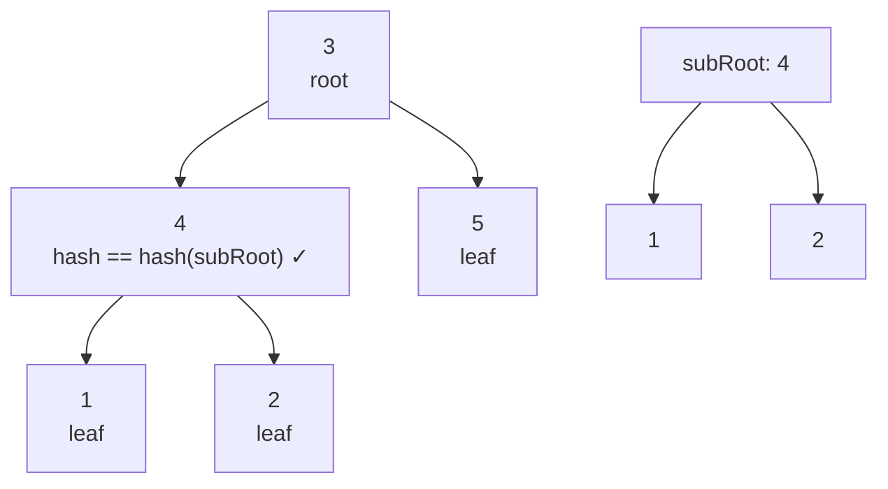

# 572. Subtree of Another Tree

**LeetCode:** https://leetcode.com/problems/subtree-of-another-tree/

## Problem
Given the roots of two binary trees `root` and `subRoot`, determine whether `subRoot`
appears somewhere inside `root` as an exact subtree — meaning some node in `root`,
together with all of its descendants, is structurally identical (same shape, same
values) to `subRoot`.

**Input:** roots of two binary trees
**Output:** `True` if `subRoot` matches a subtree of `root`, else `False`

**Examples**
1. Input: `root = [3,4,5,1,2]`, `subRoot = [4,1,2]` → Output: `True`. The subtree
   rooted at the node with value `4` matches `subRoot` exactly.
2. Input: `root = [3,4,5,1,2,null,null,null,null,0]`, `subRoot = [4,1,2]` → Output:
   `False`. The subtree at `4` has an extra node `0`, so it's not an exact match.
3. Input: `root = [1,1]`, `subRoot = [1]` → Output: `True`. A single matching node
   (with no children on either side) counts.

**Constraints:** `1 <= nodes in root <= 2000`, `1 <= nodes in subRoot <= 1000`,
`-10^4 <= Node.val <= 10^4`.

> 🔑 **Pattern Recognition**
> "Does tree B appear anywhere inside tree A" → this is Same-Tree run from every
> possible starting node, or better, subtree hashing (Merkle-style) to avoid the
> O(n·m) blowup. Recognize "find an exact matching substructure" as a hashing cue.

## Intuition (explained simply)
This is really "same tree" applied repeatedly: check every node of `root` as a
possible starting point, and see if the tree hanging from it is identical to
`subRoot`. If any starting point matches exactly, the answer is `True`.

### 1. Brute Force
- Walk every node of `root` (DFS). At each node, run a full "is same tree" recursive
  comparison against `subRoot`. If any comparison returns `True`, the answer is
  `True`.
- Time complexity: O(n * m) where n = size of `root`, m = size of `subRoot` (in the
  worst case every node comparison walks nearly all of `subRoot`)  Space complexity:
  O(h) recursion stack
- Why it's not good enough: for large, similar-looking trees this repeats a lot of
  redundant comparison work — comparing overlapping subtrees again and again.

### 2. Better
- Serialize both `root` and `subRoot` into strings via preorder traversal, inserting a
  unique separator and explicit `null` markers so that no value can accidentally be a
  substring of another (e.g. `"^3"` vs `"^13"`). Then simply check whether the
  `subRoot` string appears as a substring of the `root` string.
- Time complexity: O(n + m) to build both strings, plus substring search which is
  O(n * m) worst case with naive matching but averages close to O(n + m) in practice
  with Python's built-in string search  Space complexity: O(n + m) for the
  serialized strings
- What's still suboptimal: worst-case substring search isn't guaranteed linear, and
  building large strings has real constant-factor overhead.

### 3. Optimal
- Bottom-up (postorder) subtree hashing: compute a hash for every node that
  deterministically encodes "this node's value + its children's hashes" (a Merkle-tree
  style rolling hash), storing each subtree's hash the moment it's computed. Also
  compute the hash of `subRoot` once. Then just check whether that target hash appears
  among all the subtree hashes of `root` — an O(1) average-case set lookup after O(n)
  hashing.
- This works because two subtrees are structurally identical if and only if they
  produce the same hash when the hash function combines a node's value with its
  children's hashes recursively — identical structure and values guarantee identical
  hashes (using a strong combiner, e.g. tuples/strings, avoids collisions in practice).
- Time complexity: O(n + m) — one full DFS over each tree plus O(1) average hash
  lookups  Space complexity: O(n + m) for storing hashes
- Edge cases: `subRoot` is a single leaf — must still match individual leaf nodes in
  `root`, not just larger subtrees; `root` and `subRoot` identical — trivially `True`;
  `subRoot` larger than `root` — hash will simply never be found.

#### 🎯 Visual Walkthrough
Tracing Example 1 (`root = [3,4,5,1,2]`, `subRoot = [4,1,2]`): postorder hashing gives
the node valued `4` the same hash as `subRoot`'s root, so it's reported as a match.

Because the subtree rooted at `4` has the same shape and values as `subRoot`, their
hashes collide and the answer is `True`.

## Complexity Summary
| Approach | Time | Space |
|---|---|---|
| Brute Force | O(n * m) | O(h) |
| Better | O(n + m) avg | O(n + m) |
| Optimal | O(n + m) | O(n + m) |
