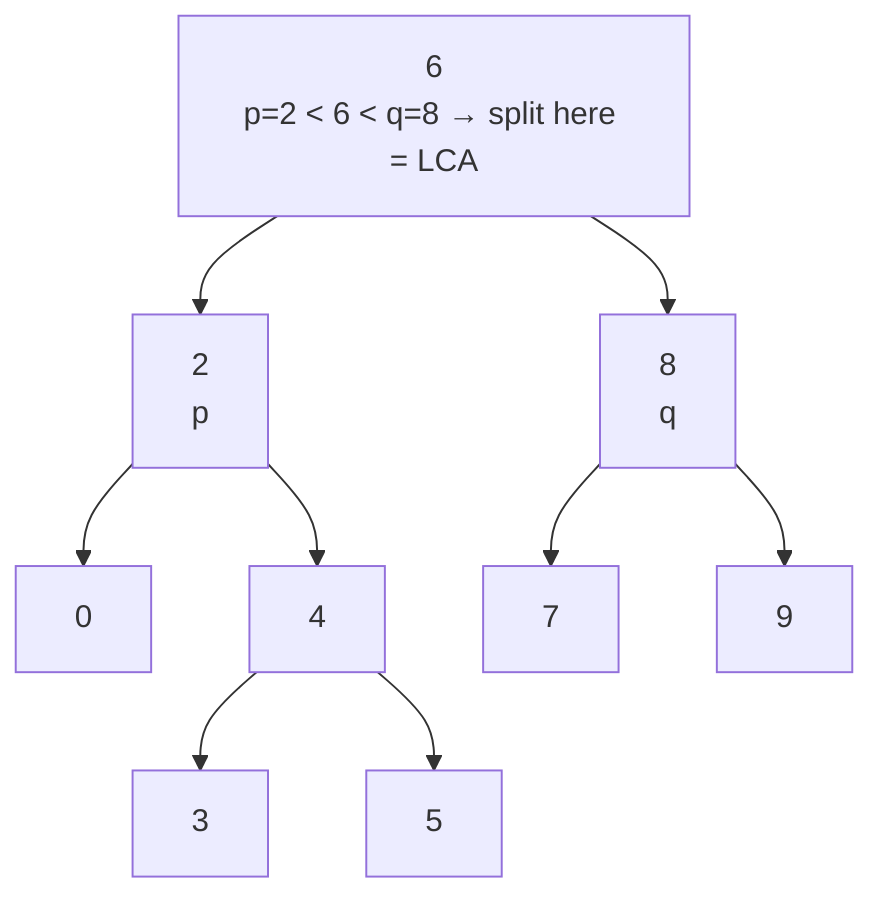

# 235. Lowest Common Ancestor of a Binary Search Tree

**LeetCode:** https://leetcode.com/problems/lowest-common-ancestor-of-a-binary-search-tree/

## Problem
Given the root of a binary search tree (BST) and two of its nodes `p` and `q`, find
their lowest common ancestor (LCA) — the deepest node in the tree that has both `p`
and `q` as descendants (a node can be its own descendant).

**Input:** root of a BST, and two existing nodes `p`, `q`
**Output:** the node that is the LCA of `p` and `q`

**Examples**
1. Input: `root = [6,2,8,0,4,7,9,null,null,3,5]`, `p = 2`, `q = 8` → Output: `6`. The
   root itself splits `p` (left subtree) and `q` (right subtree), so it's the LCA.
2. Input: `root = [6,2,8,0,4,7,9,null,null,3,5]`, `p = 2`, `q = 4` → Output: `2`. Since
   `4` is a descendant of `2`, `2` is its own ancestor and thus the LCA.
3. Input: `root = [2,1]`, `p = 2`, `q = 1` → Output: `2`. `1` is a direct child of `2`.

**Constraints:** `2 <= number of nodes <= 10^5`, all node values are unique,
`p != q`, both `p` and `q` exist in the tree.

> 🔑 **Pattern Recognition**
> Two nodes, need their common ancestor, in a tree with an ordering property → don't
> do generic tree search. Exploit the BST invariant (left < node < right) to steer a
> single path downward — no backtracking, no need to build full root-to-node paths.

## Intuition (explained simply)
In a general binary tree you'd have to search everywhere to find where two nodes'
ancestor paths diverge. But a BST has a superpower: at any node, you instantly know
whether a target value is in the left subtree (smaller) or right subtree (larger)
without searching — you just compare values. The LCA is the first node where `p` and
`q` "split" into different subtrees (or where one of them *is* the current node).

### 1. Brute Force
- Treat it like a general tree (ignore the BST ordering property): find the full
  root-to-`p` path and the full root-to-`q` path via DFS (storing each path as a
  list of nodes), then walk both paths together from the start and return the last
  node where they still match.
- Time complexity: O(n) to find both paths  Space complexity: O(n) to store both
  paths
- Why it's not good enough: it completely ignores the BST's ordering property, which
  is the whole point of the problem — the interviewer wants to see you exploit it for
  a much faster, much less memory-hungry solution.

### 2. Better
- Recursive DFS that uses the BST property directly: starting at `root`, if both
  `p.val` and `q.val` are less than `node.val`, the LCA must be in the left subtree,
  so recurse left; if both are greater, recurse right; otherwise (one is less/equal
  and the other greater/equal) `node` itself is the split point — return it.
- Time complexity: O(h) where h is the tree height (O(log n) balanced, O(n) worst
  case skewed)  Space complexity: O(h) recursion stack
- What's still suboptimal: the recursion isn't necessary — this is a case where each
  call does simple constant work and immediately returns one recursive call's result,
  which is a perfect candidate for converting to a loop and dropping the stack space.

### 3. Optimal
- Iterative version of the same idea: start `node = root`, and loop — while both
  `p.val` and `q.val` are less than `node.val`, move `node = node.left`; while both are
  greater, move `node = node.right`; otherwise `node` is the answer, return it. No
  recursion, no extra memory at all.
- This works because we're simply walking down the single unique path from the root
  toward both `p` and `q` simultaneously; the first point where their paths would
  diverge (or where the node equals one of them) is the LCA.
- Time complexity: O(h)  Space complexity: O(1)
- Edge cases: `p` or `q` equals the current node → return immediately (a node is
  considered its own ancestor); `p` and `q` on the same side the whole way down to a
  leaf → loop terminates at that leaf-adjacent node correctly.

#### 🎯 Visual Walkthrough
Tracing Example 1 (`root = [6,2,8,0,4,7,9,null,null,3,5]`, `p = 2`, `q = 8`): at the
root, `p < 6 < q`, so the two targets sit in different subtrees — the walk stops
immediately.

Since `p` and `q` fall on opposite sides of `6`, the loop stops there and returns `6`.

## Complexity Summary
| Approach | Time | Space |
|---|---|---|
| Brute Force | O(n) | O(n) |
| Better | O(h) | O(h) |
| Optimal | O(h) | O(1) |
