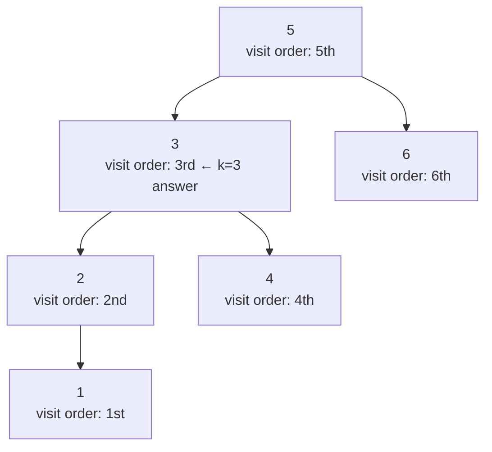

# 230. Kth Smallest Element in a BST

**LeetCode:** https://leetcode.com/problems/kth-smallest-element-in-a-bst/

## Problem
Given the root of a binary search tree and an integer `k`, find the `k`-th smallest
value stored in the tree (1-indexed, so `k = 1` means the smallest value overall).

**Input:** root of a BST, integer `k`
**Output:** the `k`-th smallest integer value in the tree

**Examples**
1. Input: `root = [3,1,4,null,2]`, `k = 1` → Output: `1`. Sorted order is
   `[1, 2, 3, 4]`; the 1st smallest is `1`.
2. Input: `root = [5,3,6,2,4,null,null,1]`, `k = 3` → Output: `3`. Sorted order is
   `[1, 2, 3, 4, 5, 6]`; the 3rd smallest is `3`.
3. Input: `root = [1]`, `k = 1` → Output: `1`. Only one node, and it's the answer.

**Constraints:** `1 <= number of nodes <= 10^4`, `0 <= Node.val <= 10^4`,
`1 <= k <= number of nodes`.

> 🔑 **Pattern Recognition**
> "Kth smallest/largest in a BST" → inorder traversal produces values in sorted order
> for free; stop counting the moment you reach `k` instead of materializing the whole
> sorted list.

## Intuition (explained simply)
The defining feature of a BST is that an inorder traversal (left, node, right)
visits every value in strictly increasing sorted order. So "find the k-th smallest"
becomes "do an inorder traversal and stop once you've counted k values."

### 1. Brute Force
- Do a full inorder traversal of the entire tree, appending every value to a list
  (which comes out sorted for free), then simply index into `list[k - 1]`.
- Time complexity: O(n) — always visits every node regardless of `k`  Space
  complexity: O(n) to store the full sorted list
- Why it's not good enough: if `k` is small (e.g. `k = 1`) and the tree is huge, this
  still visits and stores every single node — very wasteful when you only need the
  traversal to go partway through.

### 2. Better
- Recursive inorder traversal that keeps a running counter, and stops (short-
  circuits) as soon as the counter reaches `k`, without necessarily visiting the rest
  of the tree — implemented by having the recursive helper return early / propagate a
  "found" signal once the k-th node is hit, rather than always descending into every
  subtree unconditionally.
- Time complexity: O(h + k) — only descends to the leftmost node then advances k
  values before stopping  Space complexity: O(h) recursion stack
- What's still suboptimal: the early-stop logic in a recursive traversal is a little
  awkward to thread through return values cleanly; an iterative approach makes the
  "stop early" behavior completely natural.

### 3. Optimal
- Iterative inorder traversal using an explicit stack: push all left children onto
  the stack first. Then repeatedly pop a node (that's the next smallest unvisited
  value), decrement/increment a counter, and if this is the k-th pop, return its
  value immediately — otherwise move to its right child and keep pushing left
  children again. The loop naturally stops the instant `k` values have been popped.
- This works because the stack always pops nodes in sorted order one at a time, so
  there is no need to precompute or store the whole sequence — you simply stop
  consuming from the stack once you've popped `k` items.
- Time complexity: O(h + k) — worst case O(n) if `k` is close to n, but typically far
  better for small `k`  Space complexity: O(h) for the explicit stack
- Edge cases: `k` equals the total number of nodes → traversal must go all the way to
  the largest value; `k = 1` → returns almost immediately after reaching the
  leftmost node; single-node tree → trivially returns that node's value.

#### 🎯 Visual Walkthrough
Tracing Example 2 (`root = [5,3,6,2,4,null,null,1]`, `k = 3`) with iterative inorder
traversal: nodes pop off the stack in strictly increasing order, and the 3rd pop wins.

Inorder visit order is `1, 2, 3, 4, 5, 6` — the 3rd value popped is `3`, so that's
returned immediately without visiting `4`, `5`, or `6`.

## Complexity Summary
| Approach | Time | Space |
|---|---|---|
| Brute Force | O(n) | O(n) |
| Better | O(h + k) | O(h) |
| Optimal | O(h + k) | O(h) |
