# 105. Construct Binary Tree from Preorder and Inorder Traversal

**LeetCode:** https://leetcode.com/problems/construct-binary-tree-from-preorder-and-inorder-traversal/

## Problem
Given two integer arrays `preorder` and `inorder` representing the preorder and
inorder traversal of the same binary tree (with unique values), reconstruct and
return the original binary tree.

**Input:** two arrays of unique integers, same length
**Output:** the root of the reconstructed binary tree

**Examples**
1. Input: `preorder = [3,9,20,15,7]`, `inorder = [9,3,15,20,7]` → Output:
   `[3,9,20,null,null,15,7]`. `3` is the root (first in preorder); in inorder, `9` is
   left of `3` and `[15,20,7]` is right, so `9` becomes the left subtree and
   `[20,15,7]` (recursively) becomes the right subtree.
2. Input: `preorder = [1,2]`, `inorder = [2,1]` → Output: `[1,2]`. `1` is root, `2`
   appears before `1` in inorder, so `2` is the entire left subtree.
3. Input: `preorder = [1]`, `inorder = [1]` → Output: `[1]`. Single node.

**Constraints:** `1 <= number of nodes <= 3000`, all values unique.

> 🔑 **Pattern Recognition**
> Given two traversal orders and asked to rebuild the tree → preorder tells you the
> root first, inorder tells you the left/right split around that root. Reach for a
> hashmap of value→index plus index-range recursion instead of slicing arrays.

## Intuition (explained simply)
Preorder always visits `root` first, so `preorder[0]` tells you the root's value
immediately. Inorder always visits the left subtree, then the root, then the right
subtree — so once you know the root's value, finding it inside `inorder` splits that
array into "everything in the left subtree" (before it) and "everything in the right
subtree" (after it). Do this recursively and the whole tree falls out.

### 1. Brute Force
- At each recursive step: take `preorder[0]` as the root value, then *linearly
  search* through the current `inorder` slice to find that value's position (no
  lookup table), then build new sliced sub-lists for the left/right portions of both
  `preorder` and `inorder` to pass into the recursive calls.
- Time complexity: O(n^2) — a linear search per node (O(n) total across all nodes in
  the worst case) plus the cost of slicing arrays at every level (also O(n) per
  level, O(n^2) total for a skewed tree)  Space complexity: O(n^2) for all the sliced
  sub-array copies created along the way
- Why it's not good enough: both the repeated linear search and the repeated array
  copying are avoidable — searching should be O(1) with a hashmap, and slicing can be
  replaced with index bookkeeping into the original arrays.

### 2. Better
- Precompute a hashmap `value -> index` for the `inorder` array once, so finding the
  root's split point becomes O(1) instead of a linear scan. Still build new sliced
  sub-lists for each recursive call, though.
- Time complexity: O(n^2) worst case — the O(1) lookups remove the search cost, but
  slicing arrays at every level of a skewed tree still costs O(n) per level, O(n^2)
  total  Space complexity: O(n^2) for the sliced copies
- What's still suboptimal: the array-copying overhead from slicing is still there —
  it's not necessary to ever physically copy sub-arrays; index ranges into the
  original arrays carry exactly the same information.

### 3. Optimal
- Use the hashmap for O(1) root-index lookups, and instead of slicing, pass index
  boundaries `(in_left, in_right)` into the *original* `inorder` array, along with a
  running pointer into `preorder` (since preorder values are consumed strictly
  left-to-right as you build root, then left subtree, then right subtree). No copies
  are ever made.
- This works because each recursive call only needs to know *which contiguous window*
  of `inorder` corresponds to its subtree, and the correct next value to use as root
  is always exactly the next unconsumed element of `preorder` — both facts require
  only index arithmetic, not array copies.
- Time complexity: O(n) — one hashmap lookup and O(1) bookkeeping per node  Space
  complexity: O(n) for the hashmap plus O(h) recursion stack
- Edge cases: single node → trivially returns that node; a fully left-skewed or
  fully right-skewed tree → index ranges shrink correctly to empty (`left > right`)
  at the base case.

#### 🎯 Visual Walkthrough
Tracing Example 1 (`preorder = [3,9,20,15,7]`, `inorder = [9,3,15,20,7]`): `3` is
consumed from `preorder` first as root; `9` (left of `3` in inorder) becomes the
entire left subtree; `[20,15,7]` (right of `3` in inorder) becomes the right subtree,
built recursively the same way.

```mermaid
graph TD
    A["3<br/>build order: 1st (preorder&#91;0&#93;)"] --> B["9<br/>build order: 2nd (only value left of 3 in inorder)"]
    A --> C["20<br/>build order: 3rd (next unconsumed preorder value)"]
    C --> D["15<br/>build order: 4th (left of 20 in inorder slice)"]
    C --> E["7<br/>build order: 5th (right of 20 in inorder slice)"]
```

## Complexity Summary
| Approach | Time | Space |
|---|---|---|
| Brute Force | O(n^2) | O(n^2) |
| Better | O(n^2) | O(n^2) |
| Optimal | O(n) | O(n) |
