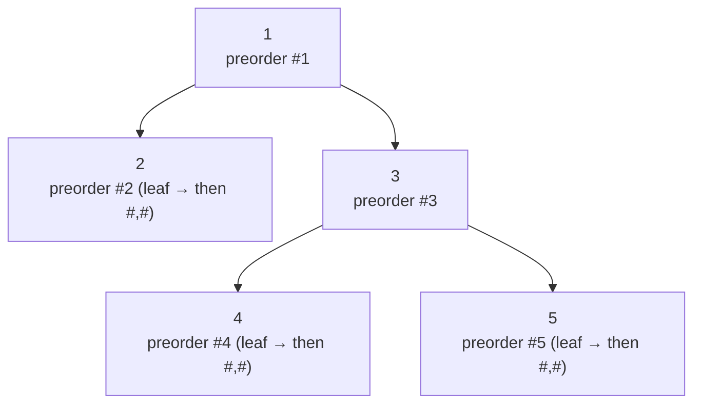

# 297. Serialize and Deserialize Binary Tree

**LeetCode:** https://leetcode.com/problems/serialize-and-deserialize-binary-tree/

## Problem
Design an algorithm to convert a binary tree into a string (`serialize`), and to
convert that string back into a binary tree with the exact same structure and values
(`deserialize`). The two operations just need to be inverses of each other — the
string format itself is entirely up to you.

**Input (serialize):** root of a binary tree → **Output:** a string
**Input (deserialize):** a string produced by your own `serialize` → **Output:** the
reconstructed root

**Examples**
1. Input tree: `[1,2,3,null,null,4,5]` → `serialize` produces some string encoding
   (e.g. `"1,2,#,#,3,4,#,#,5,#,#"` for a preorder+null-marker scheme) →
   `deserialize` on that string reproduces the identical tree `[1,2,3,null,null,4,5]`.
2. Input tree: `[]` → `serialize` produces a string representing "empty" (e.g. `"#"`)
   → `deserialize` returns `None`.
3. Input tree: `[1]` → `serialize` produces a string encoding one node with two null
   children → `deserialize` reproduces a single-node tree.

**Constraints:** `0 <= number of nodes <= 10^4`, `-1000 <= Node.val <= 1000`.

> 🔑 **Pattern Recognition**
> Need to rebuild a tree exactly from a string → any traversal works as long as
> `null` children are explicitly marked; preorder + null markers is cleanest because
> a recursive parser can consume tokens in exactly the order they were written.

## Intuition (explained simply)
To rebuild a tree exactly, the string needs to capture two things: which values exist,
and — crucially — *where the gaps are* (which children are missing), otherwise
deserializing can't tell where one subtree ends and another begins. Any traversal
order works as long as `null` children are explicitly recorded as markers.

### 1. Brute Force
- Treat the tree as if it were "complete" (like the array representation of a binary
  heap): compute the tree's height `h`, allocate a fixed-size array of length `2^h -
  1` where the node at flat index `i` has children at indices `2i+1` and `2i+2`, fill
  in values (leaving `None` for missing nodes) by walking down with that index
  scheme, then just write out the array as the serialized string. Deserializing
  reverses the index math to rebuild.
- Time/Space complexity: O(2^h) — a **skewed** tree of height h can have as few as h
  actual nodes but requires an array of size `2^h - 1` to represent it positionally
  (each missing sibling still needs its full subtree of slots reserved), which
  blows up exponentially relative to the tree's real size
- Why it's not good enough: this only stays efficient for perfectly (or nearly)
  complete trees; for realistic/skewed trees it wastes an enormous, exponential
  amount of space and time compared to the number of actual nodes.

### 2. Better
- Level-order (BFS) serialization: use a queue, and for every node popped, write its
  value; if a child is `None`, write a marker (e.g. `"#"`) and don't enqueue it — only
  *existing* nodes get enqueued for further expansion. Deserializing reverses this
  with a queue as well, reading tokens level by level and attaching children as
  markers are consumed.
- Time complexity: O(n) — exactly one token written per actual node (or per null
  child directly adjacent to a real node)  Space complexity: O(n) for the output
  string/list and O(w) for the BFS queue (w = max tree width)
- What's still suboptimal: nothing is asymptotically wrong here — this is a fully
  valid production-quality answer — but the queue-based bookkeeping (matching
  children back up during deserialization) is a bit more intricate to implement
  cleanly than a straightforward recursive traversal.

### 3. Optimal
- Preorder DFS serialization: recursively write `node.val` (or `"#"` for `None`)
  before recursing into left then right — producing a comma-separated string.
  Deserialization mirrors this exactly: use an iterator/pointer over the tokens, and
  recursively consume one token as the current node's value (or return `None` for
  `"#"`), then recursively rebuild the left subtree, then the right subtree, in the
  same order they were written.
- This works because preorder traversal, together with explicit null markers, is
  *unambiguous* — knowing the root's value and then reading tokens strictly in the
  order "root, left subtree (fully), right subtree (fully)" gives deserialization
  exactly enough information to know where each subtree begins and ends, with no
  need for a queue or index bookkeeping.
- Time complexity: O(n)  Space complexity: O(n) for the string/list of tokens, O(h)
  recursion stack
- Edge cases: empty tree → serializes to a single `"#"`, deserializes to `None`;
  values that could be negative or multi-digit → use a delimiter (comma) between
  tokens, not just concatenation, so parsing stays unambiguous.

#### 🎯 Visual Walkthrough
Tracing Example 1 (`[1,2,3,null,null,4,5]`) with preorder DFS serialization:

This produces the token stream `1,2,#,#,3,4,#,#,5,#,#`. Deserializing reads the same
tokens left-to-right — `1` becomes root, then the next tokens (`2,#,#`) fully rebuild
its left subtree before the remaining tokens (`3,4,#,#,5,#,#`) rebuild its right
subtree, reproducing the exact original tree.

## Complexity Summary
| Approach | Time | Space |
|---|---|---|
| Brute Force | O(2^h) | O(2^h) |
| Better | O(n) | O(n) |
| Optimal | O(n) | O(n) |
