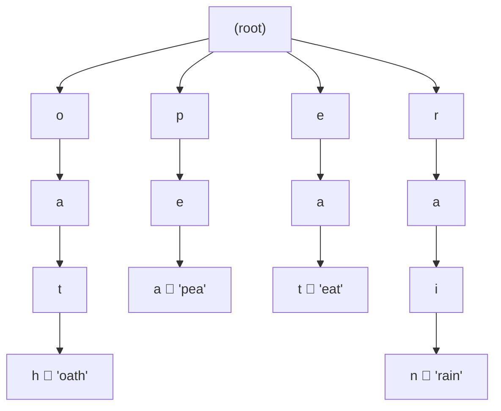

# 212. Word Search II

**LeetCode:** https://leetcode.com/problems/word-search-ii/

## Problem
Given an `m x n` grid of letters and a list of candidate `words`, find every word
from the list that can be formed by tracing a path through adjacent grid cells
(horizontally or vertically, not diagonally), where the same grid cell cannot be
reused within a single word's path.

**Input:** `board` (grid of characters), `words` (list of candidate strings)
**Output:** list of words from `words` that can be found in the board (any order)

**Examples**
1. `board = [["o","a","a","n"],["e","t","a","e"],["i","h","k","r"],["i","f","l","v"]]`,
   `words = ["oath","pea","eat","rain"]` → `["oath","eat"]`. `"oath"` traces
   `o(0,0)->a(0,1)->t(1,1)->h(2,1)`; `"eat"` traces `e(1,0)->a(1,2)... ` etc.;
   `"pea"` and `"rain"` cannot be traced through adjacent cells.
2. `board = [["a","b"],["c","d"]]`, `words = ["abcb"]` → `[]`. `"abcb"` would need to
   reuse cell `b` twice in one path, which isn't allowed.
3. `board = [["a"]]`, `words = ["a"]` → `["a"]`. A single-cell board matching a
   single-letter word.

**Constraints:** `1 <= m, n <= 12`, board cells are lowercase letters,
`1 <= number of words <= 3*10^4`, `1 <= word length <= 10`, all words distinct.

> 🔑 **Pattern Recognition**
> Searching a grid for many candidate words at once → don't repeat a full DFS per
> word. Merge all words into one shared trie so the board DFS explores each shared
> prefix exactly once and prunes dead branches the instant no word can match.

## Intuition (explained simply)
For one word, you could just try tracing it starting from every cell (classic DFS
backtracking, like "Word Search I"). But doing that separately for every word in a
list of up to 30,000 words means re-scanning the whole board that many times. The
trick is to search for **all words at once** by walking the board once and following
a shared trie of all words simultaneously — common prefixes are explored together.

### 1. Brute Force
- For each word in `words` independently, run a full DFS/backtracking search over
  the board (try every starting cell, and from there recursively try all 4
  directions, marking visited cells to avoid reuse) to check whether that exact word
  can be traced.
- Correct because it's the direct definition of "can this word be traced through
  adjacent cells" applied word by word — this is just "Word Search I" run for every
  candidate word.
- Time complexity: O(W * m * n * 4^L) where W = number of words, L = max word
  length (each word triggers its own full board search)
  Space complexity: O(L) recursion stack per search
- Why it's not good enough: with up to 30,000 words, re-running an independent DFS
  from scratch for each one is far too slow — many words share prefixes, and this
  approach explores those shared prefixes over and over.

### 2. Better
- Same per-word DFS approach, but first sort/filter `words` and skip any word whose
  first letter doesn't appear anywhere in the board at all (a quick precomputed set
  of letters present on the board) — cuts down wasted searches for words that can
  obviously never match. Still fundamentally one independent search per surviving
  word.
- Time complexity: still O(W * m * n * 4^L) in the worst case (if most words do
  start with letters present on the board, which is common), just with a lower
  constant factor in practice  Space complexity: O(L) recursion stack + O(26) letter
  set
- Still suboptimal: doesn't fix the core inefficiency of re-exploring shared
  prefixes across different words; a trie solves this structurally.

### 3. Optimal — Build a Trie of All Words, Single DFS Pass Over the Board
- Insert all words into a trie (storing the complete word string at the terminal
  node, so a match can be reported directly without rebuilding it). Then do ONE DFS
  pass: try starting from every cell in the board, and at each step, only continue
  the DFS in a direction if the current trie node has a child for that cell's
  letter. Whenever a trie node marked as "end of word" is reached, record that word
  as found (and optionally clear its `is_end` flag / prune the trie node to avoid
  duplicate reporting and to prune dead branches — an optimization once a leaf trie
  node has no more children).
- Why it works: many words share prefixes, so following the trie means we only
  explore each shared prefix path on the board once, regardless of how many words
  share it — the trie prunes DFS branches immediately once no word can possibly
  match the letters traced so far.
- Time complexity: O(m * n * 4^L) roughly (independent of W once the trie is built,
  since the branching factor is now bounded by the trie's structure rather than the
  raw word count) — building the trie itself costs O(sum of word lengths).
  Space complexity: O(sum of word lengths) for the trie, O(L) recursion stack, O(m*n)
  for the visited/board-marking overhead.
- Edge cases: duplicate letters in a word (already handled since we track visited
  cells per DFS path), words longer than the board could ever allow, words sharing
  prefixes (e.g., `"oa"` and `"oath"` — the trie must let paths terminate on
  internal nodes marked as end-of-word too), same word appearing to match multiple
  paths (only need to report it once).

#### 🎯 Visual Walkthrough
Tracing Example 1 — `words = ["oath","pea","eat","rain"]` — built into a single
shared trie before the board DFS begins:

The board DFS starting at cell `(0,0)` = `'o'` follows `o -> a -> t -> h` through the
trie, hitting `is_end = True` at `h` and reporting `"oath"`. Starting at `(1,0)` =
`'e'` follows `e -> a -> t`, hitting `is_end = True` and reporting `"eat"`. No
DFS ever starts down the `p` or `r` branches unless a board cell matches those first
letters, and `"rain"` fails once no adjacent path can complete it.

## Complexity Summary
| Approach | Time | Space |
|---|---|---|
| Brute Force | O(W * m*n * 4^L) | O(L) |
| Better | O(W * m*n * 4^L), smaller constant | O(L + 26) |
| Optimal | O(m*n * 4^L) + trie build | O(sum word lengths + m*n) |
