# 703. Kth Largest Element in a Stream

**LeetCode:** https://leetcode.com/problems/kth-largest-element-in-a-stream/

## Problem
Design a class that, given an integer `k` and an initial array of numbers, supports
an `add(val)` operation that inserts `val` into the stream and returns the k-th
largest element among all numbers seen so far (including the initial array).

**Input:** `k`, initial `nums` array, then a sequence of `add(val)` calls
**Output:** the k-th largest value seen so far, returned by each `add` call

**Examples**
1. `k=3`, `nums=[4,5,8,2]`; `add(3)` → `4` (sorted desc so far: 8,5,4,3,2 → 3rd
   largest is 4); `add(5)` → `5` (8,5,5,4,3,2 → 3rd largest is 5); `add(10)` → `5`
   (10,8,5,5,4,3,2 → 3rd largest is 5); `add(9)` → `8` (10,9,8,5,5,4,3,2 → 3rd is 8).
2. `k=1`, `nums=[]`; `add(-3)` → `-3`. With `k=1` the answer is always just the
   maximum seen so far.
3. `k=2`, `nums=[0]`; `add(-1)` → `-1` (sorted desc: 0,-1 → 2nd largest is -1);
   `add(5)` → `0` (5,0,-1 → 2nd largest is 0).

**Constraints:** `1 <= k <= 10^4`, `0 <= nums.length <= 10^4`,
`-10^4 <= nums[i], val <= 10^4`, `k <= nums.length + number of add calls`, at most
`10^4` calls to `add`.

> 🔑 **Pattern Recognition**
> Need the k-th largest value repeatedly as new numbers stream in → keep a
> min-heap of size k instead of re-sorting or re-scanning everything on each call.

## Intuition (explained simply)
The naive way is to re-find the k-th largest from scratch every time a number is
added. But we don't actually need to know the full order of every number — we only
ever care about the top `k` values. Keeping just those `k` values around, with quick
access to the smallest of them, is exactly what a min-heap of size `k` gives us.

### 1. Brute Force
- Keep a plain Python list of all numbers seen so far. On every `add(val)`, append
  `val`, then sort the entire list in descending order and return the element at
  index `k-1`.
- Correct because sorting always produces the true order, and the k-th largest is
  trivially the (k-1)-th index after a descending sort.
- Time complexity: O(n log n) per `add` call, where n = total numbers seen so far
  Space complexity: O(n)
- Why it's not good enough: re-sorting the entire growing list on every single
  `add` call is wasteful — with up to 10^4 calls, this could mean sorting
  effectively up to 10^4 elements 10^4 times.

### 2. Better
- Keep the list of all numbers seen so far, but avoid a full sort each time: use
  `heapq.nlargest(k, numbers)` (which internally uses a heap of size k and is faster
  than a full sort, O(n log k) instead of O(n log n)) to get the k largest, and
  return the smallest of those.
- Time complexity: O(n log k) per `add` call  Space complexity: O(n) (storing every
  number ever seen)
- Still suboptimal: still re-processes the entire growing history on every call, and
  keeps all numbers in memory even though only the top k values are ever relevant —
  the optimal solution never looks at old numbers again once they fall out of the
  top k.

### 3. Optimal — Min-Heap of Size k
- Maintain a min-heap containing at most `k` numbers: the k largest values seen so
  far. On `add(val)`: push `val` onto the heap; if the heap now has more than `k`
  elements, pop the smallest (discarding it, since it can no longer be in the top k
  once we have more than k larger-or-equal candidates). The k-th largest is always
  the smallest element currently in the heap, i.e., the heap's root (`heap[0]`).
- Why it works: a min-heap of size k always holds exactly the k largest elements
  seen so far, and by min-heap property, its root is the smallest of those — which
  is precisely the k-th largest overall. Every `add` only costs O(log k) since the
  heap never grows beyond size k.
- Time complexity: O(log k) per `add` call (after an initial O(n log k) to seed the
  heap with the initial `nums` array)  Space complexity: O(k)
- Edge cases: `add` calls before the heap has k elements yet (per the problem's
  guarantee, `k <= nums.length + number of add calls`, so this won't be queried
  before there are at least k elements), duplicate values, `k` equal to the total
  count of numbers seen (heap size stays exactly k).

#### 🎯 Visual Walkthrough
Tracing `k=3`, `nums=[4,5,8,2]` through example 1 (`add(3)→4`, `add(5)→5`,
`add(10)→5`, `add(9)→8`):

```mermaid
flowchart TD
    A["Seed from &#91;4,5,8,2&#93;<br/>keep top 3 → heap=&#91;4,5,8&#93;"]
    B["add(3)<br/>push 3 → &#91;3,4,5,8&#93;<br/>pop min 3 → heap=&#91;4,5,8&#93;<br/>return root=4"]
    C["add(5)<br/>push 5 → &#91;4,5,5,8&#93;<br/>pop min 4 → heap=&#91;5,5,8&#93;<br/>return root=5"]
    D["add(10)<br/>push 10 → &#91;5,5,8,10&#93;<br/>pop min 5 → heap=&#91;5,8,10&#93;<br/>return root=5"]
    E["add(9)<br/>push 9 → &#91;5,8,9,10&#93;<br/>pop min 5 → heap=&#91;8,9,10&#93;<br/>return root=8"]
    A --> B --> C --> D --> E
```

## Complexity Summary
| Approach | Time (per add) | Space |
|---|---|---|
| Brute Force | O(n log n) | O(n) |
| Better | O(n log k) | O(n) |
| Optimal | O(log k) | O(k) |
