# 1046. Last Stone Weight

**LeetCode:** https://leetcode.com/problems/last-stone-weight/

## Problem
You have a collection of stones, each with a positive weight. Repeatedly pick the two
heaviest stones and smash them together: if their weights are equal, both are
destroyed; otherwise the lighter one is destroyed and the heavier one's weight is
reduced by the lighter one's weight (and stays in play). Keep doing this until at
most one stone remains. Return that stone's weight, or `0` if none remain.

**Input:** `stones`, an array of positive integers
**Output:** the weight of the single remaining stone, or `0` if all are destroyed

**Examples**
1. `stones = [2,7,4,1,8,1]` → `1`. Smash 8&7→1, remaining [2,4,1,1,1]; smash 4&2→2,
   remaining [2,1,1,1]; smash 2&1→1, remaining [1,1,1]; smash 1&1→0 (both destroyed),
   remaining [1]; answer `1`.
2. `stones = [1]` → `1`. Only one stone to begin with, nothing to smash.
3. `stones = [2,2]` → `0`. Equal weights fully destroy each other.

**Constraints:** `1 <= stones.length <= 30`, `1 <= stones[i] <= 1000`.

> 🔑 **Pattern Recognition**
> Repeatedly need "the current two largest values" from a shrinking/changing
> collection → max-heap gives O(log n) access to extremes instead of rescanning.

## Intuition (explained simply)
At every step we only care about the two *heaviest* stones — everything else is
irrelevant until it might become one of the top two later. Repeatedly needing "the
current maximum(s)" from a changing collection is the textbook signal for a
max-heap, since a heap gives fast access to the extreme value even as the collection
changes.

### 1. Brute Force
- Keep the stones in a plain list. On each round, scan the list to find the indices
  of the two largest values (linear scan, or `sorted()` and take the top two), remove
  them, and if their weights differ, insert the difference back into the list.
  Repeat until the list has 0 or 1 elements.
- Correct because it directly simulates the process described in the problem.
- Time complexity: O(n^2) (finding the max twice, or sorting, costs O(n) or O(n log
  n) per round, repeated up to n times) Space complexity: O(n)
- Why it's not good enough: repeatedly scanning/sorting the whole list for just the
  top two elements every round is wasteful — we don't need the full order, just the
  top two, which a heap gives much faster.

### 2. Better
- Sort the list once, then use a simple approach: after each smash, use binary
  search (`bisect.insort`) to reinsert the new stone weight in the correct sorted
  position, keeping the list sorted throughout so the two largest are always at the
  end (or start, depending on direction).
- Time complexity: O(n log n) initial sort + O(n) rounds * O(n) per insort (shifting
  elements) = O(n^2) worst case for insertions, but with a much smaller constant
  than brute force since finding the max is O(1) with a sorted list; if using
  `bisect.insort` inserts run O(n) each due to list shifting, but no repeated
  "search for the two largest" scan — a solid intermediate step before a true heap.
  Space complexity: O(n)
- Still suboptimal: inserting into a sorted Python list still costs O(n) per
  insertion due to shifting; a heap gives O(log n) insertion/removal instead.

### 3. Optimal — Max-Heap
- Since Python's `heapq` only provides a min-heap, negate all weights when pushing
  (turning "largest becomes smallest") to simulate a max-heap. Heapify all stones
  once. Then repeatedly: pop the two largest (most negative) values, and if they
  differ after un-negating, push the (negated) difference back. Continue until the
  heap has 0 or 1 elements left.
- Why it works: a heap gives O(log n) access to the current maximum at every step,
  which is exactly the repeated operation this problem needs — far cheaper than
  re-scanning or re-sorting the whole collection each round.
- Time complexity: O(n log n) — heapify is O(n), and each of the up to n rounds does
  O(log n) push/pop work  Space complexity: O(n)
- Edge cases: a single stone (no smashing needed), all stones equal weight
  (everything destroys down to 0 or 1 leftover depending on parity), empty result
  (return 0), two stones with equal weight.

#### 🎯 Visual Walkthrough
Tracing `stones = [2,7,4,1,8,1]` from example 1 (max-heap shown as sorted values
for readability):

```mermaid
flowchart TD
    A["heapify → heap=&#91;8,7,4,2,1,1&#93;"]
    B["pop 8,7 → diff=1<br/>push 1 → heap=&#91;4,2,1,1,1&#93;"]
    C["pop 4,2 → diff=2<br/>push 2 → heap=&#91;2,1,1,1&#93;"]
    D["pop 2,1 → diff=1<br/>push 1 → heap=&#91;1,1,1&#93;"]
    E["pop 1,1 → diff=0<br/>equal, both destroyed → heap=&#91;1&#93;"]
    F["heap size 1 → return 1"]
    A --> B --> C --> D --> E --> F
```

## Complexity Summary
| Approach | Time | Space |
|---|---|---|
| Brute Force | O(n^2) | O(n) |
| Better | O(n^2) worst case, smaller constant | O(n) |
| Optimal | O(n log n) | O(n) |
