# 973. K Closest Points to Origin

**LeetCode:** https://leetcode.com/problems/k-closest-points-to-origin/

## Problem
Given an array of 2D points `points[i] = [xi, yi]` and an integer `k`, return the `k`
points that are closest to the origin `(0, 0)`, measured by standard Euclidean
distance. Any order is acceptable, and the answer is guaranteed to be unique (up to
ordering) when distances tie exactly at the boundary.

**Input:** `points` (array of `[x, y]` pairs), `k`
**Output:** the `k` points closest to the origin (any order)

**Examples**
1. `points = [[1,3],[-2,2]]`, `k = 1` → `[[-2,2]]`. Distance of `(1,3)` is
   `sqrt(10) ≈ 3.16`; distance of `(-2,2)` is `sqrt(8) ≈ 2.83`, which is smaller.
2. `points = [[3,3],[5,-1],[-2,4]]`, `k = 2` → `[[3,3],[-2,4]]`. Distances are
   `sqrt(18)≈4.24`, `sqrt(26)≈5.10`, `sqrt(20)≈4.47` respectively; the two smallest
   belong to `(3,3)` and `(-2,4)`.
3. `points = [[0,0]]`, `k = 1` → `[[0,0]]`. The origin itself has distance 0.

**Constraints:** `1 <= k <= points.length <= 10^4`, `-10^4 <= xi, yi <= 10^4`.

> 🔑 **Pattern Recognition**
> Need the k smallest-by-distance items, order among them doesn't matter → a
> bounded max-heap or, for the fastest average case, quickselect partitioning.

## Intuition (explained simply)
We don't actually need the exact square-root distance to compare two points — since
distance is always non-negative, comparing squared distances (`x^2 + y^2`) gives the
same ordering and avoids unnecessary floating point work. Once we can rank points by
distance, this becomes a "find the k smallest by some key" problem, which sorting or
a heap both solve.

### 1. Brute Force
- Compute the squared distance for every point, sort all points by that distance
  ascending, and take the first `k`.
- Correct because sorting by distance and taking a prefix directly gives the k
  closest points.
- Time complexity: O(n log n)  Space complexity: O(n) (for the sorted copy, or O(log
  n) if sorting in place)
- Why it's not ideal: fully sorting all n points is more work than necessary when we
  only need the smallest k of them — if k is much smaller than n, this does a lot of
  unnecessary ordering work on points we don't need to rank against each other.

### 2. Better — Max-Heap of Size k
- Maintain a max-heap (via negated distances, since `heapq` is a min-heap) of size
  at most `k`. For each point, push it (with negated squared distance as the key);
  if the heap grows past size k, pop the one with the largest distance (the current
  worst of the k we're keeping). At the end, the heap holds exactly the k closest
  points.
- Time complexity: O(n log k)  Space complexity: O(k)
- This is actually very close to optimal and a perfectly good interview answer — the
  "still suboptimal" framing here is that it processes every point with a full
  O(log k) heap operation, whereas an average-case linear algorithm exists.

### 3. Optimal — Quickselect (Partition-Based Selection)
- Use the quickselect algorithm (same partitioning idea as quicksort, but only
  recursing into the side that contains the k-th smallest element) on squared
  distances: pick a pivot, partition the array so elements with smaller distance
  than the pivot end up on the left, then based on the pivot's final position,
  recurse only into the half that must contain the k boundary. Once the array is
  partitioned such that the first `k` elements are exactly (in any order) the k
  smallest, return those k points.
- Why it works: unlike full sorting, quickselect only needs to fully order the
  *boundary* around position k — it doesn't care about the relative order of
  elements once they're confirmed to be entirely on the correct side of that
  boundary, so it avoids sorting the elements within each side.
- Time complexity: O(n) average case (each partition step eliminates roughly half
  the remaining candidates, similar to binary search, giving n + n/2 + n/4 + ... =
  O(n) total), O(n^2) worst case with an unlucky/adversarial pivot choice (mitigated
  in practice with random pivot selection) Space complexity: O(1) extra (in-place
  partitioning) or O(log n) recursion stack.
- Edge cases: `k` equal to `n` (return all points), duplicate distances, the origin
  itself being one of the points (distance 0).

#### 🎯 Visual Walkthrough
Tracing `points = [[3,3],[5,-1],[-2,4]]`, `k=2` from example 2 (squared distances:
`(3,3)=18`, `(5,-1)=26`, `(-2,4)=20`), pivot = last element:

```mermaid
flowchart TD
    A["array by dist: P1=18, P2=26, P3=20<br/>pivot = P3 (dist 20)"]
    B["scan: 18 < 20 → stays left<br/>26 < 20? no → stays right"]
    C["swap pivot into place<br/>→ &#91;P1=18, P3=20, P2=26&#93;<br/>pivot lands at index 1"]
    D["pivot index 1 == k-1 (1)<br/>✅ boundary found, stop recursing"]
    E["return first k=2:<br/>&#91;3,3&#93; and &#91;-2,4&#93;"]
    A --> B --> C --> D --> E
```

## Complexity Summary
| Approach | Time | Space |
|---|---|---|
| Brute Force | O(n log n) | O(n) |
| Better (max-heap) | O(n log k) | O(k) |
| Optimal (quickselect) | O(n) average, O(n^2) worst | O(1) extra |
