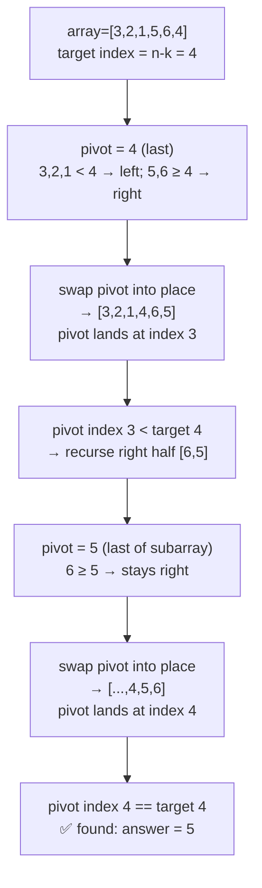

# 215. Kth Largest Element in an Array

**LeetCode:** https://leetcode.com/problems/kth-largest-element-in-an-array/

## Problem
Given an integer array `nums` and an integer `k`, return the `k`-th largest element
in the array — meaning the k-th largest in **sorted order**, not the k-th *distinct*
value (so duplicates each count individually).

**Input:** `nums` array, integer `k`
**Output:** the k-th largest value in `nums`

**Examples**
1. `nums = [3,2,1,5,6,4]`, `k = 2` → `5`. Sorted descending: 6,5,4,3,2,1 → 2nd
   largest is 5.
2. `nums = [3,2,3,1,2,4,5,5,6]`, `k = 4` → `4`. Sorted descending:
   6,5,5,4,3,3,2,2,1 → 4th largest (counting duplicates) is 4.
3. `nums = [1]`, `k = 1` → `1`. Single element, trivially the 1st largest.

**Constraints:** `1 <= k <= nums.length <= 10^5`, `-10^4 <= nums[i] <= 10^4`.

> 🔑 **Pattern Recognition**
> Only a single rank is needed, not the full order → heap of size k, or better,
> quickselect partitioning to find that one rank without sorting everything.

## Intuition (explained simply)
"The k-th largest" is a question about *rank*, not about the full sorted order. A
full sort answers it but does more work than necessary; a heap of size k, or a
partition-based selection algorithm, both answer "what's at rank k" without
needing to fully order everything else.

### 1. Brute Force
- Sort the entire array in descending order and return the element at index `k-1`.
- Correct because a full sort directly gives every element's rank.
- Time complexity: O(n log n)  Space complexity: O(n) if not sorting in place
  (O(log n) auxiliary for Python's Timsort), O(1) if we don't count the sort's
  internal usage
- Why it's not ideal: sorting the whole array is more work than needed when k is
  small relative to n — we only need to know what's at one specific rank, not the
  full order of every element.

### 2. Better — Min-Heap of Size k
- Maintain a min-heap of size at most k: push each number, and if the heap exceeds
  size k, pop the smallest. After processing all n numbers, the heap contains the k
  largest, and its root (smallest of those) is the answer.
- Time complexity: O(n log k)  Space complexity: O(k)
- This is a strong, commonly accepted interview answer already — the "still
  suboptimal" angle is purely about achieving true average-case linear time via
  quickselect, which some interviewers will ask for as a follow-up.

### 3. Optimal — Quickselect
- Use the quickselect algorithm: convert "k-th largest" into "the element at index
  `n-k` in ascending sorted order" (or equivalently, "index `k-1` in descending
  order"). Pick a random pivot, partition the array around it (elements less than
  the pivot go left, greater go right, similar to quicksort's partition step), and
  based on where the pivot lands relative to the target index, recurse into only the
  side that must contain it — never both sides.
- Why it works: this is the same "eliminate half the candidates per step" idea as
  binary search, but applied via partitioning instead of comparison — on average,
  each partition pass roughly halves the remaining search space, so total work sums
  to O(n) (n + n/2 + n/4 + ... converges to O(n)), unlike full sorting which must
  fully order every element.
- Time complexity: O(n) average case, O(n^2) worst case (mitigated by random pivot
  selection, which makes the adversarial worst case astronomically unlikely)
  Space complexity: O(1) extra (in-place partitioning) or O(log n) average recursion
  stack.
- Edge cases: `k = 1` (the maximum), `k = n` (the minimum), all elements equal,
  array with negative numbers.

#### 🎯 Visual Walkthrough
Tracing `nums = [3,2,1,5,6,4]`, `k=2` from example 1 (target ascending index =
`n-k = 4`):

## Complexity Summary
| Approach | Time | Space |
|---|---|---|
| Brute Force | O(n log n) | O(n) |
| Better (min-heap) | O(n log k) | O(k) |
| Optimal (quickselect) | O(n) average, O(n^2) worst | O(1) extra |
