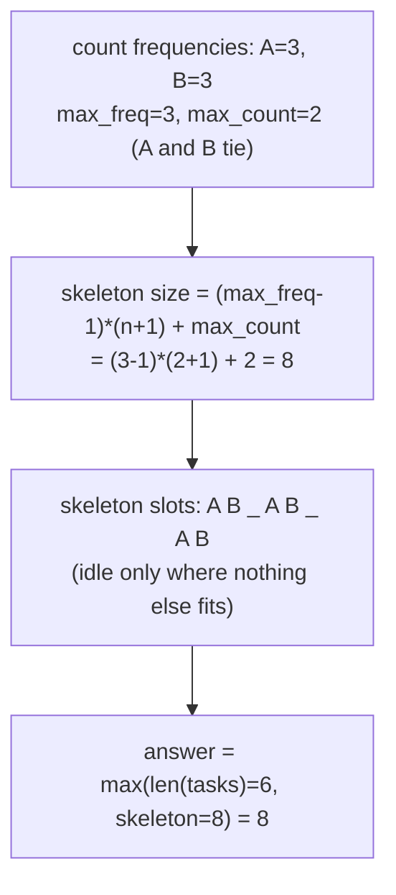

# 621. Task Scheduler

**LeetCode:** https://leetcode.com/problems/task-scheduler/

## Problem
You're given an array `tasks` of uppercase letters (each letter is a task type) and
a non-negative integer `n`. A CPU processes one task per unit time slot, but the same
task type must be separated by **at least** `n` slots (it can idle instead of doing a
task if none are available). Return the minimum total number of time slots needed to
finish all tasks.

**Input:** `tasks` (array of task-type letters), `n` (cooldown between same-type
tasks)
**Output:** minimum number of time slots to complete all tasks

**Examples**
1. `tasks = ["A","A","A","B","B","B"]`, `n = 2` → `8`. One valid schedule:
   `A -> B -> idle -> A -> B -> idle -> A -> B` (8 slots; A and B each need 2 slots
   of separation).
2. `tasks = ["A","A","A","B","B","B"]`, `n = 0` → `6`. No cooldown needed, so tasks
   can run back-to-back: `A -> A -> A -> B -> B -> B` in exactly 6 slots.
3. `tasks = ["A","A","A","A","A","A","B","C","D","E","F","G"]`, `n = 2` → `16`. The
   most frequent task (`A`, count 6) dominates: it needs 5 gaps of size at least 2
   between its 6 occurrences, and there are enough other distinct tasks to fill most
   gaps, but not quite all, requiring idle slots.

**Constraints:** `1 <= tasks.length <= 10^4`, tasks are uppercase English letters
(26 possible types), `0 <= n <= 100`.

> 🔑 **Pattern Recognition**
> Repeatedly schedule the "currently most frequent remaining item" under a
> cooldown → max-heap of counts (or, once you see the pattern, a closed-form
> formula built around the most frequent task).

## Intuition (explained simply)
The task that appears most often is the real bottleneck: it forces a minimum
skeleton of `(count-1) * (n+1) + 1` slots just to space out its own occurrences
(count-1 gaps, each of size n+1, plus one final occurrence). Other tasks fill into
the gaps of that skeleton — if there are enough distinct other tasks to fill every
gap, the answer is exactly the total number of tasks (no idle needed); if not, idle
slots pad out the leftover gaps.

### 1. Brute Force — Simulation
- Simulate time slot by time slot. At each slot, look at all task types with
  remaining count > 0 and whose cooldown has expired, pick the one with the highest
  remaining count (greedy — always attack the most frequent task first to leave more
  room for others), decrement its count, and mark its cooldown. If no task is
  available, insert an idle slot. Repeat until all tasks are done.
- Correct because greedily scheduling the most frequent remaining task at every
  legal opportunity is optimal (it's the same reasoning as the interval-scheduling
  greedy proof: delaying the most frequent task only makes future conflicts worse).
- Time complexity: O(total_slots * 26) — at every simulated time slot (up to
  roughly `n * count_of_max`, bounded but can be large) we scan all 26 letter counts
  Space complexity: O(26) for counts/cooldowns
- Why it's not good enough: explicitly simulating every single time slot (which can
  be much larger than the number of actual tasks, due to idle padding) is wasteful
  when a closed-form/heap-based approach can compute the answer far more directly.

### 2. Better — Max-Heap Simulation in Rounds
- Count task frequencies, push all counts into a max-heap (negate for Python's
  min-heap). Process in rounds of `n+1` slots: each round, pop up to `n+1` tasks
  with the highest remaining counts, decrement each, and if any still have
  remaining count, stash them in a temp list to push back into the heap after the
  round (they can't be reused within the same round due to cooldown). Add `n+1` (or
  fewer, if the heap emptied early in the round) to the total slot count for each
  round. Continue until the heap is empty.
- Time complexity: O(total_tasks * log 26) — much faster than per-slot simulation
  since work happens once per task, not once per slot (idle slots are just added by
  arithmetic, not iterated one-by-one) Space complexity: O(26)
- Still suboptimal in the sense that it's still a simulation (round by round);
  there's a purely mathematical closed-form that skips simulation entirely.

### 3. Optimal — Math Formula (Frequency-Based)
- Find the maximum frequency `max_freq` among all task types, and count how many
  distinct task types also have that same maximum frequency (`max_count`). The
  minimum slots needed to accommodate the most frequent task's spacing is
  `(max_freq - 1) * (n + 1) + max_count` (the skeleton built from the most frequent
  task(s), where ties at the max also need their own final slot in the last group).
  The answer is `max(len(tasks), that formula)` — because if there are enough total
  tasks to fill every gap in the skeleton with no idle time needed, the true answer
  is simply the total task count.
- Why it works: any tasks that aren't part of the max-frequency group can always be
  slotted into the "gaps" of the skeleton built around the most frequent task(s)
  without violating any cooldown (since gaps are sized exactly n), UNLESS there are
  so many total tasks that they overflow the skeleton entirely, in which case no
  idle time is needed at all and the answer is just the task count.
- Time complexity: O(t) to count frequencies (t = number of tasks, but effectively
  O(t) since there are only 26 possible letters to scan after counting)
  Space complexity: O(26) = O(1)
- Edge cases: `n = 0` (answer is always just `len(tasks)`), single task type,
  enough distinct tasks that idle time is never needed, all tasks the same type.

#### 🎯 Visual Walkthrough
Tracing `tasks = ["A","A","A","B","B","B"]`, `n=2` from example 1:

## Complexity Summary
| Approach | Time | Space |
|---|---|---|
| Brute Force (per-slot sim) | O(total_slots * 26) | O(26) |
| Better (heap rounds) | O(t log 26) | O(26) |
| Optimal (math formula) | O(t) | O(26) |
