# 355. Design Twitter

**LeetCode:** https://leetcode.com/problems/design-twitter/

## Problem
Design a simplified Twitter with: `postTweet(userId, tweetId)` posts a new tweet;
`getNewsFeed(userId)` returns the IDs of the 10 most recent tweets from the given
user and everyone they follow (most recent first); `follow(followerId, followeeId)`
makes `followerId` follow `followeeId`; `unfollow(followerId, followeeId)` reverses
that.

**Input:** a sequence of `postTweet`, `getNewsFeed`, `follow`, `unfollow` calls
**Output:** for `getNewsFeed`, a list of up to 10 tweet IDs, most recent first

**Examples**
1. `postTweet(1, 5)`; `getNewsFeed(1)` → `[5]`; `follow(1, 2)`; `postTweet(2, 6)`;
   `getNewsFeed(1)` → `[6, 5]` (user 2's tweet is newer, so it comes first);
   `unfollow(1, 2)`; `getNewsFeed(1)` → `[5]` (user 2's tweet no longer included).
2. `postTweet(1, 1)`; `postTweet(1, 2)`; `postTweet(1, 3)`; `getNewsFeed(1)` →
   `[3, 2, 1]` — own tweets always count toward your own feed, most recent first.
3. `follow(1, 1)` — following yourself is a no-op-safe operation; `postTweet(1, 9)`;
   `getNewsFeed(1)` → `[9]` (a user's own tweets appear regardless of the follow
   graph).

**Constraints:** `1 <= userId, followerId, followeeId <= 500`, `0 <= tweetId <= 10^4`,
all tweetIds are unique, `1 <= number of calls <= 3*10^4`.

> 🔑 **Pattern Recognition**
> Merging several already-sorted timelines and taking only the top few → this is
> "merge k sorted lists," solved with a max-heap keyed by recency.

## Intuition (explained simply)
The news feed is "merge the tweet timelines of everyone I follow (plus myself),
sorted by recency, keep the top 10." This is structurally identical to "merge k
sorted lists and take the first 10" — each followed user's tweet history is already
chronologically ordered, so we need an efficient way to merge those histories and
grab the most recent slice.

### 1. Brute Force
- Store tweets in a global list of `(timestamp, userId, tweetId)`. Store follows as
  a dict of `userId -> set of followed userIds`. For `getNewsFeed(userId)`, scan the
  ENTIRE global tweet list, filter to tweets by `userId` or anyone they follow, sort
  the filtered results by timestamp descending, and take the first 10.
- Correct because it directly implements the definition: consider every tweet ever
  posted, keep only relevant ones, sort by recency, truncate.
- Time complexity: `postTweet` O(1), `getNewsFeed` O(T log T) where T = total tweets
  ever posted (scans and sorts the entire tweet history every single call)
  Space complexity: O(T + F) where F = number of follow relationships
- Why it's not good enough: re-scanning and re-sorting *every* tweet ever posted by
  *anyone*, on every single feed request, is extremely wasteful — most of those
  tweets aren't even relevant, and old tweets get re-sorted uselessly over and over.

### 2. Better
- Store each user's own tweets in their own list (dict of `userId -> list of
  (timestamp, tweetId)`), so filtering by relevance is immediate. For
  `getNewsFeed(userId)`, gather only the tweet lists of `userId` and their followees
  (a much smaller subset than the global history), concatenate those lists, sort the
  combined result by timestamp descending, and take the top 10.
- Time complexity: `postTweet` O(1), `getNewsFeed` O(k * m log(k * m)) where k =
  number of followees, m = average tweets per relevant user (sorting only the
  relevant subset, not the whole platform) Space complexity: O(T + F)
- Still suboptimal: still fully sorts the combined relevant tweets even though we
  only need the top 10 — if any single followee has posted thousands of tweets, we
  needlessly sort all of them just to find 10.

### 3. Optimal — Max-Heap Merge (like Merge k Sorted Lists)
- Store each user's tweets as a list of `(timestamp, tweetId)`, which is naturally
  already sorted by post order (append-only). For `getNewsFeed(userId)`, gather the
  most recent tweet of `userId` and each followee (just the tail of each of their
  lists, since we walk backward), push each into a max-heap keyed by timestamp
  (using a global incrementing counter as the "timestamp" for exact recency
  ordering), then repeatedly pop the most recent, add it to the result, and push
  that user's next-most-recent tweet (if any) — exactly the k-list merge pattern,
  stopping once we have 10 tweets or the heap is empty.
- Why it works: this is "merge k sorted lists, take the first 10" solved the
  efficient way — instead of combining and fully sorting every relevant tweet, the
  heap always gives us the next most-recent one in O(log k) time, and we simply stop
  once we've pulled 10, without ever touching most of the older tweets.
- Time complexity: `postTweet` O(1), `follow`/`unfollow` O(1), `getNewsFeed`
  O(k log k) where k = number of followees + 1 (each of the up to 10 pops/pushes
  costs O(log k), and k is bounded by the number of people followed, which is much
  smaller than total tweet count) Space complexity: O(T + F) for storage, O(k) for
  the heap during a feed query.
- Edge cases: a user with no tweets and no follows (empty feed), following yourself
  (should still just show your own tweets once, not duplicated), unfollowing a user
  never followed (no-op), more than 10 relevant tweets available (must truncate).

#### 🎯 Visual Walkthrough
Tracing `getNewsFeed(1)` from example 1 after `follow(1,2)` and `postTweet(2,6)`
(user 1's timeline has tweet `5` at time `t0`, user 2's has tweet `6` at time `t1`):

```mermaid
flowchart TD
    A["push most-recent tail of each followee:<br/>(t1,tweet6,user2), (t0,tweet5,user1)<br/>max-heap by timestamp"]
    B["pop max → t1,tweet6<br/>result=&#91;6&#93;<br/>user2 has no older tweet to push back"]
    C["pop max → t0,tweet5<br/>result=&#91;6,5&#93;<br/>heap empty → stop (< 10 needed)"]
    D["return &#91;6,5&#93;"]
    A --> B --> C --> D
```

## Complexity Summary
| Approach | Time (getNewsFeed) | Space |
|---|---|---|
| Brute Force | O(T log T) | O(T + F) |
| Better | O(k*m log(k*m)) | O(T + F) |
| Optimal | O(k log k) | O(T + F) storage, O(k) per query |
