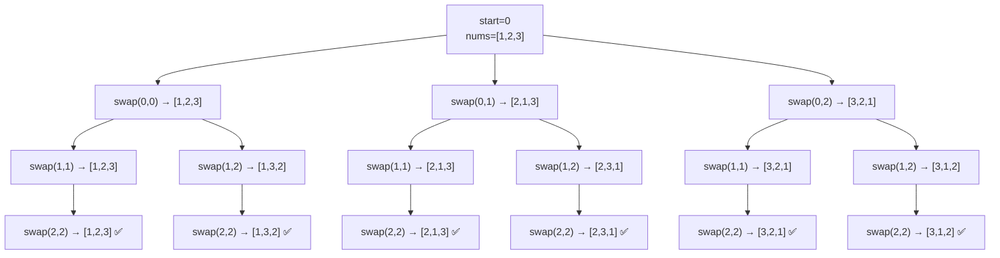

# 46. Permutations

**LeetCode:** https://leetcode.com/problems/permutations/

## Problem
Given an array of distinct integers, return every possible ordering (permutation) of
its elements. There are `n!` permutations for `n` distinct elements.

**Input:** array of distinct integers
**Output:** a list of all permutations (each a list of integers)

**Examples**
1. Input: `[1,2,3]` → Output: `[[1,2,3],[1,3,2],[2,1,3],[2,3,1],[3,1,2],[3,2,1]]`
   (order may vary) — all `3! = 6` orderings.
2. Input: `[0,1]` → Output: `[[0,1],[1,0]]` — `2! = 2` orderings.
3. Input: `[1]` → Output: `[[1]]` — only one ordering possible.

**Constraints:** `1 <= nums.length <= 6`, all values distinct.

> 🔑 **Pattern Recognition**
> Need every possible ordering of a set of items → backtracking that fixes one
> position at a time and tries every not-yet-placed value there.

## Intuition (explained simply)
A permutation is built by deciding, one position at a time, which of the *remaining*
(not-yet-used) numbers goes there. Backtracking naturally models this: pick an unused
number, place it, recurse to fill the next position, then undo the pick (mark it
unused again) so it can be tried in a different position for the next branch.

### 1. Brute Force
- Generate permutations recursively without tracking which numbers are "used" via a
  clean set — instead, at each step build a new list of the remaining elements by
  scanning through and filtering out ones already placed (an O(n) scan per step),
  and repeat this scan-and-filter for every recursive call.
- Time complexity: O(n! * n^2) — n! permutations, and building each one this way
  costs an extra O(n) filtering step at each of its n positions  Space complexity:
  O(n! * n) for the output, plus O(n^2) temporary lists created along the recursion
- Why it's not good enough: repeatedly filtering the "remaining" list from scratch at
  every step is wasted work — a simple boolean "used" tracker (or swapping elements
  in place) avoids all of that scanning.

### 2. Better
- Backtracking with an explicit `used` boolean array of length n: at each step, loop
  over all indices, skip any already marked `used`, otherwise mark it used, append
  its value to the current path, recurse, then unmark it and pop it (undo) before
  trying the next index.
- Time complexity: O(n! * n) — n! permutations, O(n) work to build/copy each one
  (plus O(n) scanning through `used` at each level, which is absorbed into the same
  bound)  Space complexity: O(n) for `used` and the path, plus O(n! * n) output
- What's still suboptimal: still allocates a separate `used` array and does a linear
  scan over it at every recursive level; an in-place swapping technique achieves the
  same result without any extra bookkeeping array at all.

### 3. Optimal
- In-place swapping backtracking: treat the array as split into a "fixed prefix"
  (positions `0..start-1`, already decided) and a "free suffix" (`start..n-1`, not
  yet decided). At each step, try every index `i` from `start` to `n-1` as the next
  element by swapping `nums[start]` and `nums[i]`, recursing with `start + 1`, then
  swapping back to restore the array before trying the next `i`. When `start == n`,
  the current arrangement of `nums` is a complete permutation — copy it into the
  result.
- This works because swapping an element into position `start` and recursing treats
  every remaining element as a candidate for that slot, and swapping back afterward
  restores the exact state needed to correctly try the next candidate — with zero
  extra tracking structures, using the input array itself as the workspace.
- Time complexity: O(n! * n) — same asymptotic bound as Better, but no auxiliary
  `used` array or per-level linear scan for "is this used," and no filtering copies
  Space complexity: O(n) recursion depth (no extra tracking array), plus O(n! * n)
  output
- Edge cases: single-element array → immediately yields the one trivial permutation;
  the swap-based method correctly restores original order after full backtracking
  completes.

#### 🎯 Visual Walkthrough
Tracing `nums = [1,2,3]` from example 1 with the in-place swap technique (full
tree, since n=3 gives all `3! = 6` leaves):

## Complexity Summary
| Approach | Time | Space |
|---|---|---|
| Brute Force | O(n! * n^2) | O(n! * n) |
| Better | O(n! * n) | O(n) + output |
| Optimal | O(n! * n) | O(n) + output |
