# 90. Subsets II

**LeetCode:** https://leetcode.com/problems/subsets-ii/

## Problem
Given an integer array `nums` that may contain duplicate values, return every
possible subset (the power set), but the result must not contain any duplicate
subsets. Subsets may be returned in any order.

**Input:** array of integers, possibly with duplicates
**Output:** a list of unique subsets

**Examples**
1. Input: `[1,2,2]` → Output: `[[],[1],[1,2],[1,2,2],[2],[2,2]]`. Note there is only
   **one** `[1,2]` and one `[2]` in the result, even though `2` appears twice in the
   input.
2. Input: `[0]` → Output: `[[],[0]]`.
3. Input: `[4,4,4]` → Output: `[[],[4],[4,4],[4,4,4]]`. All three `4`s are
   indistinguishable, so only "how many 4s" matters, not which specific `4`.

**Constraints:** `1 <= nums.length <= 10`, `-10 <= nums[i] <= 10`.

> 🔑 **Pattern Recognition**
> Same "include or exclude" subset search as LC 78, but duplicate input values
> would generate duplicate subsets → sort first and only branch once per distinct
> value (or loop over "how many copies to include").

## Intuition (explained simply)
This is Subsets (LC 78) but with a duplicate-values twist. If you don't handle
duplicates specially, picking "the first `2`" versus "the second `2`" at the same
recursion step produces two *different-looking* recursive branches that build the
exact same subset — a wasted, duplicate result. The fix: sort the array so identical
values sit next to each other, then at each decision point only take *one* instance
of a repeated value as the "start of a new pick" among siblings.

### 1. Brute Force
- Ignore duplicates during generation entirely (run the same backtracking as
  Subsets/LC 78 as if all elements were distinct by index), collecting every
  resulting subset. Then, as a separate cleanup pass, convert each subset to a
  sorted tuple and insert all of them into a set to eliminate exact duplicates,
  finally converting the set back into a list of lists.
- Time complexity: O(n * 2^n) to generate everything (same as plain Subsets) plus
  O(2^n * n log n) to sort and dedup every generated subset afterward  Space
  complexity: O(n * 2^n) — including many duplicate subsets held in memory
  temporarily before being filtered out
- Why it's not good enough: it generates a large number of subsets that are thrown
  away immediately, and pays a full sort-and-hash cost per subset just to detect
  duplicates that could have been avoided from the start.

### 2. Better
- Sort `nums` first, then during backtracking, skip an index `i` (when `i > start`)
  if `nums[i] == nums[i - 1]` — this prevents picking "the same value again as a
  fresh sibling choice" at the same recursion level, which is exactly where
  duplicate subsets originate. Recurse normally otherwise.
- Time complexity: O(n * 2^n) — no wasted duplicate generation, dedup happens by
  construction instead of after the fact  Space complexity: O(n) for the recursion
  path, plus O(n * 2^n) for the output
- What's still suboptimal: nothing algorithmically — this is essentially the
  standard optimal solution already. The remaining refinement is purely about
  implementation clarity/performance: using index-based comparisons on a pre-sorted
  array (as done here) versus alternative bookkeeping (e.g. counting frequencies)
  can be marginally cleaner for very duplicate-heavy inputs.

### 3. Optimal
- Same sorted-array backtracking with the adjacent-duplicate skip rule, but instead
  of a plain skip check, group **all** copies of the same value together and
  explicitly loop over "how many copies of this value to include" (0, 1, 2, ... up
  to however many are available) before moving to the next distinct value. This
  frames subset generation directly in terms of unique values and their multiplicity,
  which is both efficient and very natural to extend to counting-style variants.
- This works because a subset is fully determined by, for each distinct value, how
  many copies of it to include — enumerating "count of value v" independently per
  distinct value (0 up to its total occurrences) generates every unique subset
  exactly once, with no duplicate-detection logic needed at all.
- Time complexity: O(n * 2^n) — same output-bound complexity, but the multiplicity
  framing avoids any residual duplicate-skip branching overhead per recursive call
  Space complexity: O(n) for the recursion depth/grouping, plus O(n * 2^n) for the
  output
- Edge cases: all elements identical → produces exactly `n + 1` subsets (one for
  each possible count of the value, from 0 to n); no duplicates at all → behaves
  identically to plain Subsets (LC 78).

#### 🎯 Visual Walkthrough
Tracing `nums = [1,2,2]` from example 1 using the multiplicity framing (distinct
values: `1` ×1, `2` ×2 — every leaf is a distinct valid subset, no dedup logic
needed):

```mermaid
graph TD
    R["sorted nums=&#91;1,2,2&#93;<br/>distinct: 1 (x1), 2 (x2)"]
    A["include 1 × 0<br/>path=&#91;&#93;"]
    B["include 1 × 1<br/>path=&#91;1&#93;"]
    A0["include 2 × 0 → &#91;&#93; ✅"]
    A1["include 2 × 1 → &#91;2&#93; ✅"]
    A2["include 2 × 2 → &#91;2,2&#93; ✅"]
    B0["include 2 × 0 → &#91;1&#93; ✅"]
    B1["include 2 × 1 → &#91;1,2&#93; ✅"]
    B2["include 2 × 2 → &#91;1,2,2&#93; ✅"]
    R --> A --> A0
    A --> A1
    A --> A2
    R --> B --> B0
    B --> B1
    B --> B2
```

## Complexity Summary
| Approach | Time | Space |
|---|---|---|
| Brute Force | O(n * 2^n) + O(2^n * n log n) dedup | O(n * 2^n) |
| Better | O(n * 2^n) | O(n) + output |
| Optimal | O(n * 2^n) | O(n) + output |
