# 40. Combination Sum II

**LeetCode:** https://leetcode.com/problems/combination-sum-ii/

## Problem
Given a collection of candidate numbers (`candidates`, which may contain duplicates)
and a target integer, find every unique combination where the numbers sum to
`target`. Unlike Combination Sum (LC 39), **each number may only be used once per
combination** (though the same value can appear more than once in `candidates`
itself). No duplicate combinations in the output.

**Input:** array of integers (may have duplicates), integer `target`
**Output:** a list of unique combinations summing to `target`

**Examples**
1. Input: `candidates = [10,1,2,7,6,1,5]`, `target = 8` → Output:
   `[[1,1,6],[1,2,5],[1,7],[2,6]]`. Note `[1,1,6]` uses both `1`s (they're two
   separate input elements), but there's only one such combination in the result.
2. Input: `candidates = [2,5,2,1,2]`, `target = 5` → Output: `[[1,2,2],[5]]`.
3. Input: `candidates = [2]`, `target = 1` → Output: `[]`. No combination possible.

**Constraints:** `1 <= candidates.length <= 100`, `1 <= candidates[i] <= 50`,
`1 <= target <= 30`.

> 🔑 **Pattern Recognition**
> Combination-sum where each element is used at most once AND duplicate input
> values could create duplicate combinations → advance the index on every pick
> (no reuse) plus skip repeated sibling values (dedup), both after sorting.

## Intuition (explained simply)
This combines two ideas: "each element used at most once" (like Subsets, advance the
index every time you recurse) and "avoid duplicate combinations from duplicate
input values" (like Subsets II, skip repeated values at the same recursion level).
Sorting first makes both rules easy to apply together.

### 1. Brute Force
- Generate every subset of `candidates` that sums to `target` (treating every index
  as distinct, ignoring value duplication — this is exactly the LC 39 "combination
  sum" shape but forcing `i+1` instead of `i` on recursion, so no reuse), collecting
  all such combinations by index. Then post-process: convert each to a sorted
  tuple and dedup via a set.
- Time complexity: O(2^n) to explore all index-subsets whose sum could match, plus
  O(2^n * n log n) to sort and dedup every found combination afterward  Space
  complexity: O(2^n * n) holding many combinations that are duplicates of each other
  before filtering
- Why it's not good enough: many of the generated combinations are exact duplicates
  by value (e.g. using the first `1` vs. the second `1` in the input) — detecting
  and discarding this after the fact wastes both time and memory that could be
  avoided by preventing the duplicates from ever being generated.

### 2. Better
- Sort `candidates` first. Backtrack with strictly increasing index (`i+1` on
  recursion — no reuse of the same element), and at each recursion level, skip index
  `i` if `i > start` and `candidates[i] == candidates[i-1]` (this is the same
  duplicate-prevention trick as Subsets II, applied here alongside the sum
  tracking). Stop exploring a branch if the running sum exceeds `target`.
- Time complexity: O(2^n) — no wasted duplicate generation, but no early pruning
  beyond "stop if sum already exceeds target" after trying a candidate  Space
  complexity: O(n) recursion depth, plus output size
- What's still suboptimal: candidates are tried in sorted order but the loop still
  checks every remaining index even when the smallest remaining candidate is
  already too large — an explicit `break` (rather than just relying on the
  recursive call's own exceeded-sum check) can prune whole remaining suffixes of the
  loop immediately.

### 3. Optimal
- Same sorted + duplicate-skip backtracking, but add a `break` the moment
  `candidates[i] > remaining` inside the loop (not just inside the recursive call) —
  since the array is sorted, every candidate after index `i` is also too large, so
  there's no reason to even check them.
- This works for the same reason it did in Combination Sum (LC 39): sorting first
  guarantees that once one candidate is too big, all subsequent ones in the loop are
  too, so `break` safely eliminates checking the rest of that level's remaining
  choices, cutting off large unproductive parts of the search tree earlier.
- Time complexity: same worst-case bound as Better, but with a meaningfully smaller
  number of recursive calls explored in practice thanks to earlier pruning  Space
  complexity: O(n) recursion depth, plus output size
- Edge cases: multiple identical values needed in one combination (e.g. `[1,1,6]`) —
  correctly allowed since duplicate-skip only applies to *sibling* choices at the
  same level, not to values already included deeper in the current path; no valid
  combination exists → returns `[]`.

#### 🎯 Visual Walkthrough
Tracing sorted `candidates = [1,2,2,2,5]`, `target = 5` from example 2 (a
representative slice showing both the duplicate-skip and the `break` pruning):

```mermaid
graph TD
    R["sorted=&#91;1,2,2,2,5&#93;, target=5"]
    A["pick 1 (idx0) → remaining=4<br/>path=&#91;1&#93;"]
    A1["pick 2 (idx1) → remaining=2<br/>path=&#91;1,2&#93;"]
    A1a["pick 2 (idx2) → remaining=0<br/>path=&#91;1,2,2&#93; ✅"]
    A1b["idx3=2, same as idx2<br/>❌ pruned (skip duplicate)"]
    A1c["idx4=5 → 5 > 2<br/>❌ pruned (break)"]
    A2["idx2=2, same as idx1 sibling<br/>❌ pruned (skip duplicate)"]
    B["pick 2 (idx1, top level) → remaining=3<br/>path=&#91;2&#93;"]
    B1["pick 2 (idx2) → remaining=1<br/>path=&#91;2,2&#93;"]
    B1a["idx3=2 → 2 > 1<br/>❌ pruned (break)"]
    C["idx2=2, same as idx1 sibling<br/>❌ pruned (skip duplicate)"]
    D["pick 5 (idx4, top level) → remaining=0<br/>path=&#91;5&#93; ✅"]
    R --> A --> A1 --> A1a
    A1 --> A1b
    A1 --> A1c
    A --> A2
    R --> B --> B1 --> B1a
    R --> C
    R --> D
```

## Complexity Summary
| Approach | Time | Space |
|---|---|---|
| Brute Force | O(2^n) + O(2^n * n log n) dedup | O(2^n * n) |
| Better | O(2^n) | O(n) + output |
| Optimal | O(2^n), fewer nodes visited | O(n) + output |
