# 131. Palindrome Partitioning

**LeetCode:** https://leetcode.com/problems/palindrome-partitioning/

## Problem
Given a string `s`, split it into one or more substrings such that **every**
substring is a palindrome. Return all possible such partitions.

**Input:** a string `s`
**Output:** a list of partitions, each partition a list of palindromic substrings
that concatenate back to `s`

**Examples**
1. Input: `"aab"` → Output: `[["a","a","b"],["aa","b"]]`. Both split every piece
   into a palindrome.
2. Input: `"a"` → Output: `[["a"]]`. A single character is trivially a palindrome.
3. Input: `"aba"` → Output: `[["a","b","a"],["aba"]]`.

**Constraints:** `1 <= s.length <= 16`, `s` contains only lowercase English letters.

> 🔑 **Pattern Recognition**
> Split a string into pieces that each satisfy a property (palindrome) →
> backtrack over cut points, only recursing past a cut once the piece it created
> is verified valid.

## Intuition (explained simply)
At each position in the string, try every possible "next cut point" — take the
substring from here to that cut, and if it's a palindrome, recurse on the rest of
the string starting right after the cut. If it isn't a palindrome, that cut is
invalid and gets skipped. This is a classic backtracking-over-prefixes pattern.

### 1. Brute Force
- Generate every possible way to place cuts in the string at all (equivalent to
  choosing a subset of the `n-1` gaps between characters as cut points — `2^(n-1)`
  total partitions), building each full partition, and only afterward checking
  whether **every** resulting piece happens to be a palindrome, discarding the
  partition if any piece fails.
- Time complexity: O(2^n * n) — generate all `2^(n-1)` partitions, and checking all
  pieces of a partition for palindrome-ness costs O(n) total per partition  Space
  complexity: O(2^n * n) to hold all partitions (valid and invalid) before filtering
- Why it's not good enough: it wastes enormous effort constructing and checking
  partitions that are doomed the moment an early piece fails to be a palindrome —
  there's no reason to keep building past a bad prefix.

### 2. Better
- Backtracking that only extends a partition with a **verified** palindromic prefix
  at each step: at position `start`, try every end index `end` from `start+1` to
  `n`, check if `s[start:end]` is a palindrome (an O(k) check for a substring of
  length k), and only recurse further if it is — immediately pruning any branch
  where an early piece fails, instead of discovering that after building the whole
  partition.
- Time complexity: O(2^n * n) worst case still (the underlying number of valid
  partitions can itself be exponential for palindrome-heavy strings like "aaaa...a"),
  but with a much smaller constant — no wasted work past a bad prefix, and each
  palindrome check costs O(n) freshly computed  Space complexity: O(n) recursion
  depth, plus output size
- What's still suboptimal: every palindrome check (`s[start:end] == s[start:end][::-1]`)
  recomputes from scratch, even though many overlapping substrings get checked
  repeatedly across different branches of the recursion.

### 3. Optimal
- Precompute a 2D DP table `is_pal[i][j]` (`True` if `s[i:j+1]` is a palindrome) in
  O(n^2) using the standard expand-based recurrence
  (`is_pal[i][j] = s[i]==s[j] and (j-i<2 or is_pal[i+1][j-1])`), computed once up
  front. Then run the same backtracking as Better, but replace every "is this
  substring a palindrome" check with an O(1) table lookup instead of an O(n)
  recomputation.
- This works because whether `s[i:j+1]` is a palindrome only depends on
  `s[i]==s[j]` and whether the inner substring `s[i+1:j]` is also a palindrome — a
  small, reusable subproblem that's shared across many different partition attempts,
  so computing it once for every `(i, j)` pair avoids all the redundant re-checking.
- Time complexity: O(n^2) for the DP table + O(2^n) for exploring the (still
  potentially exponential) partition tree, but each step inside that tree is now
  O(1) instead of O(n)  Space complexity: O(n^2) for the DP table, plus O(n)
  recursion depth and output size
- Edge cases: all-identical characters (e.g. `"aaaa"`) → produces the maximum
  possible number of valid partitions (still exponential in the worst case, which
  is unavoidable since that's the true output size); single character → trivially
  one partition.

#### 🎯 Visual Walkthrough
Tracing `s = "aab"` from example 1 (full tree — every cut is checked against the
palindrome table):

```mermaid
graph TD
    R["s='aab', start=0"]
    A["end=1: s&#91;0:1&#93;='a'<br/>✅ palindrome"]
    A1["end=2: s&#91;1:2&#93;='a'<br/>✅ palindrome"]
    A1a["end=3: s&#91;2:3&#93;='b'<br/>✅ → complete &#91;'a','a','b'&#93; ✅"]
    A2["end=3: s&#91;1:3&#93;='ab'<br/>❌ pruned (not palindrome)"]
    B["end=2: s&#91;0:2&#93;='aa'<br/>✅ palindrome"]
    B1["end=3: s&#91;2:3&#93;='b'<br/>✅ → complete &#91;'aa','b'&#93; ✅"]
    C["end=3: s&#91;0:3&#93;='aab'<br/>❌ pruned (not palindrome)"]
    R --> A --> A1 --> A1a
    A --> A2
    R --> B --> B1
    R --> C
```

## Complexity Summary
| Approach | Time | Space |
|---|---|---|
| Brute Force | O(2^n * n) | O(2^n * n) |
| Better | O(2^n * n) fewer wasted branches | O(n) + output |
| Optimal | O(n^2) precompute + O(2^n) traversal | O(n^2) + output |
