# 51. N-Queens

**LeetCode:** https://leetcode.com/problems/n-queens/

## Problem
Given an integer `n`, place `n` chess queens on an `n x n` board such that no two
queens attack each other (no two share a row, a column, or a diagonal). Return all
distinct solutions, each represented as a list of strings where `'Q'` marks a queen
and `'.'` marks an empty cell.

**Input:** integer `n`
**Output:** a list of board configurations (each a list of `n` strings of length `n`)

**Examples**
1. Input: `n = 4` → Output: 2 solutions, e.g.
   `[".Q..","...Q","Q...","..Q."]` and `["..Q.","Q...","...Q",".Q.."]`.
2. Input: `n = 1` → Output: `[["Q"]]`. A single queen trivially doesn't attack
   itself.
3. Input: `n = 2` (or `n = 3`) → Output: `[]`. It's mathematically impossible to
   place 2 or 3 non-attacking queens on boards that small.

**Constraints:** `1 <= n <= 9`.

> 🔑 **Pattern Recognition**
> Place one item per row under column/diagonal constraints, backtrack when no
> column works → row-by-row backtracking with O(1) conflict checks (sets or
> bitmasks) instead of rescanning placed queens.

## Intuition (explained simply)
Since no two queens can share a row, you can simplify the problem to "place exactly
one queen per row" — the only real decision at each row is *which column* to put
its queen in. Backtracking tries each column for the current row, checks whether
that placement conflicts with any queen already placed in earlier rows, and if not,
moves on to the next row; if every column conflicts, backtrack to the previous row
and try a different column there.

### 1. Brute Force
- Place one queen per row (so there are `n` positions to decide, one per row), but
  check for conflicts by comparing the current placement against **every** already-
  placed queen from scratch with nested loops each time a new queen is tentatively
  placed — no precomputed tracking of "which columns/diagonals are occupied," just a
  full O(row) scan against all previously placed queens for every candidate column.
- Time complexity: O(n^n) for the raw search space (n choices per row, n rows) times
  an extra O(n) conflict-check cost per placement attempt, i.e. O(n^(n+1)) —
  although pruning cuts this down substantially in practice, this is the naive
  upper bound  Space complexity: O(n) for the current placement list, plus O(n) per
  conflict check
- Why it's not good enough: rechecking every previous queen from scratch for every
  candidate column is wasteful — three simple boolean/set trackers (columns used,
  and the two diagonal directions used) can turn each conflict check into O(1).

### 2. Better
- Backtracking with three `set()`s tracking occupied columns, occupied
  "row - col" diagonals, and occupied "row + col" diagonals (these two expressions
  uniquely identify each of the two diagonal directions). Before placing a queen at
  `(row, col)`, check membership in all three sets in O(1); after placing, add to
  all three; after backtracking out of that branch, remove from all three.
- Time complexity: O(n!) roughly — much tighter than the raw n^n bound because each
  row's valid column choices shrink as queens accumulate, and each check/undo is
  O(1)  Space complexity: O(n) for the three tracking sets plus the current
  placement
- What's still suboptimal: using three separate hash sets means three separate hash
  computations and lookups per check; bitmasking can track the exact same three
  constraints using fast integer bitwise operations instead of set membership tests.

### 3. Optimal
- Backtracking using three integer bitmasks (`cols`, `diag1`, `diag2`) instead of
  sets: representing "used columns/diagonals" as bits in an integer. Available
  columns for the current row are computed via `available = ((1 << n) - 1) & ~(cols
  | diag1 | diag2)`, and the lowest set bit is peeled off one at a time
  (`bit = available & -available`) to try each valid column — with diagonal shifts
  handled by simple bitshifts (`diag1 << 1`, `diag2 >> 1`) as you move to the next
  row.
- This works because a queen at column `c` in row `r` occupies column `c`, "\"
  diagonal `r-c`, and "/" diagonal `r+c` — representable as three bit patterns that
  combine with fast OR/AND/shift operations instead of hashing, and shifting the
  diagonal masks by one bit per row naturally re-aligns them to the new row's
  column-index frame.
- Time complexity: O(n!) same asymptotic search-space bound as Better, but with a
  dramatically smaller constant factor per node thanks to O(1) bitwise checks
  instead of hash-set operations  Space complexity: O(n) recursion depth (just a
  few integers per level, no per-level data structures)
- Edge cases: `n = 1` → the single trivial solution; `n = 2` or `n = 3` → correctly
  returns `[]` since bitmask search exhausts all branches without success; results
  must be converted from column-index arrays back into the `n` board-string format
  expected by the problem.

#### 🎯 Visual Walkthrough
Tracing `n = 4` from example 1, building the solution `cols=[1,3,0,2]`
(`[".Q..","...Q","Q...","..Q."]`), with two conflicting attempts pruned along
the way:

```mermaid
graph TD
    R["row0: try col=1<br/>place Q(0,1)"]
    A["row1: try col=0<br/>(r+c)=1 conflicts row0's (r+c)=1<br/>❌ pruned (diagonal)"]
    B["row1: try col=3<br/>no conflicts → place Q(1,3)"]
    C["row2: try col=1<br/>same column as row0<br/>❌ pruned (column)"]
    D["row2: try col=2<br/>(r+c)=4 conflicts row1's (r+c)=4<br/>❌ pruned (diagonal)"]
    E["row2: try col=0<br/>no conflicts → place Q(2,0)"]
    F["row3: try col=2<br/>no conflicts → place Q(3,2)<br/>✅ solution cols=&#91;1,3,0,2&#93;"]
    R --> A
    R --> B
    B --> C
    B --> D
    B --> E --> F
```

## Complexity Summary
| Approach | Time | Space |
|---|---|---|
| Brute Force | O(n^(n+1)) | O(n) |
| Better | O(n!) | O(n) |
| Optimal | O(n!), smallest constants | O(n) |
