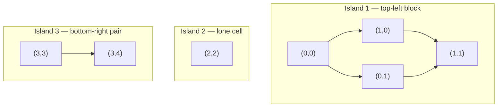

# 200. Number of Islands

  
**LeetCode:** https://leetcode.com/problems/number-of-islands/

## Problem
You get a 2D grid of `'1'`s (land) and `'0'`s (water). An island is a group of land cells connected horizontally or vertically (not diagonally), surrounded by water. Count how many islands exist.

**Input:** a grid (list of lists) of characters `'0'`/`'1'`
**Output:** an integer count of islands

**Examples:**
1.
```
11000
11000
00100
00011
```
→ `3` islands: the top-left 2x2 block, the lone `1` in the middle, and the pair in the bottom-right.
2. `grid = [["0"]]` → `0` (no land at all).
3. `grid = [["1","1","1"]]` → `1` (one connected horizontal strip).

**Constraints:** `1 <= rows, cols <= 300`, grid contains only `'0'`/`'1'`.

> **🔑 Pattern Recognition**
> A grid of cells with adjacency-based connectivity is an implicit graph — whenever you see "count groups of connected cells," think BFS/DFS flood-fill or Union-Find over grid coordinates.

## Intuition
Think of land cells as nodes in a graph, where two land cells are connected if they're adjacent. Each connected group is one island — we just need to count connected components.

### 1. Brute Force
- Scan every cell. Whenever we find an unvisited `'1'`, it's a *new* island — recursively DFS into all 4 neighbors, marking cells visited (kept in a separate visited matrix so we don't mutate the input) until the whole component is explored. Increment the island count once per new component.
- Time complexity: O(rows × cols)  Space complexity: O(rows × cols) (visited matrix + recursion stack in the worst case, e.g. a fully-filled grid)
- It's already correct and asymptotically fine, but recursion depth can blow the stack on a huge single island (e.g. a 300×300 grid that's all land → 90,000-deep recursion), which is a real concern in an interview follow-up.

### 2. Better
- Same idea, but do it iteratively with BFS (a queue) and mark visited cells by mutating the grid in place (flip `'1'` → `'0'` once visited) instead of a separate visited matrix. This removes recursion-depth risk entirely and saves the extra visited matrix.
- Time complexity: O(rows × cols)  Space complexity: O(min(rows, cols)) average queue size, O(rows × cols) worst case
- Still fundamentally "flood fill each component" — fine for a static grid, but doesn't generalize if islands change over time (e.g. LC 305 Number of Islands II, where land is added incrementally).

### 3. Optimal
- Use Union-Find (Disjoint Set Union) with path compression and union by rank. Walk the grid once; for every land cell, union it with its land neighbors (right and down are enough since we sweep left-to-right, top-to-bottom). The answer is the number of distinct roots among land cells.
- This works because Union-Find directly tracks connected components with near-constant-time union/find, and — unlike flood fill — it naturally extends to *dynamic* connectivity (adding land cells one at a time), which is exactly what interviewers probe for as a follow-up.
- Time complexity: O(rows × cols × α(rows × cols)) ≈ O(rows × cols)  Space complexity: O(rows × cols) for the parent/rank arrays
- Edge cases: empty grid, a grid of all water (`0` islands), a single cell, a grid that's entirely land (`1` island).

#### 🎯 Visual Walkthrough
Tracing Union-Find on Example 1's grid — each subgraph is one connected component (one Union-Find root):


Sweeping left-to-right, top-to-bottom, we union each land cell with its right/down land neighbors. Three distinct roots remain at the end → `3` islands.

## Complexity Summary
| Approach | Time | Space |
|---|---|---|
| Brute Force | O(rows·cols) | O(rows·cols) |
| Better | O(rows·cols) | O(min(rows,cols)) avg |
| Optimal | O(rows·cols·α) | O(rows·cols) |
